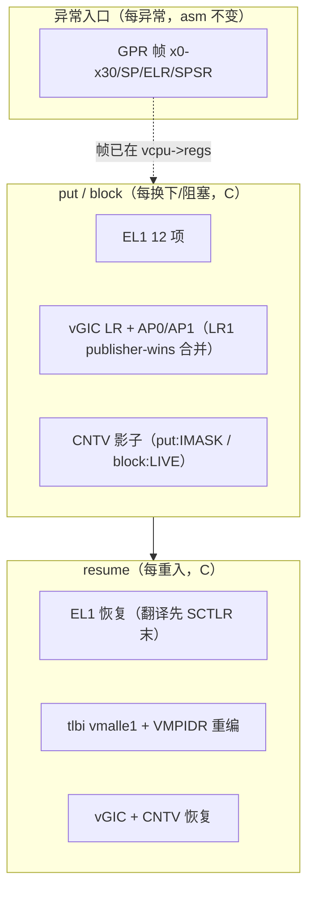

# 两层状态划分：汇编每异常存 GPR 帧，C 每切换存 EL1/vGIC/vtimer

> **Status:** Accepted. **Milestone:** M11 片 B2（2026-10-31）。

## 背景

M11 的上下文切换需要回答"哪些状态在异常入口保存、哪些在调度点保存"。08-10 设计的
决策 9/10 定了形状（汇编不扩、EL1 批量在 C）；ADR-0018（B1）落了协作让出与 GPR 级；
本 ADR 补齐 EL1 全量、vGIC 运行期协议与身份寄存器，并裁定 ADR-0018 留下的两个待决。

## Decision

1. **两层划分（终形）**：异常入口汇编保存且仅保存 GPR 帧（x0–x30、SP_EL1、ELR_EL2、
   SPSR_EL2）——每次异常都发生，`vmexit_asm.S` 不变；`vcpu_arch_put`/`vcpu_arch_block`
   保存 EL1 批量集 + vGIC 影子 + CNTV 影子——只在真实换下/阻塞时发生；`resume` 对称
   恢复 + `tlbi vmalle1` + **重编 `VMPIDR_EL2`**（TID3 转发活寄存器，身份必须随载入者）。
   **片 C 修订（2026-11-04）**：resume 的固定序为 CNTV → `stage2_activate`（VTTBR/VMID）→
   EL1 恢复 → `tlbi vmalle1; dsb nsh; isb` → VMPIDR → vGIC。VTTBR 必须先于 EL1 恢复：EL2
   上可能发生推测性 EL1&0 表遍历，若新 EL1 寄存器配旧 VMID，入 VM 的条目会被种进出 VM
   的 TLB 标签，而 `tlbi vmalle1` 只作用于当前 VMID，清不掉。load 同理（Stage-2 先于
   SCTLR 清零与 tlbi；此前的序刷的是出 VMID）。
2. **EL1 清单（12 项，Q9 推导+半清单实证+bao/xvisor 对照）**：SCTLR、TTBR0/1、TCR、
   MAIR、VBAR、CPACR、TPIDR_EL1、TPIDRRO_EL0、CONTEXTIDR、ESR_EL1、FAR_EL1。恢复序 =
   翻译寄存器先、SCTLR 末（今日惰性，片 C 跨 VM 时承重）。半清单实验 4/4 组对称失败
   见 `docs/debug/m11-b2-el1-halflist.md`。
3. **vGIC 运行期协议 = publisher-wins**（§8.1/D13）：`vgic_save` 在 `spi_lock` 内合并——
   `spi_shadow_pending` 置位即远端发布更新，保影子弃活读；否则活读。B1 的"无发布者"
   限定解除。
4. **block 与 put 的 vtimer 分叉**：put/rot = save-then-IMASK（xvisor 先例：过期期限在
   resume 解掩时电平 PPI 重升）；block = 存影子但 timer 保持 LIVE（阻塞者唯一自身唤醒源）。
5. **快路径不变式集（关卡② B1 账单 5 复审结论）**：静态亲和；cur_vcpu 恒为本 pCPU 亲和
   vCPU；RUNNING 永不入队；无迁移；wake 仅自 BLOCKED。任何松动须重审 `sched_loop`。
6. **ADR-0018 待决一落定**：`VCPU_EV_YIELD` 边**保留**——有竞争让出与独处阻塞互补
   （B2 实现三分后并存，非吸收）。
7. **ADR-0018 待决二落定**：spec §4"`switch_to` 唯一公开入口"措辞**宣布被
   put/load/resume 三元组取代**——无 switch_to 符号存在，调度即 `sched_loop` 循环。
8. **片 C 回归修订（2026-11-05）：AP 是 vCPU 上下文**。保存/恢复 AP0/AP1 全部已实现项，
   数量按 `ICH_VTR_EL2.PreBits=5/6/7` 取每组 1/2/4 项，fresh load 清零 shadow。
   SYSTEM_OFF 可在 guest 的 stop IPI handler 内换下，因此“协作调度的 AP 必为空”不成立。
   不改 ADR-0001 HW=1 链接，不把 LR0 shadow 的 pending 合并回已完成的 live LR。
9. **resident 与运行资格分离**。switch-in 完成后，`prev` 必须立即反映硬件实际归属，
   再检查 LOAD 是否成功；远端 sweep 可让 LOAD 失败，但不能把旧 resident 留在 `prev`。
10. **状态转换线性化**。PICK/LOAD/BLOCK/WAKE/YIELD/CPU_ON 用 acquire-release CAS；
    OFF 用 exchange。sweep 按 exchange 返回的真实旧状态决定是否 kick，不能另采样
    `was_running`。这是既有异步 stop 的闭合，不新增停机 ack，也不承诺 OFF 发布瞬间
    已执行完最后一条 guest 指令。证据见 [回归修复 devlog](../devlog/2026-11-05-m11-c-regression-fix.md)。

## Considered Options

- **惰性 EL1（CPTR/陷阱法按需保存）**。否决：QEMU 陷阱路径无差异收益，真机才见分晓；
  半清单实证全量清单后正确性先立住，惰性留给 RK3588 性能优化（触发条件：实测切换开销）。
- **全动态 LR 数（ICH_VTR 驱动变长数组）**。否决：freestanding 无动态分配，struct 钉死
  4 + 探测契约（<4 BUG、>4 封顶记录）等价覆盖正确性面。
- **block 也 IMASK（统一 put/block 语义）**。否决：锁死阻塞者唯一唤醒源（关卡① R2）。

## Consequences

- **已知缺口三件**（触发条件各钉）：AMAIR_EL1（首个消费者）；PAC 密钥 APIA/APIB/APGA；
  CNTKCTL_EL1。
  - 片 C 修订（2026-11-04）：CNTKCTL_EL1 已随 T1b 进保存集。
  - PAC 改为 **TID3 特性屏蔽**（T6）：ISAR1 APA/API/GPA/GPI 与 ISAR2 APA3/GPA3 读作 0，
    guest 不会启用 PAuth，HINT 空间的 PAC 指令保持 NOP。
  - 订正原理由："Linux 用 PAuth 故必须存密钥"不成立：HCR_EL2.APK/API=0 已把密钥访问陷到 EL2，
    风险是 guest 崩在 EC 0x09，不是密钥泄漏；cortex-a72（v8.0）与 RK3588 的 A76/A55
    均无 PAuth。
  - 真正的密钥存取触发条件 = 首个要求 guest 使用 PAuth 的目标。
- ~~**共享 pCPU 自 timer 唤醒缺口**~~（**片 C T4 修复**）：阻塞 vCPU 的 pCPU 后来跑了
  他者时，其 PPI 误投 cur_vcpu。现由 EL2 背景定时器覆盖：每 pCPU 一个 CNTHP（PPI 26），
  在 resume/load 末尾编程为"亲和本核、BLOCKED、非当前"vCPU 中 `ENABLE=1 && IMASK=0`
  者的最早物理期限 `cntv_cval + cntvoff`；到期 `sched_wake`，resume 恢复其已过期的
  CNTV 使 PPI 27 重新触发。选型：单 CNTHP 取最早期限（v8.0 无 CNTHV）；片 D 抢占 tick
  复用同一定时器，取 min(tick, 最早期限)。不新增通用层钩子。
- ~~**共享 profile 跨 vCPU SGI 缺口**~~（**片 C T2 修复**）：`sgi_pending[]` 按 pCPU
  键控，共享时误投当前 vCPU。原记"片 C 的 2×2-on-2 每 VM 仍 1:1，不受影响"为**误判**：
  键是 pCPU 而非 (VM, vCPU)，跨 VM 共享一个 pCPU 时发给 VM1 vCPU0 的 SGI 会注入当时在跑
  的 VM0 vCPU0（关卡① R3）。现为 per-vCPU `arch.sgi_pending` + LR2/LR3 双槽 + EOI
  维护 PPI 25 补槽（不用 NPIE：两槽皆 active-only 时 NPIE 电平持续而无可注入，饿死 guest）。
- tlbi vmalle1 为保守全刷；免失效（ASID/VMID tag）条件 = RK3588 实测成本 + §8.3。
- **idle 窗口残余竞态（测试专家 N1，2026-10-31 实证分析）**：窗口为"解掩蔽→复查队列→
  wfi→掩蔽"；已 pending 的唤醒会被复查观察到（闭合主情形），但"复查通过→wfi 执行"之间
  完成两轮 handler（唤醒+自 kick 皆被消费）的微秒级窗口仍可让非空队列沉睡——下个无关
  中断自愈。硬化触发条件：首个在低负载下观察到 idle 丢失唤醒的场景（skip-flag 方案
  在案）。
- **CPU_OFF 不存 vtimer/vGIC（N2）**：带未掩蔽 armed timer 的 CPU_OFF + 空闲期过期 →
  PPI 注入已 OFF vCPU 的 LR0 且物理线留 Active，re-ON 时被 vgic_init 清空且 HW 链接断链
  ——该 pCPU 的 vtimer PPI 可能死亡。触发：首个 hotplug-off 前不掩 timer 的 guest。
- **CPU_SUSPEND 恒走 block 路径（N5，plan 措辞偏离记录）**：非空队列时未按 put 式
  quiesce——retention 允许任意中断唤醒 + 共享 timer 缺口条目覆盖误投；首个
  suspend-with-siblings 消费者出现时复核。
- ~~**CPU_ON 不刷新 vtimer 影子（N6）**~~（**片 C T1b 修复**）：load 把 CNTV 影子复位为
  `ctl=IMASK, cval=0`，同时整块清零 EL1 集与 FP 文件（ADR-0020）。
- ~~1:1 profile 下 put/resume/EL1 路径从不执行~~（**片 C T7**）：Linux 演示拓扑已翻到
  2×2-on-2，切换路径在真实负载下执行；跨 VM 覆盖面另有 xvm 场景（T5）。
- **共享 pCPU 的协作等待饥饿（2026-11-05 已定位，未修复）**：旧 HV focused boot probe
  14 次中 1 次出现 VM0 stop-machine 与 VM1 同步 IPI 等待环；各自所需的对端在另一
  pCPU 队列中。QEMU 9.2.4 不产生 WFE configurable trap（实际 trace 的 WFx=0），
  因此不能靠 TWE 解除等待。无条件 kick 轮转也被架构诊断否决：可能换下刚收到 IPI
  的 current，消费唯一通知后形成另一个等待环。本轮用户范围是定位启动问题、不进入 D：
  保留 `wfe_wait` 非 gate 诊断；处理归既定片 D 的抢占/公平性设计，进入 D 时必须以此
  rendezvous 回归作为验收输入。**当前仍不能保证任意 Linux 启动都成功**，不得用有限
  次绿色宣称此缺口消失。目标关联的通知调度若提前实施，须另行明确批准协议。
- **片 C 新增已知缺口**（2026-11-04，各带触发条件）：
  - ~~`ICH_AP1R0_EL2` 未保存、仅片 D 触发~~：2026-11-05 已修 AP0/AP1 完整上下文。
    原假设被 SYSTEM_OFF 在 stop IPI 内换下的现场与 xvm2 受控红证伪。
    验证边界：QEMU 仅覆盖 5 位 PreBits；首个 6/7 位实现或 RK3588 bring-up 时须实跑额外项。
  - PPI 27 物理屏蔽（`gic_ppi_set_enable`，secondary 早期 VENG1=0 回退路径）是 per-pCPU 状态，
    共享 pCPU 的两个 vCPU 共用。触发 = 首个观察到一个 vCPU 的屏蔽饿死另一个 vCPU timer 的场景。
  - EL1 物理定时器 `CNTP_*` 未保存，且 `CNTHCTL.EL1PCEN=1` 放行 guest 直接访问。触发 = 首个使用
    CNTP 的 guest（Linux 用 CNTV）。
  - RK3588 A76/A55 推测性 AT 勘误（1165522/1530923）：切换路径未做勘误要求的序列。触发 =
    RK3588 bring-up。
  - `AMAIR_EL1`、`AFSR0/1_EL1`、`CSSELR_EL1` 未保存。触发 = 首个消费者（Linux 的 CSSELR 只在
    cacheinfo 初始化时写，读 CCSIDR 前现写现用）。
  - pCPU0 负载形态：2×2-on-2 下两个 VM 的 vCPU0 在 pCPU0 上永远让出轮转、不会都阻塞，背景
    定时器只在 pCPU1 上承重。不是缺陷，是覆盖面限制；xvm 用例补了 pCPU0 上的离核阻塞情形。
