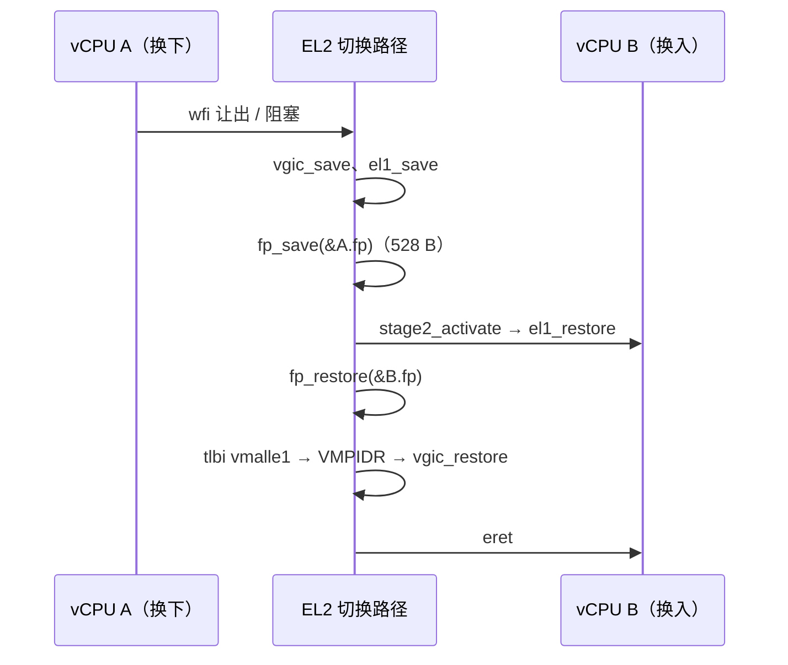

# FP/SIMD 急切保存先于惰性陷阱

> **Status:** Accepted. **Milestone:** M11 片 C（2026-11-04）。

## 背景

片 C 之前每个 pCPU 只跑一个 vCPU（或者同 VM 的 SVM 用例不碰 FP），guest 的 FP/SIMD 寄存器从不需要
保存。hypervisor 自身全程 `-mgeneral-regs-only`，永不碰 v0–v31。

片 C 让两个 VM 共享一个 pCPU（2×2-on-2），Linux 每次 `kernel_neon_begin`/用户态 FP 都会让 FP 文件
里装着自己的数据，换下时必须保存。

`CPTR_EL2` 此前**从未写过**：复位值架构上 UNKNOWN，QEMU 恰好给 0（不陷入），RK3588 上不保证。

## Decision

1. **急切保存**：每次 `vcpu_arch_put`（换下）与 `vcpu_arch_block`（阻塞；从阻塞者切走不经过 put）
   把 q0–q31、FPSR、FPCR 存进 `vcpu->arch.fp`（528 B）；`vcpu_arch_resume`/`vcpu_arch_load`
   恢复。load 恢复的是清零后的影子：新上线的 vCPU 拿到全零 FP 文件，不继承上一个驻留者。
2. **布局绑定**：`struct fp_state { u64 q[64]; u64 fpsr; u64 fpcr; }`，16 字节对齐。`fp.S`
   硬编码的偏移（q 于 0、fpsr 512、fpcr 520、总长 528）由 `check_offsets_target.c` 钉住。
   FPSR/FPCR 用 `str`/`ldr`：`stp` 的有符号偏移上限是 504。
3. **`CPTR_EL2 = 0x33FF`**：每个 pCPU 写完整定义值，不做读-改-写。E2H=0 下的 RES1 位
   [13:12] 与 [9:0] 置位；TFP/TTA/TAM/TCPAC 清零。
4. **否决惰性 `CPTR_EL2.TFP` 陷阱法**（KVM 早期 / xvisor 可选）：换入时置 TFP，guest 首条 FP 指令
   陷入再恢复。省掉不用 FP 的切换的 528 B 搬运，但多一条陷阱路径、一个"FP 属主"per-pCPU 状态，
   以及 put 时"属主是否在本核"的判断。

## 理由

- 正确性边界最小：FP 文件永远是 cur_vcpu 的，没有"FP 属主"与 cur_vcpu 分离的中间态。
  片 D 的抢占也不引入新情形。
- 开销在 QEMU 上不可测量。协作调度下切换只发生在 `wfi`，频率由 guest 空闲节奏决定。

## 触发重审

- **RK3588 实测切换开销**：如果 528 B 搬运在 A76 上占切换成本的显著份额（片 D 抢占 tick 下切换
  频率上升），改为惰性 TFP 陷阱。
- SVE/SME guest：寄存器文件变长（VL 相关），急切保存成本成倍上升，需要先有惰性方案。

## 验证

- ctxsw：两 vCPU 在 v0–v31 与 FPCR/FPSR 盖互异 canary，轮转后各自校验。用例以
  `-mgeneral-regs-only` 编译，保证编译器不碰 v 寄存器。受控红：不存 FP 时 v0 的校验失败。
- xvm：VM1 vCPU1 fresh load 时 FP 文件必须全零（VM0 vCPU0 先盖过章）。
