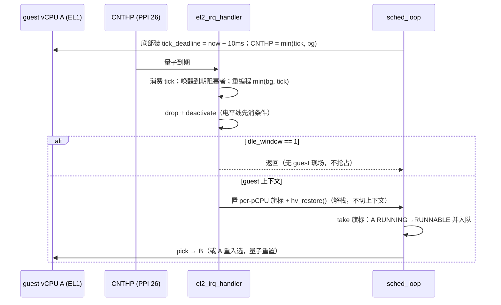

# 时间片抢占：tick 在 run loop 消费，不在中断上下文切换

> **Status:** Accepted. **Milestone:** M11 片 D（2026-11-07）。

## 背景

片 A/B1/B2/C 交付的是**协作**调度：只有 WFI trap 或 HVC 才换 vCPU。共享 pCPU 上，先被
Load 上硬件者一直跑到自己让出——没有任何机制能把它换下。后果是 **H-174**：VM0 的
stop-machine/`csd_lock` 等待环需要的对端排在同一个 pCPU 队列里，宿住者不让出，等待环
永不闭合（旧 HV 引导 14 次中 1 次真实挂死）；`tests/svm/cases/wfe_wait.c` 是它的确定性
复现。

片 C 已否决"无条件 kick 轮转"：可能换下刚收到 IPI 的 current，消费掉唯一通知，形成新的
等待环。因此正解只能是一个**与通知无关的时间源**。

已有条件：EL2 为背景 vtimer 唤醒已经占用了 CNTHP（PPI 26），并在换入/恢复末尾按(亲和本核、
BLOCKED、非当前) vCPU 的最早期限编程。

## Decision

1. **tick 复用同一个 CNTHP，取 `min(背景 vtimer 最早期限, tick 期限)`**；v8.0 无 CNTHV，
   QEMU `cortex-a72` 与 RK3588 都适用。`el2_timer_rearm()` 是唯一写 `CNTHP_CVAL/CTL` 的
   函数（片 C 的 `vtimer_bg_arm` 改名而来）——否则"换入时重编程背景定时器"会把 tick 静默
   抹掉；这是本决策最容易破的不变量，由该函数的单一写点强制。
2. **量子**：`SCHED_QUANTUM_MS = 10`，运行时用 `CNTFRQ_EL0/100` 换算成计数，不写死频率；
   每次 guest 入口前（`sched_loop` 底部、`vcpu_arch_run` 之前）重装。fast path（不换
   vCPU 的 `hv_restore` 回路）**不重装**，继承原期限——否则"WFI 立即被 pending vIRQ
   打断"的紧循环能无限续期而永不被抢占。
3. **中断上下文只解栈，不切换**：`BOARD_HYP_TIMER_IRQ` 分支先消费到期 tick 与唤醒到期
   的阻塞 vCPU，重编程后 `gic_priority_drop` + `gic_deactivate`（电平线必须先消条件），
   然后 `sched_preempt_request()` + `hv_restore()`。RUNNING→RUNNABLE 的转换与入队发生在
   `sched_loop` 顶部，走既有的 `VCPU_EV_YIELD` + `sched_yield_cur()`——状态机保持单一
   入口（ADR-0019），中断里不做 `vcpu_state_step`。
4. **idle 窗口不抢占**：那一刻硬件上没有 guest 寄存器现场，`hv_restore` 会载入陈旧的 HV
   上下文。只返回，让循环自己复查队列。
5. **guest 掩中断不阻止投递**：2026-11-07 实验（QEMU 9.2.4 / cortex-a72，guest 在 EL1
   全程 `PSTATE.I=1` 自旋，EL2 侧临时装 5 ms CNTHP）观测到 `[hv] TICK probe hit`。中断
   路由到 EL2 时异常在 EL2 取，guest 的掩蔽位不作用于它。因此抢占对"掩中断自旋"同样生效，
   H-174 没有豁免段。

## Considered Options

- **tick 在 run loop 消费（选中）** —— 状态转换只有一条路径，中断上下文保持"只解栈"的
  既有语义（与 kick-SGI 停机路径同构），host 可测该分支（`tests/host/sched_test.c`）。
- **在中断处理里直接 `vcpu_arch_put` + 切换** —— 否决：中断上下文要持状态机、调用
  load/resume（含 Stage-2、TLB、FP），ADR-0019 的原子化转换与"不在中断上下文切换"
  两条都被破坏，且 host 无法测。
- **远程 IPI/定时 kick 轮转** —— 否决：片 C 已论证会消费掉唯一一份 IPI 通知，把"饥饿"
  换成"丢通知"。
- **guest 内强制时间片（trap CNTV）** —— 否决：仍然是 guest 可关的东西（`CNTV_CTL.IMASK`），
  且给 guest 施加了它没要求的语义。
- **权重/优先级调度** —— 延后：本片只要"前向进度"；延迟属于 H2 能力里程碑的输入。

## Consequences

- **公平性不是时延保证**：每 10 ms 给等着的 vCPU 一次机会；100 Hz 的 CNTHP 退出在 QEMU
  与真机都可接受（背景 vtimer 已占用同一中断）。
- **单一写点是不变量**：任何新代码直接写 `CNTHP_CVAL/CTL` 即是 bug；`el2_timer_rearm()`
  是唯一入口。
- **量子在每次 guest 入口重置**，所以"频繁 trap 又立刻返回"的 guest 实际上不会被抢占；
  它的 trap 本身就是让出点，可接受。
- **`PSTATE.I` 实验只在 QEMU 上做过**：RK3588 bring-up（M15）时重跑该探针，结果进
  ADR-0019 缺口表。目前有两份独立证据：架构师的 5 ms 探针，与测试专家 2026-11-07 的
  变体实验（删掉 `preempt` 场景的 `daifclr`，场景仍绿）——后者把该主张挂到了常态门禁上。
- 抢占引入的上下文保存路径依赖既有 `vcpu_arch_put`（EL1 集、FP、vGIC、CNTV），没有新增
  保存项；若将来新增"仅在 guest 跑到一半才有效"的状态，必须确认 `put` 覆盖它。
