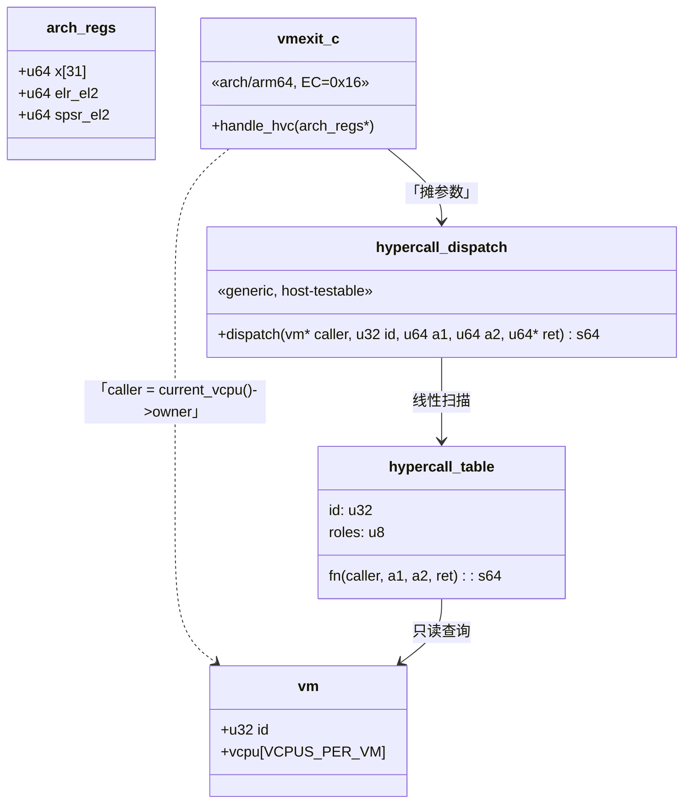

# Hypercall ABI：SMCCC vendor 号段、表分发、身份只来自 vCPU

> **Status:** Accepted. **Milestone:** H1 / HV-005（2026-11-08）。

## 背景

在 HV-005 之前，guest 与 hypervisor 之间只有三样东西：PSCI 的 `smc/hvc 0x84/0xC4` 分支、
两个 SMCCC base 探测、以及一个只为测试存在的 ad-hoc 分支 `HC_GUEST_DONE`。要新加一个调用，
就得往 `handle_hvc()` 里塞 `if`；"谁能调谁"没有任何表达位置。

但同时有三条约束把它按住：

1. **没有消费者就不该造框架**（ponytail）：DM/HSM 还没落地，所以本片只发两个调用
   （`HC_VERSION`、`HC_VM_QUERY`），表只有两项。
2. **不能和既有 ABI 混在一起**：PSCI 是固件代理（`0x84/0xC4` 调用约定），SMCCC base
   是能力探测（`0x80000000` 段），hypercall 是 hypervisor 服务——三者的返回语义不同，
   混在一个 `switch` 里迟早出事。
3. **身份不能来自参数**：hypercall 是特权面，guest 自报"我是 Service VM"必须无效。

## Decision

1. **号段**：hypercall 用 SMCCC **vendor 服务范围** `0x87000000+`（DEN 0028 B），
   编码 `id = base + (module << 8) + index`。已发布的 `HC_GUEST_DONE = 0x87000001`
   **值不变**；本片新增 `HC_VERSION = 0x87000000`、`HC_VM_QUERY = 0x87000100`。
   PSCI 与 SMCCC base 的既有分支顺序与行为不动。
2. **身份**：调用者是 `current_vcpu()->owner`，由 arch 在陷入点取，generic 只拿到指针；
   **任何从 `x1..x5` 取身份的写法都是 bug**。
3. **权限**：表项带 `roles` 位掩码（`HC_ROLE_ANY` / `HC_ROLE_SERVICE`）。当"能否调用"
   依赖参数而不是调用者类别时（今天的例子：`HC_VM_QUERY` 查自己 vs 查他人），检查放在
   处理函数里，并在注释里写明为什么不能放进表项。
4. **返回**：`x0 = 0` 成功、`x0 = 负 errno`（`HC_EINVAL/EPERM/ENOSYS/ENODEV`）；成功时
   需要回传的值放 `x1`。未知 id → `HC_ENOSYS`，不打印、不静默成功。
5. **落点**：分发在 generic（`common/hypercall/hypercall.c`），arch 只把 `arch_regs`
   摊成 `u64` 调 `hypercall_dispatch()`。因此 host 可测，第二个架构（x86 VMCALL）只换入口。
6. **兼容**：id **只增不改**；未使用的参数忽略不校验；返回字只能**追加高位**，已有位不动。

## Considered Options

- **ACRN 风格的表分发 + 号段编码（选中）** —— ACRN `BASE_HC_ID(module, id)` 与
  `struct hc_dispatch` 的形态已在多架构代码里验证过；表让"新增调用"变成加一行。
- **连续 syscall 号（0、1、2…）** —— 否决：会和 SMCCC base / PSCI 号段撞车，且
  guest 侧无法从编号判断归属，调试时多一次查表。
- **分发写在 arch（`vmexit.c` 的 switch）** —— 否决：host 测不到；x86 侧要复制一份；
  `check-arch-boundary` 的精神是 arch 只做机制。
- **身份从参数取（`x1 = caller vmid`）** —— 否决：等于把权限交给被审查方。
- **参数用结构体指针 + `copy_from_gpa`（ACRN 的 `hcall_create_vm` 形态）** —— 延后：
  第一个需要它的调用（VM 创建）出现时再加，不提前给所有调用套一层内存拷贝。

## Consequences

- **ABI 版本 0.1，只有测试消费者**：id 与错误码承诺"只增不改"，但 minor 兼容不承诺；
  等 DM 接上后再谈稳定。**只支持 32 位调用约定的 `0x87` 号段**：SMCCC 64 位私有段
  （`0xC7000000+`）落到 unknown HVC → `SMCCC_NOT_SUPPORTED`；id 在 arch 入口按 `u32`
  截断（与 SMCCC 一致），要 64 位 id 必须改入口。
- **返回字会长期被追加**：HV-004 的 VM 级状态、PAUSE 位等只能加新位，不能重排；
  改编码等同于 ABI break。
- **"查自己"类检查散在处理函数里**：这是设计允许的两个位置之一（另一个是表项 roles），
  代码审阅时要盯住这一点。
- **Service VM 判据暂时是 `id == 0`**：出现第二个 service 类 VM 时，role 必须提到
  `vm_config` 并让 `vm_is_service()` 读配置——`vm_is_service()` 是唯一的判断入口，
  届时只改它一处。
- **x86 复用同一张表**：新增调用不需要第二份实现，只需要 VMCALL 入口把参数摊开。
- **`HC_VM_QUERY` 会泄露 VM 个数**：`HC_EPERM` 与 `HC_ENODEV` 的差别让 guest 能探出
  "哪些 vmid 存在"（本片的 test-guest 正是用它自识别）。泄露面仅此；若将来要收紧，须同时
  换掉自识别协议。
- **`HC_GUEST_DONE` 没有权限门**：任意 VM 可调，后果是该 vCPU 自己 park（自伤，不是越权）。
  接真实 guest（HV-004 之后）时必须把它放到测试配置门后，或改成一个受权限管理的调用。
- **`hypercall_dispatch()` 的 `caller` 是前置条件**：只有 arch 入口调用，恒有当前 vCPU；
  不做 NULL 防御（真为 NULL 是入口 bug，应该崩而不是静默）。
