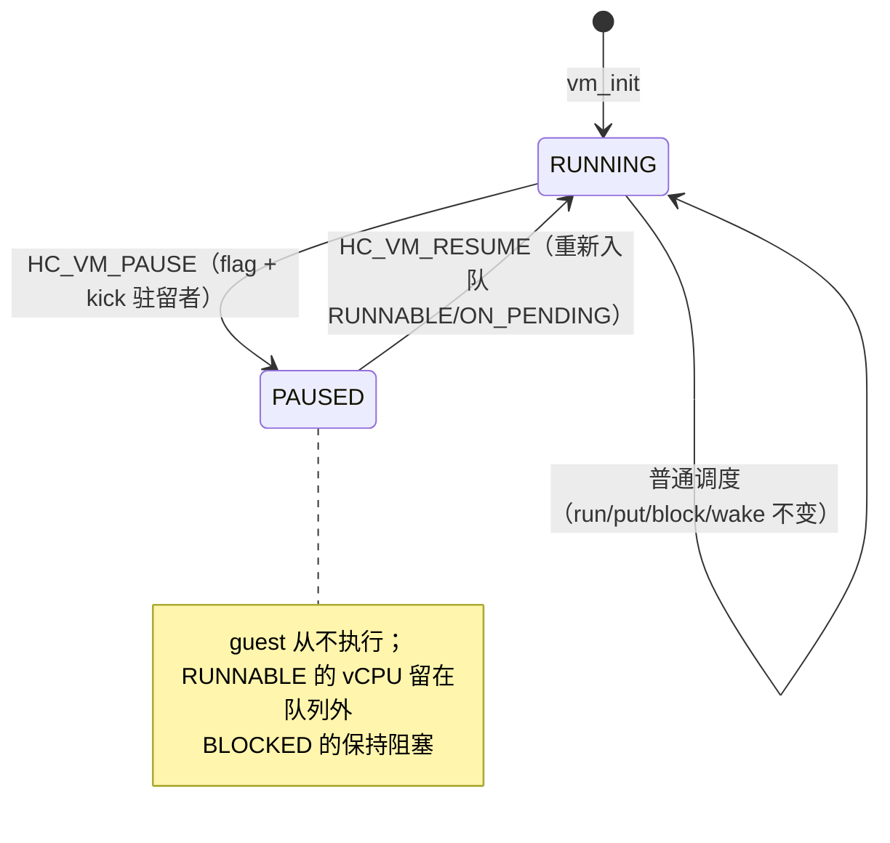

# VM 暂停是调度判据，不是停 guest（异步生效）

> **Status:** Accepted. **Milestone:** HV-004 第一刀（2026-11-08）。

## 背景

HV-004 要 VM 级生命周期，而完整的 `CREATED/READY/RUNNING/PAUSED/DESTROYED` 需要 VM 创建
（分配 Stage-2 表、初始化 vGIC）与销毁（teardown）——那是 H2 的资源管理。现在硬做，只能凭空
造一套分配器。

所以第一刀只做**今天能完整成立的一段**：`RUNNING ↔ PAUSED`。但"暂停"有两种截然不同的
实现语义，选错会留下很难改的骨架：

- **停下 guest**：让 vCPU 在安全点 echt 停下、保存现场、等恢复（需要与 vCPU 的会合协议）。
- **不再调度它**：把它从运行队列里拿掉，正在硬件上跑的下一个调度点换下，硬件状态照常由
  既有的 `vcpu_arch_put` 保存。

## Decision

1. **暂停是调度判据**：`struct vm` 加 `bool paused`；`sched_loop` 在 `sched_pick()` 之后
   看到暂停 VM 的 vCPU 就直接丢弃（vCPU 保持 `RUNNABLE`、不在队列里，与既有 swept 分支
   同形）。**丢弃点在 `sched_loop` 而不是 `sched_pick`**：pick 保持纯出队原语，丢弃是
   "拿到手之后要不要它"的调度决策。
2. **正在跑的由 kick 强制换下**：`sched_vm_pause()` 对每个 `RUNNING` 的 vCPU 发 kick；
   目标 pCPU 的 kick 处理分支发现 `cur_vcpu` 属于暂停 VM → `sched_preempt_request()` +
   `hv_restore()`（与量子 tick 同形，含 idle 窗口门）。状态转换与入队仍在 `sched_loop`。
3. **恢复**：清标志后把该 VM 的 `RUNNABLE` **与 `ON_PENDING`** vCPU 重新入队并 kick；
   `BLOCKED` 不动——它在等自己的事件，暂停不该伪造唤醒。
   （`ON_PENDING` 是必需的：与暂停竞争的 CPU_ON 会被 pick 丢弃，漏掉它就等于让 secondary
   永远不上线。）
4. **异步生效**：hypercall 返回不保证目标已离开硬件；最坏延迟是一个量子或一次 kick。
   **不做同步确认**（需要 vCPU 会合协议；触发条件 = 首个要求"停稳后复用资源"的消费者）。
5. **权限与状态码**：`HC_VM_PAUSE`/`HC_VM_RESUME` 仅 Service VM（表项 `roles`）；暂停/恢复
   自己 → `HC_EINVAL`；重复暂停 / 未暂停恢复 → `HC_EBUSY`；`HC_VM_QUERY` 追加
   `bit 32 = paused`（只加高位）。
6. **不引入 `enum vm_state`**：两态用枚举就是死代码。VM 创建/销毁落地时再引入枚举，
   `paused` 成为其中一态（届时 `vm_is_paused()` 是唯一切换入口，改动收敛在一处）。

## Considered Options

- **调度判据 + 异步（选中）** —— 不新增会合协议，复用 tick 已经验证过的"旗标 + 解栈"形状；
  代价是暂停要等下一个调度点才真正生效。
- **同步停下 guest** —— 否决（本片）：需要 vCPU 会合/确认协议，而 HV-004 的消费者
  （DM 的资源复用）还没出现；先造协议等于把没验证过的形状钉进 ABI。
- **只在 vmexit 边界暂停**（不 kick） —— 否决：忙等的 guest 可能很久不退出，暂停会看起来
  "没生效"；tick 已经给了有限延迟，kick 让暂停不必等满一个量子。
- **暂停时销毁/保存额外资源** —— 否决：暂停不是销毁；资源归 VM 创建/销毁切片。
- **`enum vm_state` 全套（CREATED/READY/DESTROYED）** —— 延后：没有创建/销毁入口时，
  那些状态无法进入，是死代码。

## Consequences

- **异步边界必须写进文档**：hypercall 成功 ≠ 目标已停。任何"停稳后释放资源"的逻辑都必须
  先立确认协议。
- **`ON_PENDING` 是一个真实的坑**：任何新增的"跳过某类 vCPU"的调度判据，都要同时回答
  "它被丢弃后谁把它放回来"。
- **BLOCKED 的 vCPU 在暂停期间仍可能被自己的事件唤醒**：它会被入队、然后在 pick 处再次
  被丢弃。无害（多一次队列往返），但别把它误读成"暂停失效"。
- **冻结的确定性证明在 host，不在 QEMU**：QEMU 场景用 `CNTPCT` 空洞证明目标真的停过，
  但"pick 不再选它"这条由 `tests/host/sched_test.c` 钉死。
- **kick 分支没有回归门**（2026-11-08 测试专家实测）：删掉 `irq_handler.c` 的强制换下分支，
  `hcall` 场景**仍然全绿**——量子 tick（10 ms，guest 掩不掉）会独立把暂停 VM 的驻留者
  换下。因此 kick 是**延迟优化**（10 ms → µs），正确性由 tick 兜底；没有 gate 能区分
  有/无 kick（探针确认分支确实被执行）。触发条件：出现需要亚量子级停止延迟的消费者时，
  再设计可观测的判据。
- **`ON_PENDING` 只有 host 单点覆盖**：CPU_ON 与暂停竞争的窗口不可在 SVM 场景构造，
  `tests/host/sched_test.c` 是唯一防线。
- **VM 创建/销毁切片会重访这里**：届时 `enum vm_state` 引入，`paused` 变成其中一态，
  `vm_is_paused()` 是唯一读点，改动不会外溢。
