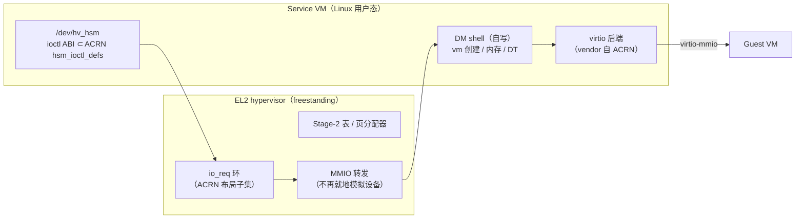

# DM 复用策略：契约对齐 ACRN，代码后期只 vendor virtio 后端

> **Status:** Accepted. **Milestone:** 跨里程碑（DM/HSM 方向）。**日期:** 2026-11-08。

## 背景

`devicemodel/` 目前零代码。用户提议复用 ACRN 的 devicemodel 源码、抛开 x86 架构部分，
重构成 ARM64（后续 AMD/Intel 共用）。事实基础（2026-11-08 对照 `../acrn-hypervisor`）：

- ACRN DM：**81 000 行 C**，`BSD-3-Clause`，跑在 **Service VM 的 Linux 用户态**——
  不受本工程 freestanding 约束（那条约束只管 EL2）。
- 它已有 `devicemodel/arch/x86` 这个缝：`core/` 与 `hw/pci/virtio/*` 基本 arch-neutral。
- 但它对我们 hypervisor 的假设，**一个都还没有**：`/dev/acrn_hsm` 的 ioctl ABI、
  `struct acrn_io_request`（`acrn_common.h:283`）共享环、`vm_create(name, req_buf, …)`、
  MMIO/PIO 请求投给用户态、vSBL/OVMF 加载、ACPI 表生成。
- 我们今天的 MMIO（vGIC `vgic_v3_mmio.c`、vuart）是在 **EL2 里直接模拟**的，
  没有"转给 DM"这条路径。

所以"现在把 ACRN DM 搬进来"= 81 000 行跑不起来的代码 + 数月接线；而复用价值并不在
代码本身，在**契约**。

## Decision

1. **契约对齐 ACRN（现在做，成本近零）**：HSM 字符驱动接口、`acrn_io_request` 环布局、
   VM 创建/销毁与 MMIO 请求的语义，按 ACRN 的 `hsm_ioctl_defs.h` + `acrn_common.h`
   **取子集**实现，不另发明。ARM64 只用到 MMIO 请求（PIO/PCI 子结构不实现）。
   收益：三架构（ARM64 / AMD / Intel）共用一套 DM 与契约；x86 侧将来可直接跑 ACRN DM 本体。
2. **代码后期 vendor，且只 vendor 这些**：
   `hw/pci/virtio/{virtio.c, virtio_block, virtio_net, virtio_console, virtio_rnd}`、
   `core/{iothread, mevent, sbuf, monitor, vm_event}`、`hw/block_if.c`、`hw/uart_core.c`。
   放 `third_party/acrn/`，保留原始版权头 + NOTICE + 钉 commit 哈希。
3. **明确丢弃**：`hw/platform/{acpi, atkbdc, cmos_io, ioapic, pit, rtc, hpet, ps2*}`、
   `hw/pci/{hostbridge, lpc, passthrough, gvt, xhci, ahci}`、`core/sw_load_{bzimage, ovmf,
   vsbl}`、`bios/`、`mptbl.c`、`devicemodel/arch/x86` —— x86 世界，ARM64 用 DT（我们已有
   `guest/qemu_virt.dts` 生成链）而不是 ACPI/MP table。
4. **DM shell 自写**：vm 创建、内存映射、DT/initrd 加载、console、monitor——这部分是
   "我们的 DM"，比 ACRN 的 81k 小得多，且不依赖 x86 假设。
5. **顺序不变**：Stage-2 页分配器/属性/fault → VM 创建/销毁 + 事件 → `io_req` 环 +
   HSM 驱动 + MMIO 路由到 DM → 才 vendor virtio 后端。**MMIO 从 EL2 迁到 DM 是一次架构
   转向**（ACRN 模型），逐项定，不一把梭：vGIC 留在 EL2（它是硬件虚拟化扩展），
   PL011/vuart 与 virtio 走 DM。

## Considered Options

- **契约对齐 + 后期 vendor virtio（选中）** —— 复用价值在 ABI 与 virtio 后端；代码搬运
  推迟到契约存在之后，避免 81k 行无法运行的依赖。
- **现在整树移植 ACRN DM** —— 否决：它对 hypervisor 的假设（hsm ioctl、io_req、
  MMIO 路由、ACPI/vSBL）一个都不成立，移植等于先写一遍 M12/M13 再加大量 x86 删改。
- **自研 DM 与 ABI** —— 否决：等于把 ACRN 已经验证过的契约重新发明一遍，三架构共用
  的目标也随之消失。
- **用 crosvm / cloud-hypervisor（Rust）** —— 否决：引入第二语言与巨大依赖树，与本工程
  "小而可读、ACRN 式"的取向冲突；且它们的 HV 接口是 KVM，不是我们的。
- **ARM64 也做 ACPI** —— 否决（当前）：ARM64 用 DT 已够（Linux guest 现成），ACPI 只在
  服务器/异构场景需要，触发条件 = 出现只能吃 ACPI 的 guest。

## Consequences

- **LICENSE 必须先定**：本仓库 LICENSE 还是 `TBD`（`docs/`），vendor BSD-3 代码前必须先
  定许可并保留归属；这是 vendor 动作的硬前置条件，不是"以后再说"。
- **ACRN 上游会漂**：vendor 时钉 commit 哈希（与 guest 镜像同一纪律）。
- **MMIO 转发有代价**：每次设备 MMIO 多一次环交互与上下文切换；哪些设备留在 EL2
  （vGIC、可能的早期串口）由各自的消费者决定，ADR 逐项记。
- **ARM64 的 virtio 传输**：先做 virtio-MMIO（我们没有 PCI 总线），virtio-PCI 等 PCI
  主机桥模拟出现再说。
- **x86 复用面**：AMD/Intel 端口若实现同一 HSM ABI 子集，可直接跑 ACRN DM 本体；
  这是本决策最大的长期收益，也是"只取子集、不改语义"的纪律来源。
