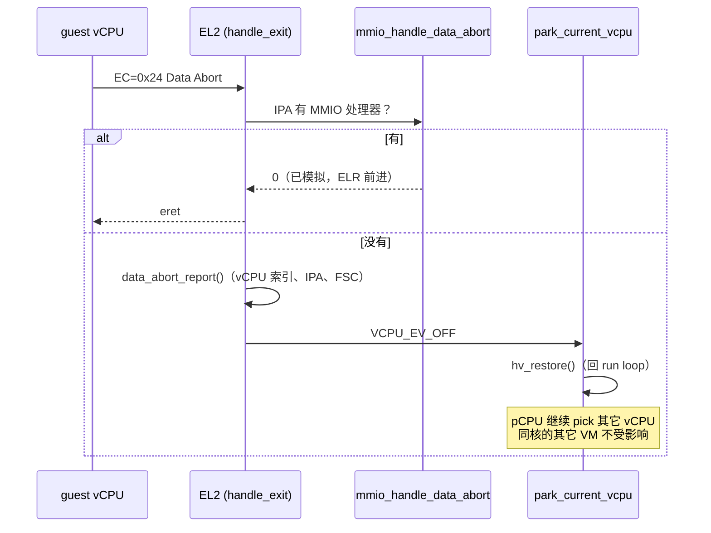

# Stage-2 表由分配器建，fault 只停 vCPU

> **Status:** Accepted. **Milestone:** H1 / HV-011+HV-012 第一刀（2026-11-08）。

## 背景

`mmu/stage2.c` 原来是**两张硬编码静态表**：设备 2 MB 块、RAM 1 GB 块、GICD/GICR 与 PL011
靠"置无效"打洞，没有分配器、没有映射 API、没有 TLB 维护、没有权限位。要加一个设备、改一段
内存属性、做只读页，只能改常量。

更严重的是失败模式：**未处理的数据异常走 `vmexit.c` 的 `default:` → `cpu_arch_halt()`**。
共享 pCPU 上，一个 guest 摸到未映射 IPA 就把整核停死，另一个 VM 一起陪葬。

## Decision

1. **4 KB 表页静态池 + 纯逻辑映射 API**：`s2_pool_init/alloc/free` 与
   `s2_map/s2_unmap/s2_protect` 放在 **generic** `common/mmu/s2_table.c`，只做描述符算术，
   返回"是否需失效（`*flush`）"；arch 侧才碰 `MAIR/VTCR/VTTBR/dsb/tlbi`。全部可 host 测试。
2. **初始映射用新 API 重建，并与旧静态值逐字节自检**：`stage2_init` 末尾比对 RAM 块、设备块、
   两处不映射的洞；不一致就打印 `[hv] stage2: EQUIV FAIL …` 并让该 VM 建表失败。这把
   "重构没改语义"变成可执行断言。
3. **属性**：Stage-2 描述符自带 `MemAttr`，`S2_ATTR_*` 是属性选择器而**不是 MAIR 槽号**；
   `MAIR_EL2` 保持 `el2_mmu.c` 的 slot0=Device / slot1=Normal（那是 EL2 自己 stage-1 的索引）。
4. **权限**：写保护走 S2AP（`S2_PROT_RO`），XN 是独立 flag；`attr` 字做全掩码校验，
   未知位与越界选择器一律 `S2_EINVAL`（否则会静默编码成别的属性）。
5. **fault 只停该 vCPU**：未处理的数据异常 → 打印 `[hv] s2 fault: vCPU<x> ipa=… fsc=… ec=…`
   → `vcpu_state_step(EV_OFF)` → `hv_restore()`。pCPU 继续调度其它 vCPU；该 vCPU 之后可被
   `CPU_ON` 复活（与 `CPU_OFF` 同一条边）。**数据异常路径不再有 `cpu_arch_halt()`**。
6. **TLB 保守全刷**：映射变更后 `tlbi vmalls12e1is` + `dsb ish`（VM 级）。

## Considered Options

- **静态池 + 纯逻辑 API（选中）**——分配量可预算（64 页够 2 VM），编码可 host 测试，
  失败路径显式（`-ENOMEM` → 该 VM 不下发）。
- **动态 malloc 风格分配器**——否决：freestanding 没有堆，也不想为 stage-2 引入一个。
- **保留静态表、只加"改属性"补丁**——否决：加设备/改布局仍然要改常量，DM 之后没法用。
- **fault 时 halt pCPU**（现状）——否决：一个坏 guest 拖垮同核好 guest，与"多 VM 隔离"的目标冲突。
- **fault 时报给用户态 DM**——延后：`io_req` 环未落地（M13）。
- **改 `MAIR_EL2` 槽序来"统一"属性**——否决：stage-2 不读 MAIR，而 EL2 stage-1 在读；
  乱改会让 EL2 自己的 GIC/UART 映射变可缓存、镜像变 Device。测试专家实测：**QEMU 不建模
  属性，改错也能启动**——所以这条只能靠描述符单测与真机，不能靠 gate。

## Consequences

- **属性正确性没有 gate**：QEMU 不建模内存属性，`MemAttr/SH/XN` 的错误只能靠
  `tests/host/s2_test.c` 的描述符断言 + RK3588 真机。任何属性语义改动必须标"待真机复验"。
- **`s2_map` 无回滚**：中途 `ENOMEM` 会留下已装映射与已分配表页；当前唯一调用者失败即弃 VM，
  动态消费者（M13）必须自己 unmap。
- **`*flush`/`stage2_flush_vm()` 暂无运行期消费点**：启动期末尾无条件刷一次兜底；第一个
  动态映射落地时必须改成"看 `flush` 再刷"，否则 guest 可能读到旧描述符。
- **保守全刷 TLB**：每次映射变更都 VM 级失效；升级条件 = 实测开销成为瓶颈（RK3588 直通）。
- **没有巨页拆分**：遇到"块中间改一页"的请求一律 `S2_EINVAL`；触发 = 第一个部分改写的
  消费者（MMIO 直通/按需调页）。
- **`s2fault` 借用 `svm_xvm2` 拓扑**：两 VM 的 vCPU0 同 pCPU0，所以 VM1 的 banner 才能证明
  pCPU 没死；代价是它与 xvm2 的 survivor 语义耦合。
