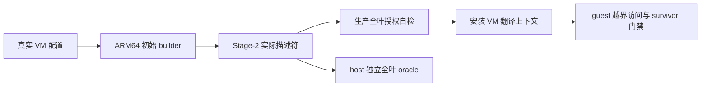

# 初始 Stage-2 RAM 映射不得超出 VM 配置授权

> **Status:** Accepted（设计裁定；运行验收以独立报告为准）。2026-11-08，XL-003 的 HV 侧切片。
> 局部替代 [ADR-0004](0004-stage2-static-1gb-block-mapping.md) 的固定 1 GiB RAM 映射，
> 以及 [ADR-0025](0025-stage2-allocator-and-vcpu-scoped-fault.md) 的 RAM 旧描述符等价要求。
> 不改变本切片开始时的设备窗口。对应 [spec](../superpowers/specs/2026-11-08-xl003-ram-bounds-design.md)。

## 背景

旧 `stage2_init()` 将 `ram_pa` 向下截到 1 GiB，再固定映射 1 GiB，没有使用配置的
`mem_base/mem_size`。Linux 每 VM 配置 256 MiB，实际多授权 768 MiB；SVM VM0 配置
2 MiB，实际身份映射覆盖 EL2 镜像 PA 0x40080000。正常 Linux 两 VM 的 RAM PA 不覆盖
EL2，也不互相重叠，不能把 SVM 缺口泛化为全部 profile 的同一漏洞。

旧自检正确复现了旧映射，却也保留了越界授权。因此“与旧描述符一致”不再是 RAM 的
验收标准。描述符的实际覆盖范围才是授权边界，DTB 声明较小内存不能限制恶意 guest。

## 决策

1. 初始 RAM 精确映射配置三元组：`[mem_base, mem_base + mem_size)` 对应
   `[ram_pa, ram_pa + mem_size)`。不掩码取整扩大授权，不重排现有加载地址。
2. 复用表页池及 `s2_map()` 的块/页选择：对齐且整段授权才可用大块。当前 Linux 使用
   2 MiB 叶覆盖 256 MiB；SVM 使用一个 2 MiB 叶。不需要巨页拆分或按需调页。
3. 纯初始建表与自检放在 ARM64 `mmu/stage2_build.c`，寄存器与上下文安装留在
   `stage2.c`。host 编译生产 builder 与真实 Linux/SVM `vm_configs.c`，不复制算法。
4. 生产自检遍历所有有效叶：设备叶必须匹配保留窗口和洞；RAM 叶必须完整落在授权内，
   OA 偏移及属性匹配，累计覆盖恰好等于 `mem_size`。不能仅筛 Normal 而忽略越界 Device 叶。
5. 初始 builder 校验页对齐、非零长度、39-bit IPA、40-bit PA 及端点溢出；40-bit 限制
   来自当前 VTCR，不应用于 host 表池虚拟指针。失败沿现有初始化通道保持 VM OFF。
6. QEMU 链接断言 `__stack_top <= 0x40200000`，含 BSS 与 boot stack，阻止 HV 侵入 SVM
   backing。该常量须与 `BOARD_SVM_MEM_BASE` 同步；本切片不引入布局生成器。

## 验证契约

host 独立遍历真实配置的所有叶，验证 RAM 范围、OA、属性、设备洞、当前两个 VM 的
RAM OA 不重叠且不覆盖 HV 保留区。生产自检不能同时充当测试的唯一 oracle。

QEMU 每次独立启动一个致命探针：VM0 读 IPA 0x40080000、0x40400000、0xc0200000，
前两项预期 L2 translation fault，第三项预期 L1 fault。每次同时要求精确 IPA/EC/FSC、
访问后穿透标记不存在、同 pCPU VM1 完成。第三项仅为既有隔离回归。

变异回退旧映射时须区分：新自检拒绝启动证明自检承重；一致的旧 builder/旧自检下
真实访问穿透、负向 checker 判红，才证明访问门禁承重。不能互相替代。

## 备选方案

- 只缩小 guest DTB：拒绝，不能约束 Stage-2 实际访问权。
- 继续 1 GiB 块但调整 RAM backing：拒绝，改变地址仍不解决授权长度被忽略。
- 引入动态页帧分配与通用布局协议：延期，不是修复当前静态授权漏洞的必要条件。

## 后果与边界

- 新授权语义有意改变旧 RAM 映射，不再要求 RAM 描述符逐字节等价；旧历史文档保留，
  以本 ADR 的局部替代说明为准。
- 当前 profile 的静态配置通过测试，不代表已有任意动态配置的授权与重叠拒绝系统。
- 设备区仍是低地址宽映射减 GIC/UART 洞；设备白名单、DMA/SMMU、共享页、HSM/DM、
  运行期 TLBI 与 VMID 复用均未由本切片解决。不能宣称完整 VM 隔离或 XL-003 全量完成。
- `s2_map()` 半途失败无回滚仍是既有限制；当前失败弃 VM，不承诺重试/资源复用。
- Linux 正常启动只证明回归行为；真实 cacheability 与硬件设备语义仍需真机验收。
