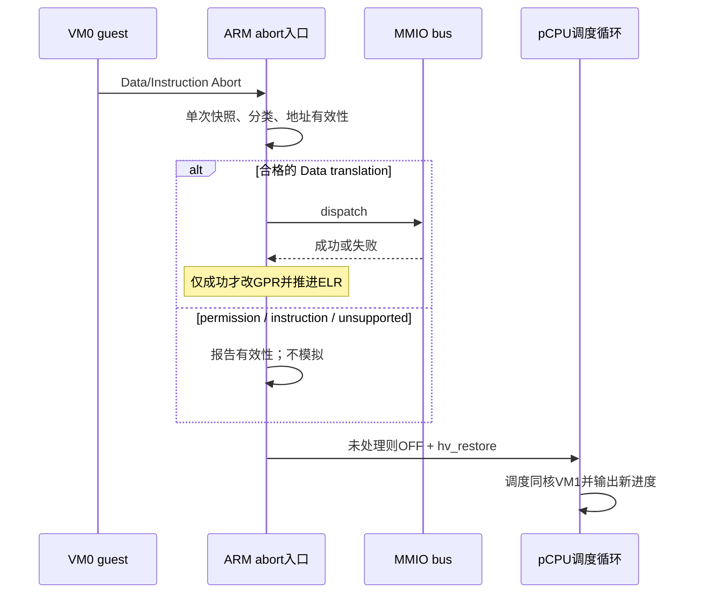

# 先分类 abort，再允许 MMIO；以 guest 负向访问验证启动前权限

> **Status:** Accepted。2026-11-09，HV-012 受限切片。
> 补充 [ADR-0025](0025-stage2-allocator-and-vcpu-scoped-fault.md) 的 fault 诊断与分流，
> 不改变仅停故障 vCPU 的策略；保留 [ADR-0026](0026-initial-stage2-ram-authorization.md) 的 RAM 授权边界。
> [设计与寄存器来源](../superpowers/specs/2026-11-09-hv012-abort-permissions-design.md) ·
> [独立验收](../reports/2026-11-09-hv012-abort-permissions-verification.md)

## 背景

旧 Data Abort 入口仅检查 ISV，然后无条件从 HPFAR/FAR 拼 IPA 并查找 MMIO。构造的
permission fault 配合陈旧 HPFAR 可以触发已注册 handler、改 GPR 并推进 ELR。当前 RAM
没有注册 MMIO handler，因此该 host 行为反例不是“已复现生产 RAM 写保护绕过”。

非 S1PTW permission fault 不保证 HPFAR 有效；ISV 只描述指令 syndrome，不表示地址可靠
或故障属于 MMIO。原始数值不能脱离有效性解释。已有 RO/XN 描述符断言也不能替代 guest
实际访问验证；QEMU 能检查权限，不能将此前 MAIR 实验泛化为“属性都不可测”。

## 决策

1. 在 ARM 私有实现捕获一次 abort 快照并分类；generic MMIO bus 不解释 ESR。
   支持当前 profile 的 L1–L3 translation/access-flag/permission FSC，其他编码保守拒绝。
2. MMIO 仅允许 lower-EL Data translation、ISV=1、S1PTW=0、CM=0、可靠且在当前
   39-bit IPA 范围的地址。handler 成功才写回 GPR/推进 ELR；拒绝或 handler 失败不改寄存器。
3. 非扩展 FIPA 按 HPFAR[39:4] 解码，再校验当前范围，不先截高位伪造合法地址。
   普通 permission（含 XN）标 `ipa_valid=0`，不实施 AT。FnV 按定义类别解释，不当万能有效位。
4. Data/Instruction Abort 都明确诊断并复用 `park_current_vcpu()`。单条记录绑定
   VM/vCPU/pCPU、原始 ESR、EC/FSC/class、FAR/ELR 与 valid 字段。
   `ipa=0x0 ipa_valid=0` 是占位，不表示地址为零；XN 的 `wnr=0 wnr_valid=0` 也仅为占位。
5. 专用编译 profile `svm_s2perm` 在 VM0 首次激活前将授权 RAM 重建成 4 KiB 叶，先通过
   原授权自检，再用真实 `s2_protect()` 设置一页 RO、一页 XN；独立全叶检查限制变化。
   fixture 位于测试目录，不引入生产权限配置接口，不放宽正常 RAM 自检或改变设备/VM1。
6. 两次独立 guest 启动分别验证 RO store 与 XN branch，先成功读取目标，再要求精确
   permission fault、无穿透标记、故障后同 pCPU survivor 产生新进度。
   linker 固定探针地址，预加载 XN 指令，不临时生成代码或引入运行期 TLB 协议。

## 验证策略与备选方案

- 选择 host 同源 spy 行为 RED/GREEN，加真实 guest RO/XN。单测仅检查编码或只看 VM1
  无序 banner 都不足以证明 fault 分类与故障后进展。
- 不采用 AT 重建、按需补页、COW、块拆分、运行期 protect/TLBI；当前切片没有这些消费者。
- 不仅按错误码高位分组接受扩展 FSC；支持范围以当前 cortex-a72/非 LPA2 profile 为准。
- checker 绑定同一完整 fault 行，拒绝重复字段，交叉核对原始 ESR，要求 read 在前、
  survivor 新进度在后。此前引用文本、重复 key、ESR 矛盾及 XN 尾随引号假阳性均保留
  在验收历史，并有对应回归；不以通过自测宣称任意日志来源可信。

## 后果与限制

最终验收涵盖当前 profile 的启动前权限与既定日志契约。运行期权限更新/失效、AT、LPA2、
真机 cacheability/设备排序、DMA/SMMU、HSM/DM 仍未验证；H-123 和 H-127 均不能据此全项关闭。
SVM 显式关闭 Stage-1 MMU，FAR 与探针 IPA 的对应前提不推广到 Linux。
