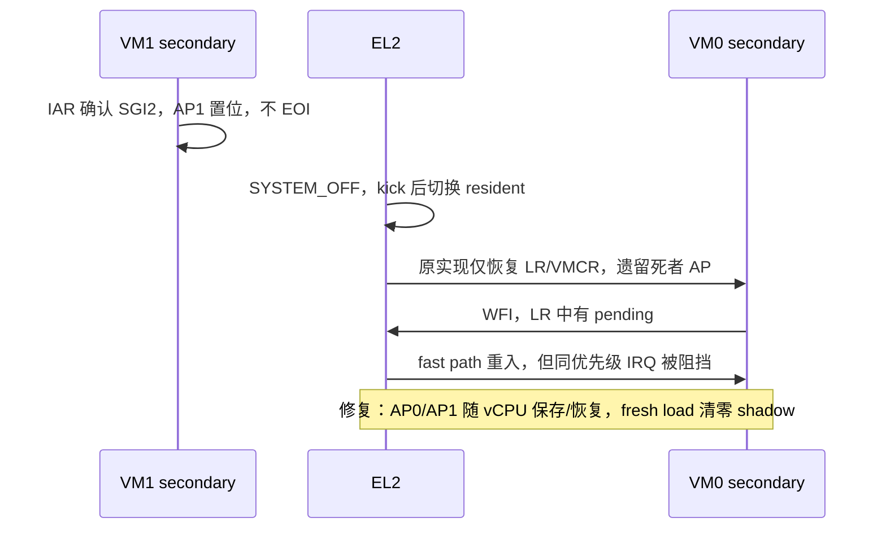

# M11 片 C：跨 VM SYSTEM_OFF 回归定位

> 2026-11-05 更新：幸存者中断停摆已完成受控 RED → GREEN → 回退 RED。
> VM1 secondary IABT 亦已定位修复；启动挂死已定位，处理方案评审中。本页不是片 C 验收通过声明。

## 先撤回旧结论

旧版记录保留在 git 历史，但其中的“已排除”“决定性根因”不能继续作为证据：

- 原 `xvm2` 首次收到 IRQ 后 `timer0` 不再为零，后续五次 `while (!timer0)` 立即结束。
  所谓五个采样窗口没有实际等待。仅修正等待新计数、采用 250 ms 窗口后，原场景在未改
  hypervisor 上通过；旧 RED、基于它的二分和失败修法不能证明产品根因。
- `live LR0 invalid / shadow pending` 可以是 guest 已正常完成 IAR/EOI，不能证明
  `vgic_save()` 丢中断。没有依据添加 LR0 publisher-wins 合并（会重放已完成的 IRQ）。
- `0x70a0001b0000001b` 的 LR state 是 pending；`0x30a0001b0000001b` 是 invalid，
  **不是 active+pending**。临时 `'0' + nibble` 打印的 `1;` 是十六进制 `1b`，不是 SGI 1。
- 旧 Linux 驱动会把命令回显中的 marker 当完成；关机不能等待 guest 返回结束 marker；
  无 workload 时 `NO_HZ_IDLE` 的空闲 CPU 定时器计数不增长也不是故障。
- 手写 `S3_4_C12_C8_n` 读的是 AP0Rn，不是 LRn；读取未实现寄存器会造成插桩自身的
  EL2 异常。使用寄存器符号名，并按 `ICH_VTR_EL2.PreBits` 限定 AP 数量。
- 单次 VTTBR 快照不能排除所有上下文串用竞态；不得再以它宣称 Stage-2 路径全部正确。

## 已证实：遗漏虚拟活动优先级上下文

`vgic_save()/vgic_restore()` 原来只处理 HCR、VMCR、LR 和物理 timer PPI Active，
没有处理 **ICH_AP0Rn_EL2 / ICH_AP1Rn_EL2**。这些寄存器决定虚拟 running priority，
不能由新 LR 集合自动重建。

新的 Linux 现场（正确符号读取，临时插桩已移除）：

| 项目 | 观测 |
|---|---|
| VM1 secondary | LR2=`0x90a0000000000002`：active SGI 2，priority 0xa0 |
| pCPU1 切入 VM0 secondary 前 | AP1R0=`0x100000`，AP0R0=0 |
| VM0 secondary | LR0=`0x70a0001b0000001b`，timer pending；另有 pending SGI 1 |
| 调度状态 | VM1 两 vCPU OFF；VM0 v0 BLOCKED、v1 RUNNING；队列空 |

Linux stop IPI 的 handler 不返回、不 EOI。5 位 preemption priority 下，0xa0 对应 AP
第 20 位（`1 << 20 = 0x100000`）。死者的 running priority 留在 pCPU1，阻挡幸存者同优先级
中断；`vgic_has_pending()` 仍为真，WFI fast path 反复重入却取不到 IRQ。



修复范围：`arch/vm.h` 尾部增加 AP shadow；`vgic_init/save/restore` 同步处理。
`PreBits=5/6/7` 分别访问每组 1/2/4 个寄存器；不改 ADR-0001 的 HW=1 timer 投递模型。
参考 xvisor `arch/arm/cpu/common/vgic_v3.c` 的 AP 保存/恢复，但数量按 PreBits 而非 PRIbits。

## 可重复检测与因果验证

`tests/svm/cases/xvm2.c` 的 VM1 secondary 收到 SGI 2 后发布握手，留在 handler 内 WFE，
VM1 primary 观察握手后 SYSTEM_OFF。VM0 在另一共享 pCPU 上必须在五个实际经过的
250 ms 窗口中持续收到自己的 timer。

| 实验 | 结果 |
|---|---|
| 只修旧采样窗口、尚无 active-IPI 场景 | 未改 HV 即 PASS，证明旧 RED 无效 |
| 新 active-IPI 场景，未修 HV | 连续 3 次 RED；五个窗口均经过，幸存 v1 不推进 |
| 补 AP 上下文、全新构建目录 | 连续 3 次 GREEN |
| 撤回 AP 修复并清理该构建目录 | RED，缺 survivor marker，done x1=1 |
| 重新应用 AP 修复并重建 | GREEN，done x1=0 |

RED 测试提交：`4aa637e`。原始日志保存在本次工作目录的 `build/m11c-evidence/` 和临时
运行日志中；验收摘要后续归入 devlog/日报。

`tests/run_linux_xvm_test.py` 沿用 `run-qemu.sh` 的镜像环境变量，使用唯一、整行完成 marker，
检查命令退出码；通过聚焦后读取 `/proc/cmdline` 和 CPU online 状态确认双 guest 启动。
两个 guest 的 TX 按字节交错，不能以完整启动 banner 是否存在判断是否启动。
关机后在 VM0 两 vCPU 上绑定周期 sleep workload，再验证两列 arch_timer 增长与命令应答。
`--self-test` 覆盖回显、过期/不完整 marker、失败状态、非法计数和分块 UTF-8 解码。

## 已证实：LOAD 失败后 resident 串用造成 IABT

AP 修复不能解决独立的 VM1 secondary IABT。隔离旧实现的第 6 次 Linux 对照运行捕获：

```text
[diag] pCPU1 failed LOAD VM1/v1; stale prev VM0/v1
Hardware name: hv-guest-vm1 (DT)
pc : 0x1
Kernel panic - not syncing: Oops: Fatal exception in interrupt
```

硬件已属于 VM1，但 `prev` 仍是 VM0。下一次重选 VM0 误走 self-repick，未恢复 Stage-2 /
EL1 上下文，用 VM0 的 frame 运行 VM1 内存。`20012b7` 把 resident 更新提前到 LOAD 检查前；
真实 sched.c 的 host mock 在 fresh-load/resume 两种路径都能确定性检出旧错误。
修后 Linux 连续 6 次通过。详细日志：`build/m11c-evidence/linux-stale-prev-6.log`。

另有独立并发缺陷：非原子状态 RMW 可覆盖 OFF；提前采样 was_running 可漏 stop kick。
`0733716` 以 CAS + 返回原子旧状态的 OFF exchange 修复。500000 轮 host 竞争中，旧实现
丢 OFF 113791 次，修后为零；这不等于完整并发 CPU_ON 生命周期或停机 ack 的证明。

## 已定位：启动时共享 pCPU 协作等待死锁

正确的 focused-command 探测在旧 HV 第 14 次复现真实挂死（前 13 次通过）：

- pCPU0 current=VM0/v0，保存的 guest LR 位于 `multi_cpu_stop`；VM0/v1 排在 pCPU1。
- pCPU1 current=VM1/v1，现场回溯 `csd_lock_wait → smp_call_function_many → kick_all_cpus_sync`；
  VM1/v0 排在 pCPU0。
- 两队列各 count=1，两个 current 均 RUNNING、两个对端均 RUNNABLE。
- before-restore AP 诊断为零；它不是冻结时全部 live AP 的快照。

两 current 等待对端完成同步工作，却占着对方所需的共享 pCPU。**不仅是 banner 假阴性**。
日志：`build/m11c-evidence/boot-old-14-gdb.log`。

WFE 不能在本机充当可靠让出点：实际 QEMU 9.2.4 的 ctxsw 诊断运行完成 CPU_ON、排队
secondary 后等待 4 秒，trace 有 133 个异常、**WFx 异常为 0**，secondary 从未运行。
本地 QEMU 源码也明确不产生 WFE configurable trap。因此只改 `handle_wfx` 不足以修复。
架构诊断认可 kick 有重新检查 runnable work 的职责，但否决无条件轮转：可能换下刚收到
IPI 的 current，消费唯一通知后形成新的等待环。目标关联通知协议或公平抢占需另行批准。
本轮仅定位启动问题，不进入 D；把此例纳入既定片 D 的设计输入，**不宣称启动挂死已修复**。

保留独立诊断 `tests/svm/cases/wfe_wait.c`，不纳入当前硬件 gate。运行方式：

```sh
make BUILD_DIR=build/diag-wfe HV_GUEST=svm_ctxsw all build/diag-wfe/svm/svm-wfe_wait.bin
LINUX_IMAGE= HV_NR_CPUS=4 HYPERVISOR_ELF=build/diag-wfe/hypervisor.elf \
SVM_BIN=build/diag-wfe/svm/svm-wfe_wait.bin timeout 4 ./scripts/run-qemu.sh </dev/null
```

当前 QEMU 9.2.4 的预期诊断是 CPU_ON succeeded 后外部 timeout（124），没有 secondary ran；
这表示缺口被复现，不是测试通过。原 ctxsw 聚合用例保持可满足的 WFI 协作契约，并增加
active IRQ round-trip 断言：EOI 前换下再恢复，同优先级 SGI 仍须不可确认。受控把 AP 恢复
改成清零时该断言 RED，恢复真实 shadow 后 GREEN，防止“只清 AP”伪修复。

全量 `make test` 已通过 10 个 QEMU 场景；最终干净树 Linux 三连尚待执行。正式专家复验不在本轮。
