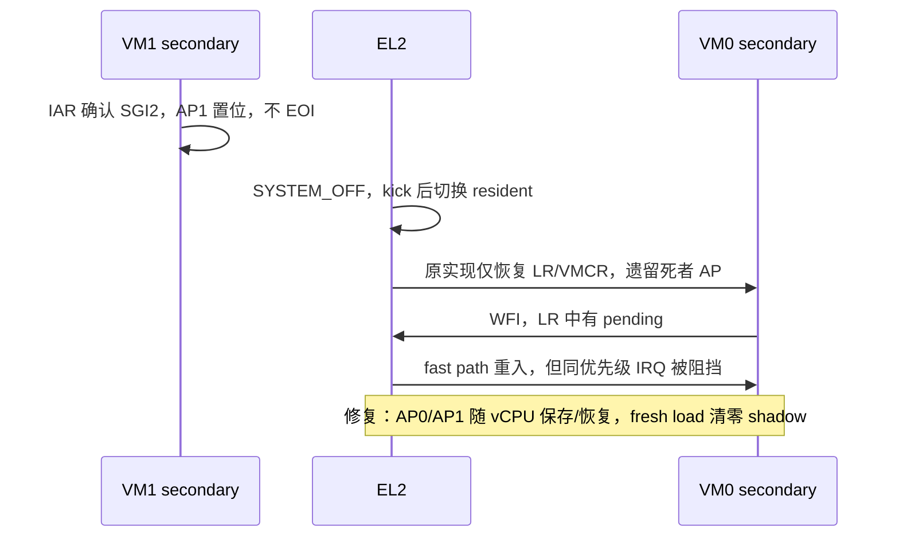

# M11 片 C：跨 VM SYSTEM_OFF 回归定位

> 2026-11-05 更新：幸存者中断停摆已完成受控 RED → GREEN → 回退 RED。
> VM1 secondary 的 IABT 和启动问题仍在排查；本页不是片 C 验收通过声明。

## 先撤回旧结论

旧版记录保留在 git 历史，但其中的“已排除”“决定性根因”不能继续作为证据：

- 原 `xvm2` 首次收到 IRQ 后 `timer0` 不再为零，后续五次 `while (!timer0)` 立即结束。
  所谓五个采样窗口没有实际等待。仅修正等待新计数、采用 250 ms 窗口后，原场景在未改
  hypervisor 上通过；旧 RED、基于它的二分和失败修法不能证明产品根因。
- `live LR0 invalid / shadow pending` 可以是 guest 已正常完成 IAR/EOI，不能证明
  `vgic_save()` 丢中断。没有依据添加 LR0 publisher-wins 合并（会重放已完成的 IRQ）。
- `0x70a0001b0000001b` 的 LR state 是 pending；`0x30a0001b0000001b` 是 invalid，
  **不是 active+pending**。临时 `'0' + nibble` 打印的 `1;` 是十六进制 `1b`，不是 SGI 1。
- 旧 Linux 驱动会把命令回显中的 marker 当完成；关机不能等待 guest 返回结束 marker；
  无 workload 时 `NO_HZ_IDLE` 的空闲 CPU 定时器计数不增长也不是故障。
- 手写 `S3_4_C12_C8_n` 读的是 AP0Rn，不是 LRn；读取未实现寄存器会造成插桩自身的
  EL2 异常。使用寄存器符号名，并按 `ICH_VTR_EL2.PreBits` 限定 AP 数量。
- 单次 VTTBR 快照不能排除所有上下文串用竞态；不得再以它宣称 Stage-2 路径全部正确。

## 已证实：遗漏虚拟活动优先级上下文

`vgic_save()/vgic_restore()` 原来只处理 HCR、VMCR、LR 和物理 timer PPI Active，
没有处理 **ICH_AP0Rn_EL2 / ICH_AP1Rn_EL2**。这些寄存器决定虚拟 running priority，
不能由新 LR 集合自动重建。

新的 Linux 现场（正确符号读取，临时插桩已移除）：

| 项目 | 观测 |
|---|---|
| VM1 secondary | LR2=`0x90a0000000000002`：active SGI 2，priority 0xa0 |
| pCPU1 切入 VM0 secondary 前 | AP1R0=`0x100000`，AP0R0=0 |
| VM0 secondary | LR0=`0x70a0001b0000001b`，timer pending；另有 pending SGI 1 |
| 调度状态 | VM1 两 vCPU OFF；VM0 v0 BLOCKED、v1 RUNNING；队列空 |

Linux stop IPI 的 handler 不返回、不 EOI。5 位 preemption priority 下，0xa0 对应 AP
第 20 位（`1 << 20 = 0x100000`）。死者的 running priority 留在 pCPU1，阻挡幸存者同优先级
中断；`vgic_has_pending()` 仍为真，WFI fast path 反复重入却取不到 IRQ。

修复范围：`arch/vm.h` 尾部增加 AP shadow；`vgic_init/save/restore` 同步处理。
`PreBits=5/6/7` 分别访问每组 1/2/4 个寄存器；不改 ADR-0001 的 HW=1 timer 投递模型。
参考 xvisor `arch/arm/cpu/common/vgic_v3.c` 的 AP 保存/恢复，但数量按 PreBits 而非 PRIbits。

## 可重复检测与因果验证

`tests/svm/cases/xvm2.c` 的 VM1 secondary 收到 SGI 2 后发布握手，留在 handler 内 WFE，
VM1 primary 观察握手后 SYSTEM_OFF。VM0 在另一共享 pCPU 上必须在五个实际经过的
250 ms 窗口中持续收到自己的 timer。

| 实验 | 结果 |
|---|---|
| 只修旧采样窗口、尚无 active-IPI 场景 | 未改 HV 即 PASS，证明旧 RED 无效 |
| 新 active-IPI 场景，未修 HV | 连续 3 次 RED；五个窗口均经过，幸存 v1 不推进 |
| 补 AP 上下文、全新构建目录 | 连续 3 次 GREEN |
| 撤回 AP 修复并清理该构建目录 | RED，缺 survivor marker，done x1=1 |
| 重新应用 AP 修复并重建 | GREEN，done x1=0 |

RED 测试提交：`4aa637e`。原始日志保存在本次工作目录的 `build/m11c-evidence/` 和临时
运行日志中；验收摘要后续归入 devlog/日报。

`tests/run_linux_xvm_test.py` 沿用 `run-qemu.sh` 的镜像环境变量，使用唯一、整行完成 marker，
检查命令退出码；通过聚焦后读取 `/proc/cmdline` 和 CPU online 状态确认双 guest 启动。
两个 guest 的 TX 按字节交错，不能以完整启动 banner 是否存在判断是否启动。
关机后在 VM0 两 vCPU 上绑定周期 sleep workload，再验证两列 arch_timer 增长与命令应答。
`--self-test` 覆盖回显、过期/不完整 marker、失败状态、非法计数和分块 UTF-8 解码。

## 仍未解决的独立问题

AP 修复后，聚焦应答式 Linux gate 前两次通过；第三次再次捕获 VM1 secondary IABT：
`Hardware name: hv-guest-vm1`、`pc=lr=1`、`Call trace: do_idle`，在 SYSTEM_OFF 后发生。
因此 **AP 修复不等于全部问题已解决**，当前还不能交测试专家复验。

只读架构诊断另指出：状态转换非原子 RMW 可覆盖 OFF；sweep 的 running 采样与 OFF 写入
分离可漏 kick；switch-in 后 LOAD 失败时 `prev` 仍指向旧 resident 可造成上下文串用。
它们有源码交错依据，尚需确定性测试和现场对应，不能直接宣称是本次 IABT 的根因。

启动问题也要区分真实停滞、TX banner 交错和驱动错误。最终统计必须依据聚焦命令应答，
不能沿用旧的 banner 计数。尚未完成最终全量 gate、连续三次 Linux gate、正式专家复验。
