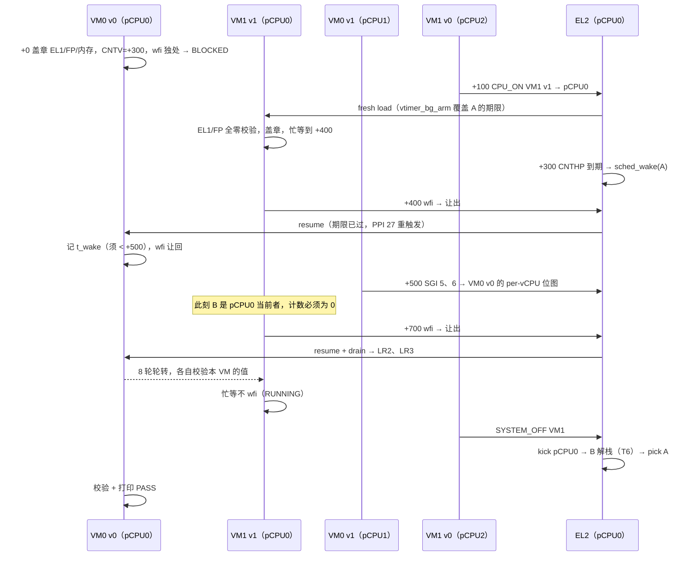

# M11 片 C xvm 受控红（Q9 纪律）——跨 VM 共享隔离场景的三个牙齿

> 2026-11-04（片 C Task 5）。工作树内验收操作，未落红 commit；本档为实验记录。

## 场景

profile `svm_xvm`：VM0 `vcpu_pcpu = {0, 1}`、VM1 `vcpu_pcpu = {2, 0}`——VM0 vCPU0 与 VM1 vCPU1 共享
pCPU0。用例 `tests/svm/cases/xvm.c` 同源编两份（`-DXVM_ID=0/1`，`-mgeneral-regs-only`）。

## 第一版的漏洞：背景定时器红灯不红

第一版（B 忙等到 +700 才让出）把 `vtimer_bg_arm` 桩掉后**仍全绿**。

原因：+500 的 SGI 走 `vgic_sgi_trap` → `sched_wake(t)`，也会唤醒阻塞的 A；A 在 +700 被 resume
时，过期的 CNTV 照样触发。场景没有把"谁唤醒了 A"隔离开。

修正：B 在 +400（SGI 之前）先让出一次。此时只有 CNTHP 能把 A 放进队列；A 记录被恢复的时刻，
必须落在 [+300, +500)，然后立刻让回 B，SGI 阶段 B 依然是当前者。

## 三个受控红（修正后，QEMU 实测）

| 回退 | 失败行（摘） | 机理 |
|---|---|---|
| `vtimer_bg_arm` 恒 `any=false`（T4 回退） | `own timer woke it via the bg timer, before the SGIs`、`no SGI leaked`、其后全部 | B 在 +400 独处 wfi → BLOCKED，pCPU0 空闲；A 直到 +500 的 SGI 才被唤醒，t_wake 越界；时间轴整体错位 |
| `vgic_sgi_trap` 目标改回 `percpu[pcpu].cur_vcpu`（T2 回退，per-pCPU 键控） | `no SGI leaked from VM0`、`SGI 5 and 6 received` 及其后 | 发给 VM0 v0 的 SGI 被注入当时在 pCPU0 上跑的 VM1 v1 |
| kick 分支 OFF vCPU 改回 `cpu_arch_halt()`（T6 回退） | `XVM0: isolation intact`、`ran after VM1 SYSTEM_OFF`、`done` | SYSTEM_OFF 的 kick 把共享 pCPU0 停死，A 永远不再运行 |

还原后绿跑 4/4。

## 结论

1. 场景设计要把每个唤醒源隔离成"只有它能解释的观测"。SGI 与 timer 都经 `sched_wake`，
   同时存在时会互相掩盖。
2. 盖章校验（EL1、FP、同 IPA 内存字）在三个回退里都不是首个失败点，它们管的是另一类缺陷
   （保存集与 Stage-2 隔离）。两者在 T1b/T3 的 ctxsw 受控红里已经各自证明过有牙齿。
