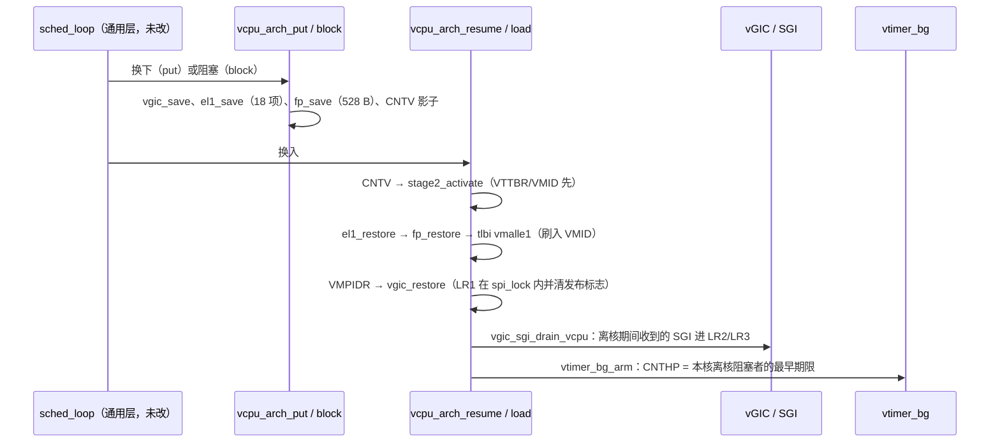

# M11 片 C — 跨 VM 共享 pCPU：隔离、FP、背景定时器、per-vCPU SGI

> **日期**: 2026-11-04（Day 6 特性开发文档）。**状态**: 按用户指示线性合入 develop，
> **未通过测试专家验收，也未过架构师关卡②**（见下文"合入时的未决项"）。
> [片 C plan](../superpowers/plans/2026-11-04-m11-slice-c-cross-vm-fp.md) /
> ADR-0019（修订）/ [ADR-0020](../adr/0020-eager-fp-simd-save.md) /
> [xvm 受控红](../debug/m11-c-xvm-controlled-red.md)。

> **2026-11-05 更新**：两项 SYSTEM_OFF 回归已在后续 feature 修复并补受控红，见
> [修复 devlog](2026-11-05-m11-c-regression-fix.md)。启动挂死确认为共享 pCPU 协作等待饥饿，
> 本轮仅定位，未实施片 D。下文为合入时的历史记录，原手工 gate 数字不能替代新检测网，
> 也不代表正式复验或关卡②已通过。

## 这是什么

B2 让**同一个 VM** 的两个 vCPU 安全地共享 pCPU；片 C 把共享推到**跨 VM**：两个 Linux VM 的
vCPU0 共享 pCPU0、vCPU1 共享 pCPU1（2×2-on-2），pCPU2/3 空闲。跨 VM 意味着换入者看到的每一项
硬件状态（Stage-2/VMID、TLB、EL1、FP、vtimer、vGIC LR、SGI 待决）都不能残留上一个驻留者的值。
另外，阻塞 vCPU 不再能依赖"pCPU 上只有我"。

## 怎么用（可观察面）

- **Linux 演示**：`make run` 起两个 Linux VM 跑在 pCPU0/1 上，`vm_list` 两行都显示 `0-1`；
  Ctrl-T 切焦点、cpu1 hotplug 往返、VM1 关机后 VM0 存活都照旧。两个 VM 的 cpu1 arch_timer
  计数都在走（`cat /proc/interrupts`）。
- **xvm 场景**（`make test-qemu-xvm`，进 `make test` 聚合，8 → 9）：VM0 vCPU0 与 VM1 vCPU1
  共享 pCPU0，验证 fresh load 不泄漏、背景定时器唤醒、跨 VM SGI 不误投、同 IPA 内存/EL1/FP
  各归各、SYSTEM_OFF 不困死共享 pCPU。
- **ctxsw 场景**新增 SP_EL0/TPIDR_EL0 与 v0–v31+FPCR/FPSR canary。

## 怎么工作

### 1. 恢复序（T1）

VTTBR 必须先于 EL1 恢复：EL2 上可能发生推测性 EL1&0 表遍历，新 EL1 寄存器配旧 VMID 会把入 VM 的
条目种进出 VM 的 TLB 标签，而 `tlbi vmalle1` 只刷当前 VMID。load 此前的序刷的就是出 VMID。

### 2. EL1 集补全 + fresh load 清零（T1b）

保存集从 12 项到 18 项：+SP_EL0（Linux 的 `current`）、ELR/SPSR_EL1、TPIDR_EL0、PAR_EL1、
CNTKCTL_EL1。fresh load 不再只写 `SCTLR=0`，而是整块清零 EL1 影子后走 `el1_restore`，同时
复位 CNTV 影子（IMASK）与 FP 文件。

### 3. per-vCPU SGI + LR2/LR3 双槽（T2）

`sgi_pending` 原本按 **pCPU** 键控：跨 VM 共享时，发给 VM0 vCPU0 的 SGI 会注入当时在 pCPU0 上跑的
VM1 vCPU1。现在挂在目标 vCPU 上，按目标所在位置投递：

- 自身：立即 drain。
- 别核当前者：kick 后由对方 drain。
- 排队或阻塞：resume/load 时 drain。

纯逻辑核心 `vgic_sgi_place_lrs` 负责放槽，配了 host 单测（16 断言）：

- 同 vINTID 合并，不占两个 LR。
- 有剩余时占用槽置 EOI 位，guest deactivate 触发维护 PPI 25 补槽。

**偏离 plan**：plan 写的是 NPIE。两槽都 active-only 时 NPIE 电平持续而无可注入，会饿死 guest，
所以改为 per-LR EOI 维护。

### 4. FP/SIMD 急切保存（T3，ADR-0020）

`fp.S` 存取 q0–q31/FPSR/FPCR。put **与** block 都存，因为从阻塞者切走不经过 put。另外
`CPTR_EL2` 以前从未写过（复位值 UNKNOWN），现在每核写 `0x33FF`。

### 5. EL2 背景定时器（T4）

阻塞 vCPU 的 CNTV 保持活跃是它自己的唤醒源，但 pCPU 换入他者后，活 CNTV 属于新来者。每 pCPU
一个 CNTHP（PPI 26）取离核阻塞者中最早的物理期限 `cntv_cval + cntvoff`；到期 `sched_wake`，
resume 恢复已过期的 CNTV 让 PPI 27 自然重触发。电平触发，先重编程再 drop+deactivate。

### 6. kick 解栈 + PAuth 屏蔽（T6）

SYSTEM_OFF 的 kick 以前在被 kick 的 pCPU 上 `cpu_arch_halt()`，在共享 pCPU 上会把另一个 VM
一起困死。现在 `hv_restore()` 回调度循环 pick 下一个。PAuth 没有密钥存取，改为 TID3 把
ISAR1/ISAR2 的 PAuth 字段读作 0。

## 验证

- `make test` 9× ALL PASS，`make host-test` 181。
- 手工 Linux gate 14/14（`/tmp/m11c-gate.sh`）：cpu1 arch_timer 计数 VM0 275→296、VM1 227→259。
- 受控红：每个回退都确定性失败。
  - ctxsw：去掉 SP_EL0/TPIDR_EL0 恢复（T1b）、去掉 FP 保存（T3）。
  - xvm：桩掉背景定时器（T4）、SGI 改回 per-pCPU（T2）、kick 改回 halt（T6）。
- xvm 第一版的背景定时器红**不红**：+500 ms 的 SGI 也经 `sched_wake` 唤醒了阻塞者，掩盖了
  定时器缺失。重塑为 +400 ms 先让出一次、阻塞者校验自己恢复于 SGI 之前。

## 已知缺口（详见 ADR-0019）

~~`ICH_AP1R0_EL2` 未保存（片 D 抢占触发）~~（11-05 已补 AP0/AP1，SYSTEM_OFF 也会在 IRQ 内换下）、
PPI 27 物理屏蔽 per-pCPU 共用、`CNTP_*` 未保存、
RK3588 推测性 AT 勘误、AMAIR/AFSR/CSSELR、pCPU0 永久让出的负载形态。协作调度无抢占：
忙等的 vCPU 会饿死同 pCPU 的另一个 VM（片 D）。vuart TX 按行缓冲是片 D 前置。

## 合入时的未决项（2026-11-04，用户指示先合入）

测试专家验收结论为**不通过**。第 1 轮修复已随本次合入：

- **Critical-1**：VM1 关机后 VM0 在共享 pCPU 上的 vtimer 停摆。根因是 PPI 27 的物理 Active
  状态（HW 直通，EL2 只做 priority drop）留在 pCPU 上，没有按 vCPU 保存。现在 `vgic_save`
  保存、`vgic_restore` 强制写回换入者的值。手工 gate 两次：VM0 cpu0 关机后恢复计数
  （473→492、452→468）。
  **VM0 cpu1 关机后计数仍不涨（2/2）**，未定位：可能是 NOHZ 下真空闲（gate 判据过严），也可能
  pCPU1 上另有停摆。下一步：关机后在 cpu1 上绑负载复测。
- gate `to_guest` 改为只出现在输出里的 marker；xvm 加 SGI 7 覆盖 EOI 补槽（受控红：去掉 PPI 25
  的 drain 即挂死）；`ponytail:` 注释 cntvoff 回绕与 ICC_DIR 丢弃（EOImode=1 guest 前须实现 DIR）。
- 未查：测试专家观察到 Linux 启动挂死 1/6（停在 `legacy bootconsole [pl11] disabled`）。
- 未做：测试专家复验、架构师关卡②。
