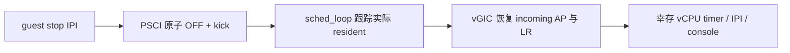

# M11 片 C 回归修复：活动优先级、resident 与并发停止

> 状态：开发中，尚未交测试专家复验；不进入片 D。
> 关联：[定位记录](../debug/m11-c-survivor-freeze.md)、
> [片 C plan](../superpowers/plans/2026-11-04-m11-slice-c-cross-vm-fp.md)、
> [本轮报告](../reports/2026-11-05-m11-c-regression-fix.md)。

## 已实现

1. **vGIC AP 上下文**：`arch/vm.h` 增加 AP0/AP1 shadow；`vgic_init/save/restore`
   按 `ICH_VTR_EL2.PreBits` 保存、恢复已实现项。解决死者在 stop IPI 内不 EOI 时，
   running priority 遗留到另一 VM、阻挡 timer/IPI 的问题。不改 HW=1 投递协议。
2. **resident 记账**：`sched_loop()` 在 switch-in 完成后立即更新 `prev`，再检查 LOAD。
   远端 OFF 导致 LOAD 失败也不能把旧 vCPU 当作仍驻留，否则重选旧 vCPU 会跳过恢复。
3. **原子停止**：状态转换用 CAS，OFF 用 exchange；sweep 根据 exchange 返回的真实旧状态
   决定是否 kick。其他 pCPU 的过期 PICK/LOAD/BLOCK/WAKE/YIELD 不能覆盖 OFF。
4. **构建一致性**：同步 generic-tail 布局 pins、增加对象头文件依赖，避免扩展上下文后
   复用旧对象。ARM64 用 inline LL/SC，不能依赖 freestanding 环境中不存在的 outline helpers。



## 检测网与受控红

- `xvm2`：VM1 secondary 在 SGI2 handler 中 WFE、不 EOI；primary 观察握手后 SYSTEM_OFF。
  VM0 两 vCPU 在另一共享 pCPU 仍须持续收到自己的 timer。
- 原测试的五个窗口没有等待新 IRQ，已修正；现在每窗 250 ms 并检查截止时间。
- `4aa637e` 是可靠 RED 测试提交：未修 HV 连续 3 次失败；AP 修复后连续 3 次通过；
  撤回 AP 修复并清理该构建目录再次失败，重新应用后通过。
- `e998b54` 的 host 测试直接编译真实 `sched.c`，只 mock arch hooks，分别强制 B fresh-load /
  resume 后 OFF。旧实现两种情况都把 B 的 resident 当 A 运行；`20012b7` 后 20 assertions 通过。
- `d693e36` 的双线程测试让五种状态转换分别与 OFF 竞争，共 500000 轮。旧实现分别丢失
  23447 / 21126 / 21779 / 23137 / 24302 次 OFF；CAS 后全部为零。压力测试不是穷尽交错证明。

## Linux 证据与运行方式

`tests/run_linux_xvm_test.py` 使用已有 `run-qemu.sh` 环境变量：

```sh
LINUX_IMAGE=/path/to/Image LINUX_INITRD=/path/to/initramfs.cpio.gz \
GUEST_DTB=/path/to/guest.dtb GUEST_DTB1=/path/to/guest-vm1.dtb \
HYPERVISOR_ELF=build/hypervisor.elf python3 tests/run_linux_xvm_test.py --log /tmp/linux-xvm.log
python3 tests/run_linux_xvm_test.py --self-test
```

initramfs 使用仓库 `guest/initramfs-init.sh`，需要 `cat/grep/taskset/sleep/poweroff` applets。
通过聚焦命令读取 `hv.vm=N` 和两 CPU online 来确认启动；不依赖字节交错的 banner。
关机后给两幸存 vCPU 绑定周期 sleep workload，避免把 NO_HZ_IDLE 正常停 tick 误判为停摆。

隔离的 AP-only 旧代码在第 6 次运行捕获：

```text
[diag] pCPU1 failed LOAD VM1/v1; stale prev VM0/v1
Hardware name: hv-guest-vm1 (DT)
pc : 0x1
Kernel panic - not syncing: Oops: Fatal exception in interrupt
```

这把 IABT 与 switch-in 失败后的 resident 串用直接对应起来。修复 resident 后连续 6 次
Linux gate 通过；最终全部修改后的干净树验收尚待执行。

## 启动挂死：已定位，保留明确限制

旧 HV 在校准的聚焦启动探测中第 14 次真实挂死（前 13 次通过）：pCPU0 的 VM0/v0 在
`multi_cpu_stop` 等待排在 pCPU1 的 VM0/v1；pCPU1 的 VM1/v1 在 `csd_lock_wait` /
`kick_all_cpus_sync` 等待排在 pCPU0 的 VM1/v0。两队列 count=1，AP=0。
当前 WFE 只跳过，不 yield；这是共享 pCPU 上的协作等待死锁，不是 banner 假阴性。

实际 QEMU trace 证明 WFE 不产生陷阱（4 秒、133 个异常中 WFx=0），故不实施无效的
WFE handler 修复。无条件 kick 轮转也被架构诊断否决：可能换下刚收到 IPI 的 current，
造成新的等待环。保留 `wfe_wait.c` 非 gate 诊断，不修改 QEMU 或偷偷加入片 D tick。
处理归既定片 D 的公平调度设计，rendezvous 场景必须作为设计输入；提前改目标关联通知
协议须另行批准。**本轮完成的是定位，不是启动稳定性修复**。

原 `7be77bf` 的候选 WFE 检测不再放进要求全绿的 ctxsw gate；独立诊断保留相同失败条件。
ctxsw 另增 active IRQ round-trip：timer EOI 前 WFI 切换并恢复，随后自发同优先级 SGI，
IAR 必须返回 spurious（priority 仍 active）。把 AP 恢复临时改为零时 RED，还原后 GREEN。
这是实际投递检查，不使用现有 TC-trapped RPR 的常量 stub。

## 未验证边界

本轮不是正式测试专家复验或架构师关卡②。AP 的 6/7 位硬件分支、RK3588 真机尚未运行；
异步 stop 不承诺 OFF 发布瞬间零 guest 指令，并发 CPU_ON 的完整生命周期协议不在本轮。
全量 `make test` 已通过 10 个 QEMU 场景；最终干净树 Linux 三连与 Linear 收尾仍待完成。
当前会话没有可用 Linear CLI / 工具或环境授权，未对远端 H-27 作更新。
