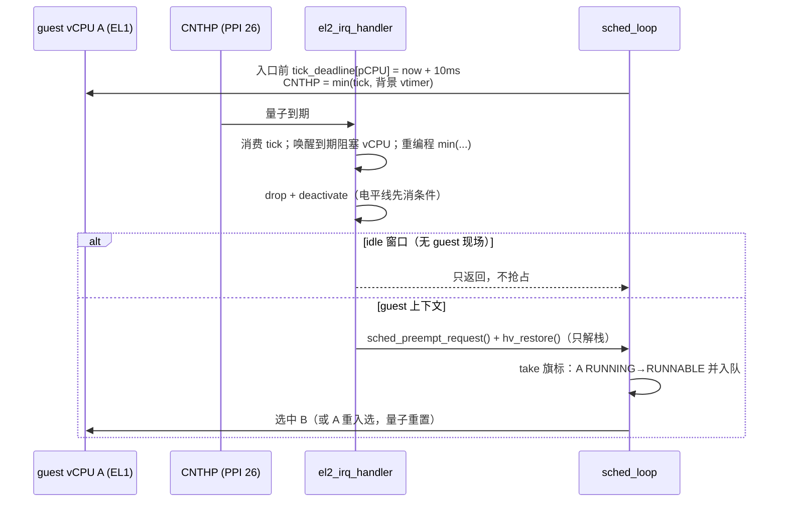

# M11 片 D — 时间片抢占与 `make test-linux`

> 2026-11-07。分支 `feature/m11-d-preemption`（`181110c..af98bd9`），线性合回 `dev`。
> 设计：[片 D 设计](../superpowers/specs/2026-11-07-m11-slice-d-preemption-design.md)；
> 决策：[ADR-0021](../adr/0021-time-slice-preemption-in-the-run-loop.md)；
> 过程与关卡细节见 [当日报告](../reports/2026-11-07-m11-d.md)。

## 是什么

1. **时间片抢占**：共享 pCPU 上的 vCPU 每 10 ms 被无条件换下一次。之前只有 WFI trap 才会
   换人——一个不让出的 vCPU 能把同 pCPU 上另一个 VM 的 vCPU 饿死（ADR-0019 的
   "共享 pCPU 协作等待饥饿"，H-174 启动挂死的成因）。
2. **`make test-linux`**：一条命令跑真实双 Linux VM 门禁（2×2-on-2 到双 shell、
   SYSTEM_OFF 隔离、幸存者 timer 在走），镜像哈希先行校验。

## 怎么用

```sh
# 常规门（每次改动）
make host-test        # 秒级
make test             # 4 项静态检查 + 11 个 QEMU 场景，约 2–5 分钟

# 真实 Linux 门（切片关卡②、里程碑验收；不进 make test 聚合）
make test-linux                                    # 默认镜像路径 + 哈希校验
LINUX_IMAGE=/path/to/Image LINUX_INITRD=/path/to/initramfs.cpio.gz make test-linux
```

镜像不进仓库：内核 `Image` 与 busybox initramfs 是构建产物，构建步骤见
[2026-11-06 devlog](2026-11-06-linux-gate-rebuild.md)。`tests/linux-gate.sha256` 钉住
"验证过的那两个文件"，哈希不符就红并提示重新构建——这是裁定 9.1 的落地形态。

新增的抢占回归场景：

```sh
make test-qemu-preempt     # 单个场景，约 5 s
```

## 怎么工作



关键不变量（改代码前先读 ADR-0021）：

- `arch/arm64/timer/vtimer.c` 的 `el2_timer_rearm()` 是**唯一**写 `CNTHP_CVAL/CTL` 的地方：
  背景 vtimer 唤醒与抢占 tick 共用一个比较器，取 `min(两者最早期限)`。任何"换入时重编程
  背景定时器"的代码绕开它，就会静默抹掉 tick。
- 中断上下文**不做**状态转换、不入队、不切上下文：只置 per-pCPU 旗标 + `hv_restore()`。
  RUNNING→RUNNABLE 与入队发生在 `sched_loop`，走既有的 `VCPU_EV_YIELD` 路径。
- 量子在每次 guest 入口前重装；fast path（不换 vCPU 的 `hv_restore` 回路）不重装，避免
  "WFI 立即被打回的紧循环"无限续期。
- guest 在 EL1 掩中断（`PSTATE.I=1`）**不影响** tick 投递（中断路由到 EL2，异常在 EL2 取）；
  两路独立实验见报告。

## 怎么验证

| 检查 | 结果 |
|---|---|
| `make host-test` | `PASS (195)` / `scheduler PASS (34)` / `state race 500000 rounds` |
| `make test`（`make clean` 后从零） | 4 静态检查 + **11/11** 场景，0 告警，2m22s |
| `make test-qemu-preempt` ×3 | 3/3 `ALL PASS` |
| `make test-linux` ×5 | 5/5 `Linux XVM PASS`（单次约 10 s） |
| 承重性反证 | 把抢占分支改恒假 → `scheduler FAIL (31 assertions)`；把 tick 装定改 `return;` → `preempt` 场景红（`PREEMPT: v1 never ran`） |
| 负向 | 缺镜像/坏哈希/缺 pin 文件 → 全部 fail-closed 红，文本指向构建步骤 |

受控红与承重实验全文：`docs/debug/2026-11-07-m11-d-preempt-controlled-red.md`、
[测试专家复验报告](../reports/2026-11-07-m11-d-verification.md) §3。

## 已知边界

- 量子固定 10 ms、无优先级：只保证前向进度，不保证时延（H2 再评估）。
- 抢占只在 QEMU 9.2.4 / `cortex-a72`（TCG）验证；RK3588 真机（M15）未跑，`PSTATE.I`
  探针与 20 位 CNTFRQ 需在真机重跑。
- Linux 门禁连跑 5 次全绿**不构成**"H-174 消失"的断言（上轮口径：14 次中 1 次）。
- `make test-linux` 依赖本机镜像；新机器先按 2026-11-06 devlog 构建（用
  `busybox --install -s` 建全部 applet 软链，否则 driver 的 `grep`/`taskset` 会缺）。
