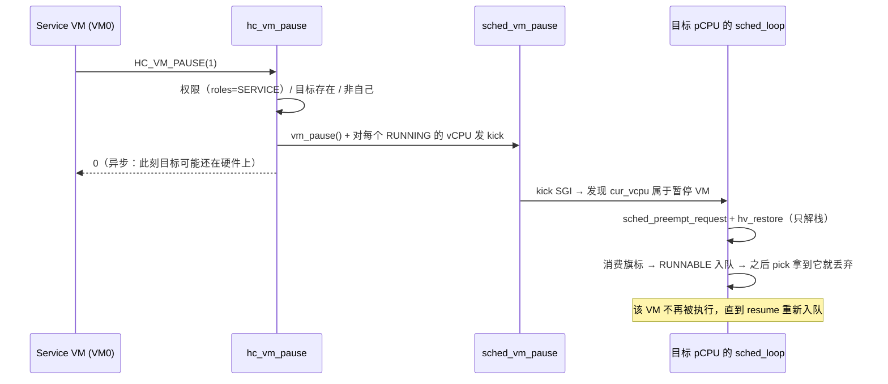

# HV-004 第一刀 — VM 暂停/恢复

> 2026-11-08。分支 `feature/hv004-vm-pause`（`ac844e4..`），线性合回 `dev`。
> 设计：[spec](../superpowers/specs/2026-11-08-hv004-vm-pause-design.md)；
> 计划：[plan](../superpowers/plans/2026-11-08-hv004-vm-pause.md)；
> 决策：[ADR-0023](../adr/0023-vm-pause-is-a-scheduling-predicate.md)；
> 复验：[测试专家报告](../reports/2026-11-08-hv004-verification.md)。

## 是什么

Service VM（VM0）现在能暂停/恢复另一个 VM，并且暂停真的让它不再被调度：

| id | 名称 | 谁可调 | 参数 | 返回 |
|---|---|---|---|---|
| `0x87000101` | `HC_VM_PAUSE` | 仅 Service VM | `x1 = vmid` | `0` / `HC_EPERM` / `HC_EINVAL`（自己）/ `HC_EBUSY`（已暂停）/ `HC_ENODEV` |
| `0x87000102` | `HC_VM_RESUME` | 仅 Service VM | `x1 = vmid` | 同上（未暂停时 `HC_EBUSY`） |

`HC_VM_QUERY` 的返回字追加 `bit 32 = paused`；`vm_list` 的 STATE 列会在暂停时显示
`paused`。**没有** `CREATED/READY/DESTROYED` 与事件通道——那是 VM 创建/销毁切片
（依赖 H2 的页分配）。

## 怎么用

```sh
# 门禁（扩展的 hcall 场景，含暂停/恢复往返与冻结证明）
make test-qemu-hcall
```

guest 侧：

```c
hvc2(HC_VM_PAUSE, 1, &x1);     /* Service VM 暂停 VM1 */
hvc2(HC_VM_QUERY, 1, &x1);     /* (x1 >> 32) & 1 == 1 */
hvc2(HC_VM_RESUME, 1, &x1);    /* 恢复 */
```

## 怎么工作

暂停是**调度判据**，不是"停下 guest"：



要点：

- **丢弃点在 `sched_loop`（pick 之后），不在 `sched_pick`**：pick 保持纯出队原语。
- **恢复只重入队 `RUNNABLE` 与 `ON_PENDING`**，`BLOCKED` 不动（它在等自己的事件，
  暂停不该伪造唤醒）。`ON_PENDING` 是必需的：与暂停竞争的 CPU_ON 会被丢弃，漏掉它
  secondary 永远不上线。
- **kick 是延迟优化**：正确性由 10 ms 量子 tick 兜底（guest 掩不掉）。测试专家实测：
  删掉 kick 分支 `hcall` 仍全绿，所以没有 gate 能区分有/无 kick——这条已写进 ADR-0023。

## 怎么验证

| 检查 | 结果 |
|---|---|
| `make host-test` | `PASS (195)` / `scheduler PASS (60)` / `state race` / `hypercall PASS (57)` |
| `make clean && make test` | 4 静态检查 + **12/12** 场景（`hcall` 追加 7 行），0 告警 |
| `make test-qemu-hcall` ×6 | 6/6 `ALL PASS`；真实时间戳裕量 1.30 s（空洞检测窗 5 s） |
| `make test-linux` ×2 | `Linux XVM PASS` ×2 |
| 承重反证 | 删 pick 后的丢弃 → host 3 条 + hcall 2 行红；`roles` 改 ANY → host 2 条红；删 `ON_PENDING` → host 精确红 |
| 冻结证明 | VM1 用 `CNTPCT` 检测到自己有 >1 s 的空洞（不是只读状态位） |

## 已知边界

- **异步生效**：hypercall 返回 ≠ 目标已停（最坏一个量子/kick）。没有确认协议。
- **kick 分支无回归门**、**`ON_PENDING` 只有 host 覆盖**（ADR-0023 记为已知缺口 + 触发条件）。
- 没有 `CREATED/READY/DESTROYED`、没有事件通道；`paused` 将来会成为 `enum vm_state` 的一态。
- 只有 Service VM 能暂停/恢复；跨 VM 通知没有。
