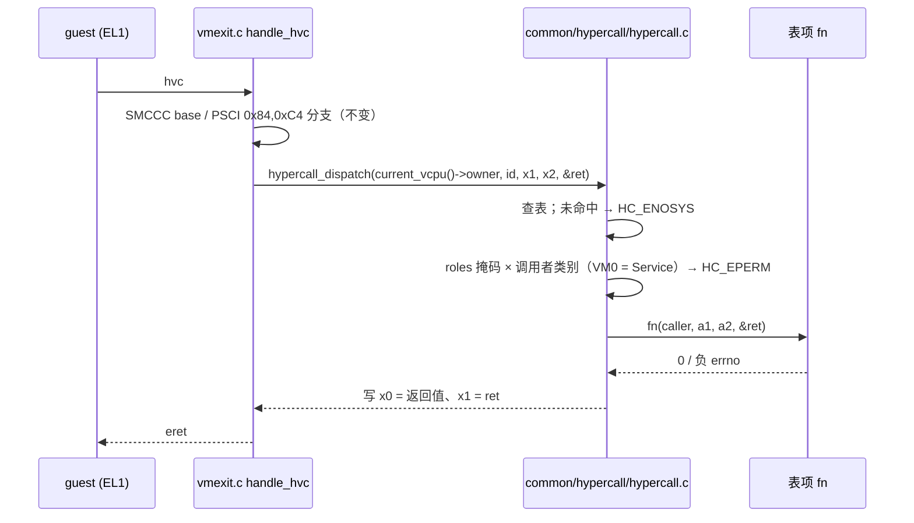

# HV-005 — Hypercall ABI（guest 调用 hypervisor 的正式接口）

> 2026-11-08。分支 `feature/hv005-hypercall-abi`（`c1f502c..`），线性合回 `dev`。
> 设计：[spec](../superpowers/specs/2026-11-08-hv005-hypercall-abi-design.md)；
> 决策：[ADR-0022](../adr/0022-hypercall-abi-vendor-range-table-dispatch.md)；
> 复验：[测试专家报告](../reports/2026-11-08-hv005-verification.md)。

## 是什么

在 HV-005 之前，guest 只能陷入 EL2 做三件事：PSCI（`smc/hvc 0x84/0xC4`）、两个 SMCCC
base 探测、以及测试专用的 `HC_GUEST_DONE`。现在多了一层**受管制的服务调用**：

| id | 名称 | 谁可调 | 参数 | 返回 |
|---|---|---|---|---|
| `0x87000000` | `HC_VERSION` | 任意 VM | — | `x1 = major<<16 \| minor`（当前 `0.1`） |
| `0x87000001` | `HC_GUEST_DONE` | 任意 VM | `x1` 诊断值 | 不返回（测试用，行为未变） |
| `0x87000100` | `HC_VM_QUERY` | 查自己：任意；查他人：仅 VM0 | `x1 = vmid` | `x1 = vmid① \| service<<16 \| online_vcpus<<17` |

失败一律负 errno：`HC_EINVAL -1`、`HC_EPERM -2`、`HC_ENOSYS -3`（未知 id）、
`HC_ENODEV -4`（vmid 不存在）。

## 怎么用

guest 侧（`tests/svm/cases/hcall.c` 是完整例子）：

```c
register u64 id asm("x0") = HC_VERSION;
register u64 a1 asm("x1") = 0;
__asm__ volatile("hvc #0" : "+r"(id), "+r"(a1) :: "memory");
/* id == 0 成功；失败时 id 是负 errno */
```

自识别（同一份二进制跑不同 VM）：

```c
/* 非 Service VM 的答案集只有自己；Service VM 的是全体，所以 VM0 取最小 id 即 0 */
id = HC_VM_QUERY; a1 = 0; hvc #0;      /* 0 号（自己）；越权时 a1 任意他人 vmid → -2 */
```

运行门禁：

```sh
make test-qemu-hcall     # 双 VM hypercall 场景，约 10 s
```

## 怎么工作



三条不可违反的约定（改代码前先读 ADR-0022）：

1. **身份只来自 `current_vcpu()->owner`**：任何从 `x1..x5` 取调用者的写法都是安全 bug。
2. **id 只增不改**：`HC_GUEST_DONE` 仍是 `0x87000001`；返回字只能追加高位。
3. **分发在 generic**：`hypercall.c` 不包含任何 arch 头，所以 host 可测、x86 将来只换入口
   （VMCALL）。

"查自己 vs 查他人"这种**依赖参数**的权限检查放在处理函数里（表项 `roles` 只能表达
调用者类别）；这是设计允许的两个权限位置，审阅时要盯住。

## 怎么验证

| 检查 | 结果 |
|---|---|
| `make host-test` | 新增 `hypercall PASS (35 assertions)`；其余三套不变 |
| `make clean && make test` | 4 静态检查 + **12/12** 场景（新增 `hcall`），0 告警 |
| `make test-qemu-hcall` ×5 | 5/5 `ALL PASS`（双 VM 输出错峰 100 ms / 800 ms） |
| `make test-linux` ×2 | 回归绿（调度/定时器未受影响） |
| 承重反证 | 删 EPERM 判断 → host 与 hcall 双红；`HC_GUEST_DONE` 改一位 → 10 个 SVM 场景集体红；arch 号段掩码改一位 → hcall 红 |
| 对抗性 | vmid 越界/截断别名全部 `-4`；身份伪造被 `current_vcpu()` 挡住 |

## 已知边界

- ABI 只有 test-guest 消费者；minor 兼容不承诺。
- `HC_VM_QUERY` 报的是**派生态**（"至少一个 vCPU 没 OFF"），不是 VM 级状态；真正的
  CREATED/PAUSED/DESTROYED 随 HV-004 落地后**追加位**。
- 只支持 32 位调用约定的 `0x87` 号段；64 位私有段（`0xC7…`）未接。
- `HC_VM_QUERY` 的 `EPERM`/`ENODEV` 差别会让 guest 探出 VM 个数（自识别协议依赖它）。
- `HC_GUEST_DONE` 无权限门，接真实 guest 前必须放到测试配置门后（ADR-0022 已记）。
