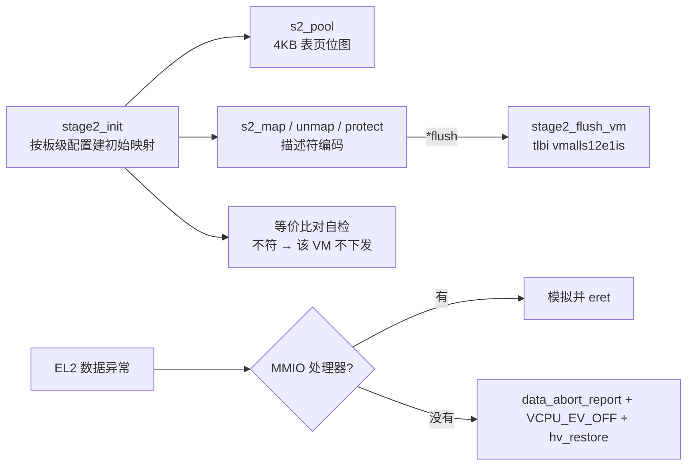

# HV-011/012 第一刀 — Stage-2 表分配器与 fault 闭环

> 2026-11-08。分支 `feature/hv011-s2-tables`（`03232ad..`），线性合回 `dev`。
> 设计：[spec](../superpowers/specs/2026-11-08-hv011-stage2-allocator-design.md)；
> 计划：[plan](../superpowers/plans/2026-11-08-hv011-stage2-allocator.md)；
> 决策：[ADR-0025](../adr/0025-stage2-allocator-and-vcpu-scoped-fault.md)；
> 复验：[测试专家报告](../reports/2026-11-08-hv011-verification.md)。

## 是什么

Stage-2 从"两张硬编码静态表"变成"表页池 + 映射 API"，并且**未处理的数据异常不再停 pCPU**，
只停出问题的那个 vCPU。

| 能力 | 之前 | 现在 |
|---|---|---|
| 建表 | `stage2.c` 里的静态数组与常量 | 4 KB 表页池 + `s2_map/unmap/protect`（host 可测） |
| 权限/属性 | `S2AP` 写死、Device/Normal 靠常量 | `S2_PROT_RO/RW`、`S2_XN`、属性选择器，`attr` 字全校验 |
| 初始映射 | 手写常量 | 用新 API 建 + **与旧值逐字节等价比对**（不符即该 VM 不下发） |
| 未映射 fault | `cpu_arch_halt()`（整核停死） | 打印 `[hv] s2 fault` + `VCPU_EV_OFF` + `hv_restore`（只停该 vCPU） |
| TLB | 无 | `tlbi vmalls12e1is` + `dsb ish`（保守全刷） |

## 怎么用

```sh
make host-test            # 新增 s2 table 用例（池/映射/权限/属性编码）
make test-qemu-s2fault    # 一个 guest 摸未映射 IPA，同核另一个 VM 必须仍活
```

代码里：

```c
/* 建一段 4 KB 页映射，返回是否需要刷 TLB */
bool flush = false;
rc = s2_map(root, &pool, ipa, pa, len, S2_ATTR_NORMAL_WB | S2_PROT_RO | S2_XN, &flush);
if (flush) stage2_flush_vm(vmid);
```

## 怎么工作



三条要记住的：

1. **Stage-2 描述符自带 `MemAttr`，不读 `MAIR_EL2`**；`S2_ATTR_*` 是属性选择器不是 MAIR 槽号。
   （spec 原稿这条写错了，已按实测修订。）
2. **fault 只 park 该 vCPU**，同一条状态机边与 `CPU_OFF` 相同，之后可被 `CPU_ON` 复活；
   数据异常路径上不再有 `cpu_arch_halt()`。
3. **等价比对自检**是这次重构的安全网：初始映射必须与旧静态值逐字节一致，否则该 VM 建表失败
   并打印 `EQUIV FAIL`（pCPU 继续跑）。

## 怎么验证

| 检查 | 结果 |
|---|---|
| `make host-test` | 五套全绿，新增 `s2 table PASS (82 assertions)` |
| `make clean && make test` | 4 静态检查 + **13/13** 场景（新增 `s2fault`），0 告警 |
| `make test-qemu-s2fault` | `[hv] s2 fault: vCPU0 ipa=0x80000000 fsc=0x5` + `SVM: hello from VM1`（同核另一 VM 仍活） |
| `make test-linux` ×2 | `Linux XVM PASS`（Guest 内存视图未变） |
| 承重反证 | 换回 `cpu_arch_halt()` → VM1 banner 消失；改错一位描述符 → `EQUIV FAIL` 且 pCPU 继续跑；删池位图清理 → host 红 |

## 已知边界

- **属性正确性没有 gate**：QEMU 不建模内存属性（测试专家实测：把 `MAIR_EL2` 槽序改错照样
  启动），所以 `MemAttr/SH/XN` 只能靠描述符单测 + RK3588 真机。
- `s2_map` 中途失败**不回滚**（唯一调用者失败即弃 VM）；`*flush` 与 `stage2_flush_vm()`
  目前**没有运行期消费点**（启动期末尾无条件刷一次兜底）。
- RAM 仍静态（板级 `ram_pa`、1 GB 块），没有按页分配 guest 内存，也没有巨页拆分。
- fault 只 park，不报给用户态 DM（`io_req` 未落地）。
