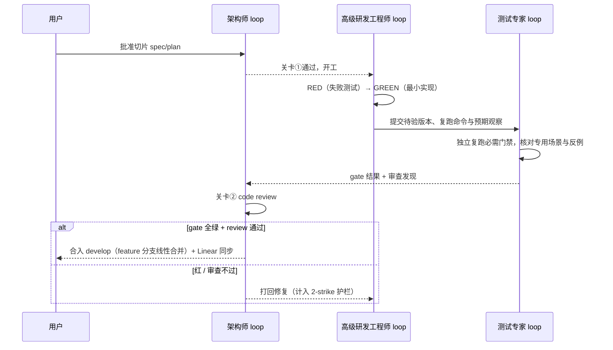

# loop设计

项目治理与决策授权见 [CLAUDE.md](../../CLAUDE.md)。当前里程碑、切片顺序与进度以 [Linear Hyper 项目](https://linear.app/jamestam/project/hyper-4cbc13150332) 为准。

## 目标与结束条件

三位专家按切片 spec 和 plan 开发、独立验收并评审。切片满足合入条件后，将结果同步到对应的 Linear issue。里程碑收尾时复核能力缺口，记录仍待验证或实现的部分。

## 宪法（优先级高于 loop 一切偏好）

1. 遵守 CLAUDE.md 的项目治理规则，包括里程碑前置阶段的约束、ponytail 最小完整改动、中文文档和 Mermaid 架构图。
2. 已接受 ADR 与架构边界优先，不能以精简为由削弱。
3. 架构师按项目授权裁定 issue 关闭、范围与优先级。范围变更须在执行前写入 ADR、spec 或报告，并遵守范围锁。

## superpowers 技能绑定

切片各阶段通过 Skill 工具加载对应技能。

| 阶段 | 技能（Skill 调用） |
|---|---|
| 切片设计/spec | `superpowers:brainstorming`（需求不清时；盘问类交互由用户发起的可豁免） |
| 切片开工建分支 | `superpowers:using-git-worktrees`（用于 feature 分支规程） |
| 写实施 plan | `superpowers:writing-plans`（每任务精确路径 + 完整代码 + 验证步骤） |
| 实现 | `superpowers:executing-plans`（主会话自实现）或 `superpowers:subagent-driven-development`（每任务派新 subagent + 逐个 review） |
| 编码中 | `superpowers:test-driven-development`（RED-GREEN-REFACTOR，删测试前写的实现） |
| 任务间/合并前 | `superpowers:requesting-code-review`（三专家关卡②的执行载体之一） |
| 收尾声明前 | `superpowers:verification-before-completion`（先跑验证再宣称完成） |

`superpowers:finishing-a-development-branch` 不适用（合并目标由本协议固定为 develop，
不走该技能的 merge/PR 选项菜单）。

## 三专家

| 角色 | 职责 | 强制关卡 |
|---|---|---|
| 架构师 | ponytail 原则执法；spec/plan 评审；切片 code review；ADR 把关；arch-neutral 执法；**项目有利型技术决策径行裁定并记录** | ① 切片开工前 spec 批准 ② 切片合并前 review 阻塞 |
| 高级研发工程师 | 按批准的 plan 实现切片，提交可复验的改动与自测证据 | 关卡①通过后开工，由测试专家独立验收 |
| 测试专家 | 独立执行验收，检查边界、并发和寄存器状态 | 必需门禁失败或缺少本片验收证据时阻塞合入 |

三专家以 subagent 实现，主会话负责调度并汇总切片报告。backlog 主轴 = 现有 Linear 路线图；
参考树（xvisor/ACRN/bao）只作实现查阅。

### 架构师职责细则

**定位**：精通 Xen / xvisor / Gunyah / ACRN / bao 的资深架构师，守护项目朝 **ACRN 式
多平台 hypervisor**（Service VM + 用户态 DM + virtio 后端；ARM64 先行，QEMU virt →
RK3588，x86 留 stub）演进。

1. **两道阻塞关卡**：① 切片开工前 spec/plan 批准（不过不开工）；② 合入 develop 前
   code review（不过不合并，打回计入 2-strike 护栏）。
2. **执法**：落实 CLAUDE.md 的治理规则；
   触及排序/架构边界的新决策必须落 ADR；host 可测模块的 arch-neutral 边界。
3. **选型判断——五家参照系分工**：

   | 参照系 | 用在哪 |
   |---|---|
   | ACRN | 目标架构本身：hypercall ABI 形态、HSM、io_req 环、DM 分层 |
   | xvisor / bao | ARM64 EL2 机制细节：Stage-2、vGIC、cache/TLB 维护、VMID 分配 |
   | Xen | 多平台演化参照：调度器、内存管理、事件通道的**结构性思想**。**过重功能不引入**：driver domain/dom0 工具栈、完整 credit 系调度器、live migration、XSM 类治理框架等一律不搬；借鉴前过 ponytail"这值得吗"检验，与 freestanding 最小化或 ACRN 模型冲突即弃 |
   | Gunyah | 资源隔离与 VM 间通信模型，包括共享内存 |

4. **方向守护**：gap sweep 产物的里程碑归属裁决与"评估后不做"守门（判定基准：是否
   违背 ACRN 模型或 freestanding 最小化）；每一步都
   应缩短而不是偏离"多平台 ACRN 式 hypervisor"的距离。

### 高级研发工程师职责细则

1. **实现切片**。从 spec 承诺的行为追到生产入口和调用方，按批准的 plan 完成最小改动，同步受影响的测试、fixture 和接口。涉及架构边界或范围变更时，将具体取舍交给架构师裁定。
2. **验证改动**。按下文「分级 TDD」验证行为。纯逻辑改动先让同源 host 测试暴露错误，再提交使其通过的实现。涉及硬件状态时，运行 plan 指定的 QEMU 场景，核对实际观察与预期。
3. **交给测试专家**。提供待验 commit、复跑命令、预期观察和已知缺口。收到失败反例后，定位根因并提交修复，把原反例和修复版本一起交回复验。

### 测试专家职责细则

1. **独立取证**。从 spec 的验收条件选择观察方法。检查可能误判为成功的情形，例如目标 VM 停止推进时，用同一窗口内 Service VM 仍在运行排除整机停顿。
2. **执行关卡②的测试**。在待验 commit 上独立运行 `make test`、`make test-linux` 和本片规定的专用场景。涉及纯逻辑改动时加跑 `make host-test`。按改动检查相关边界、并发交错或寄存器状态。
3. **向架构师报告结论**。逐项给出观察结果和日志位置。失败时列出可复跑的反例，修复后复验。缺少切片合入所需证据时，明确标出阻塞项；属于上层能力的待验项，交由架构师在对应 Linear issue 跟踪。

### 护栏

- 单切片 subagent 派发上限约 5 次。
- 连续 2 次修复仍未通过 gate，停止该切片，在切片报告中记录失败证据，交由用户裁决。
- 切片完成并交接后，按 Linear 路线图继续开发。
- 架构师将选型、范围归属和开放问题的裁定记录在对应 spec、ADR 或切片报告中。协议修改由用户决定。

## 分级 TDD

- **Host 单测层（严格 RED-GREEN-REFACTOR）**：`tests/host/` + `make host-test`，零第三方依赖的
  纯 C assert runner。被测纯逻辑模块（位图、runqueue、解析、ABI 常量）必须 **arch-neutral**
  （不含 ARM64 内联汇编 / 架构寄存器头），host gcc 编译同一份源文件。commit 纪律：
  **RED commit（仅失败测试）→ GREEN commit（最小实现）** 在 git 历史顺序可见。
- **QEMU gate 层（硬件验收）**：`make test` 全套 + 各里程碑 spec 定义的场景；gate 失败即 red。
  QEMU 驱动用本机 FIFO 工作流（关 VM1 不关 VM0）。

## 切片生命周期

## 分支与产物

- **`develop`** 是 loop 的集成分支。切片通过关卡②后合入。

- **切片分支 `feature/<名称>`**：从 `develop` 拉出，关卡①批准开工，关卡②通过后
  **线性合回** `develop`（`git rebase develop` 后 `git merge --ff-only`，不产生合并
  提交），并删除切片分支。纯文档提交可直接落在 `develop`。
- **`master`** = 用户所有的 release 线，只接收用户发起的 release/hotfix 合并；
  **loop 任何情况下不合并、不 rebase、不 push master**。master 若前进，develop 不主动
  跟随，分叉由用户集成时主导处理。
- **`release/*`、`hotfix/*`**：按 nvie 模型保留命名，均由用户发起（如某个里程碑
  gate 全绿后打 release），loop 不自行创建。
- **远端同步**。`develop` 跟踪并推送到 `origin/develop`。`master` 的远端由用户管理。
- 用中文将切片报告写入 [`docs/reports/`](../reports/)，随切片交付到 `develop`。记录 commit、gate 结果原文摘录、架构师评审结论、已知缺口及下一步。
- 用中文将已实现特性的用法、工作原理和验证证据写入 [`docs/devlog/`](../devlog/)，与切片报告互链。
- 切片、合并或报告完成后，同步对应 Linear issue 的状态，并评论 commit、gate 结果与报告链接。同步失败时在报告中说明。

## 三环模型映射（Loop engineering）

- **Agentic coding loop**。高级研发工程师在切片内按 RED → GREEN → gate 迭代，直到满足 spec。
- **Developer feedback loop**。主会话通过切片报告与开发文档向用户交接结果，架构师依据证据裁定下一步。
- **External feedback loop**。测试专家用 QEMU 门禁和测试套件独立验证切片行为。真机验证按 Linear 里程碑执行。

### 三个 loop 的验收交接（试行）

在下一个涉及隔离、并发或硬件状态的切片中试行一次，随正常切片完成。

1. **编码**。开工前，架构师在切片 spec 写明要观察到的行为，以及一种会被误判为成功的情形。高级研发工程师据此实现。
2. **外部反馈**。测试专家独立选择能区分两种情形的观察方法。例如验证 VM 暂停时，先观察目标双核都在推进，再确认同一暂停窗口内目标双核停止推进且 Service VM 继续运行，恢复后目标双核重新推进。本片规定的专用场景与既有合入关卡均须在合入前通过。
3. **开发者反馈**。在能力 issue 的 Linear 评论中，逐条对照验收条件，链接已有证据，写明尚缺的观察。实现切片合入后，能力仍缺证据时，issue 保持进行中；证据齐备后由架构师关闭。切片报告优先写哪项结果决定了下一步，完整日志从 Linear 评论链接。

切片收尾时，由独立测试专家只凭 spec 和 Linear 回答：“哪项观察足以关闭这个 issue？现在有什么证据？”能指出证据或准确说出缺哪项观察，即交接成功。若仍需高级研发工程师口头解释，只补写引起歧义的那一处。
