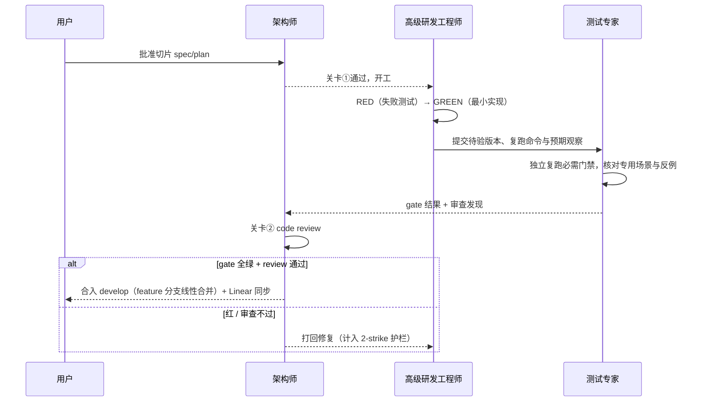

# Delivery Loop：功能交付协议

> 共同治理、专家职责、双关卡、护栏、分支规则与调度节奏见 [README.md](README.md)；
> 项目治理与决策授权见 [CLAUDE.md](../../CLAUDE.md)。本协议不替代共同规则。

## superpowers 技能绑定

切片各阶段通过 Skill 工具加载对应技能。

| 阶段 | 技能（Skill 调用） |
|---|---|
| 切片设计/spec | `superpowers:brainstorming`（需求不清时；盘问类交互由用户发起的可豁免） |
| 切片开工建分支 | `superpowers:using-git-worktrees`（用于 feature 分支规程） |
| 写实施 plan | `superpowers:writing-plans`（每任务精确路径 + 完整代码 + 验证步骤） |
| 实现 | `superpowers:executing-plans`（主会话自实现）或 `superpowers:subagent-driven-development`（每任务派新 subagent + 逐个 review） |
| 编码中 | `superpowers:test-driven-development`（RED-GREEN-REFACTOR，删测试前写的实现） |
| 任务间/合并前 | `superpowers:requesting-code-review`（三专家关卡②的执行载体之一） |
| 收尾声明前 | `superpowers:verification-before-completion`（先跑验证再宣称完成） |

`superpowers:finishing-a-development-branch` 不适用（合并目标由本协议固定为 develop，
不走该技能的 merge/PR 选项菜单）。

## 分级 TDD

- **Host 单测层（严格 RED-GREEN-REFACTOR）**：`tests/host/` + `make host-test`，零第三方依赖的
  纯 C assert runner。被测纯逻辑模块（位图、runqueue、解析、ABI 常量）必须 **arch-neutral**
  （不含 ARM64 内联汇编 / 架构寄存器头），host gcc 编译同一份源文件。commit 纪律：
  **RED commit（仅失败测试）→ GREEN commit（最小实现）** 在 git 历史顺序可见。
- **QEMU gate 层（硬件验收）**：`make test` 全套 + 各里程碑 spec 定义的场景；gate 失败即 red。
  QEMU 驱动用本机 FIFO 工作流（关 VM1 不关 VM0）。

## Delivery Loop：切片生命周期

## Delivery Loop：增量执行规则

沿用 [共同治理与三专家协议](README.md)、双阻塞关卡、本文件分级 TDD 和切片生命周期，以及共同分支协议。额外约定：

- 开工前在现有 spec/plan 明确目标、非目标、验收行为、可能的假阳性及必需 gate；不另造任务文件。
- 每个切片使用独立工作上下文，交接后新切片从 CLAUDE.md、CONTEXT.md、Linear、相关 ADR/spec/plan 和必要报告恢复，不继承全部聊天历史。
- 测试专家从待验 commit 独立取证，记录 commit、命令、环境（包括适用的镜像与工具版本）、结果、日志位置和未运行项。研发自测不能替代独立验收。
- 合入前确认验收和 review 对应最终提交。rebase 或代码变化后重新评审差异并复跑必需 gate；不得复用与最终版本不匹配的通过结论。
- 区分「切片可合入」与「能力可关闭」。上层能力缺证据则 Linear issue 继续进行；本片必需证据缺失则不得合入。
- 当前切片内的失败仍由 Delivery 修复，遵守原有约 5 次派发及 2-strike 护栏；不得通过转入 Quality 重置预算或绕开阻塞。

## 三类反馈的验收交接（试行）

在下一个涉及隔离、并发或硬件状态的切片中试行一次，随正常切片完成。

1. **编码**。开工前，架构师在切片 spec 写明要观察到的行为，以及一种会被误判为成功的情形。高级研发工程师据此实现。
2. **外部反馈**。测试专家独立选择能区分两种情形的观察方法。例如验证 VM 暂停时，先观察目标双核都在推进，再确认同一暂停窗口内目标双核停止推进且 Service VM 继续运行，恢复后目标双核重新推进。本片规定的专用场景与既有合入关卡均须在合入前通过。
3. **开发者反馈**。在能力 issue 的 Linear 评论中，逐条对照验收条件，链接已有证据，写明尚缺的观察。实现切片合入后，能力仍缺证据时，issue 保持进行中；证据齐备后由架构师关闭。切片报告优先写哪项结果决定了下一步，完整日志从 Linear 评论链接。

切片收尾时，由独立测试专家只凭 spec 和 Linear 回答：“哪项观察足以关闭这个 issue？现在有什么证据？”能指出证据或准确说出缺哪项观察，即交接成功。若仍需高级研发工程师口头解释，只补写引起歧义的那一处。

## 与其他闭环的交接

当前切片内失败仍按本协议修复，不重置重试预算。跨切片缺陷与非阻塞验证缺口交 [Quality Loop](quality.md) 裁定；重复流程失败与 Harness 瓶颈交 [Evolution Loop](evolution.md) 复盘。
