我建议将你的三环模型与我提出的三环模型结合起来，但**不是将三个 Loop 增加到六个 Loop，而是重新区分反馈机制、执行角色和工程生命周期。**

你的原始设计解决的是：**AI 如何开发、如何获得外部反馈、如何向开发者反馈。**

我提出的设计解决的是：**如何持续交付功能、如何保证工程质量、如何让研发系统自身持续进化。**

两者并不冲突，而是处于不同的抽象层次。

我倾向于保留你的三专家机制，将其作为执行层；将 Delivery、Quality、Evolution 三个不同频率的 Loop 作为工程控制层。

## **一、Hypervisor Loop 3.0 总体架构**

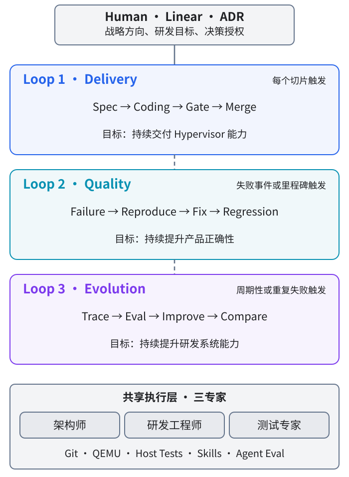

这里有一个非常重要的变化：**一个 Agent 角色不再等于一个 Loop。**

架构师、研发工程师、测试专家都可以参与不同的 Loop，但每个 Loop 的优化目标、触发条件和结束条件必须不同。

## **二、如何融合你原有的三个 Loop**

我重新考虑了你在 [`docs/loop/README.md`](https://github.com/James7zy/hypervisor/blob/develop/docs/loop/README.md?utm_source=chatgpt.com) 中定义的三环模型。

我的建议是将它们作为贯穿三个工程 Loop 的反馈通道，而不是三个相互独立的任务执行器。

| 你原有的 Loop               | 新架构中的定位                      | 是否保留  |
| ----------------------- | ---------------------------- | ----- |
| Agentic Coding Loop     | Delivery、Quality 中的代码实现与迭代机制 | 完整保留  |
| Developer Feedback Loop | 三个 Loop 共用的人机反馈与决策机制         | 完整保留  |
| External Feedback Loop  | 三个 Loop 共用的独立验证机制            | 完整保留  |
| Delivery Loop           | 面向产品功能交付                     | 新增控制层 |
| Quality Loop            | 面向产品缺陷和验证能力                  | 新增控制层 |
| Evolution Loop          | 面向 AI 研发系统自身优化               | 新增控制层 |

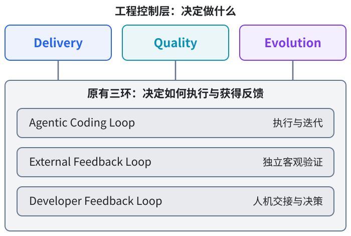

这是我认为最适合你当前项目的融合方式。原有设计不用推翻，也不需要额外增加三个常驻 Agent。

## **三、Loop 1：Delivery Loop（功能交付闭环）**

主循环

高频 · 每个切片执行

这是你 Hypervisor 项目的主要研发驱动力，负责推进 ACRN 式多平台 Hypervisor 的路线图。

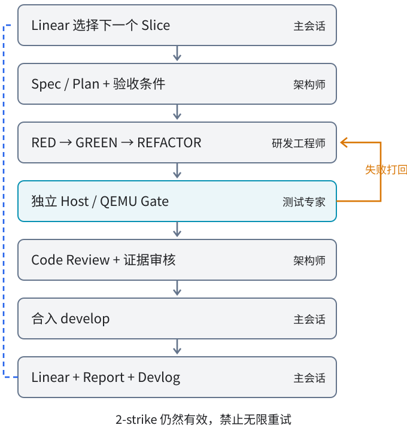

你现有的切片生命周期基本可以直接作为 Delivery Loop，不需要大改。

### **我建议增加三个机制**

| 机制                | 现有设计                 | 优化建议                                        |
| ----------------- | -------------------- | ------------------------------------------- |
| Context Reset     | 每个 Task 可派发 Subagent | 每个切片完成后清理临时上下文，只继承必要证据                      |
| Evidence Contract | Spec、报告、日志           | 开工前明确行为、反例、验收条件及证据格式                        |
| Commit Binding    | 提交待验版本               | 所有 Gate 和 Review 绑定最终合入版本，rebase 后重新验证受影响项目 |

尤其是 Context Reset，借鉴 Ralph Wiggum 的思想：

每完成一个切片，下一个切片的 Agent 不需要继承之前所有的对话，只需要读取以下信息：

```
CLAUDE.md
CONTEXT.md
当前 Linear Issue
当前 Spec / Plan
相关 ADR
上一切片的交接报告
```

Git 和 Linear 是长期状态，对话 Context 是临时运行状态。

## **四、Loop 2：Quality Loop（工程质量闭环）**

事件驱动

中频 · 缺陷、回归或里程碑触发

你的 External Feedback Loop 已经能够在切片内部独立验收。但我认为，还需要一个不完全依附于当前功能切片的质量闭环。

区别在于：

**Delivery Loop 验证本次功能能不能交付，Quality Loop 研究整个系统还有哪些正确性问题。**

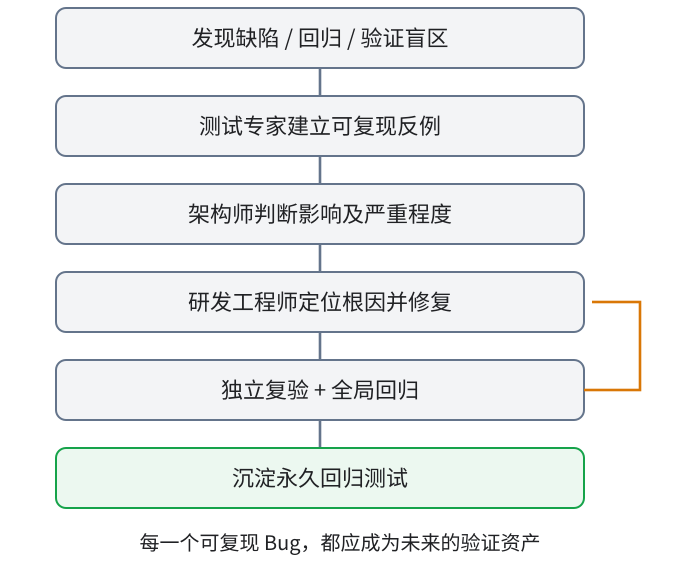

### **Quality Loop 的任务分类**

| 类型     | 具体例子                   | 处理方式                 |
| ------ | ---------------------- | -------------------- |
| 当前切片失败 | 新增 PSCI 接口返回错误         | Delivery 内修复，不另起任务   |
| 历史回归   | 新调度器破坏 vTimer 行为       | Quality Loop 或阻塞当前切片 |
| 并发缺陷   | vCPU 状态竞争              | 建立可重复的并发场景           |
| 架构违规   | Generic 代码直接访问 ARM 寄存器 | 修复并强化架构检查            |
| 测试假阳性  | VM 暂停实际是整个系统停顿         | 强化验证方法               |
| 历史技术债  | 某些寄存器状态未被覆盖            | 记录 Linear，按优先级执行     |

### **结合你的 Hypervisor 设计，增加主动质量发现**

目前测试专家的主要职责是验证研发工程师交付的代码。

我建议在 Quality Loop 中，让测试专家进一步扮演 **Adversarial Tester（对抗性测试专家）**。

例如，针对虚拟化子系统主动研究以下场景：

| 子系统          | 主动探索方向                         |
| ------------ | ------------------------------ |
| Stage-2      | 非法 IPA、越界映射、权限错误、TLBI          |
| vGIC         | 重复注入、Pending/Active 状态竞争、LR 耗尽 |
| Scheduler    | 饥饿、重复入队、vCPU 状态转换竞争            |
| PSCI         | 重复 CPU_ON、非法参数、并发 OFF/ON       |
| VM Lifecycle | VM 暂停、销毁、恢复时的竞态                |
| vTimer       | 切换后丢失中断、重复中断、时间异常              |
| VM Isolation | 跨 VM 内存访问、状态泄漏                 |

这些问题不应该全部塞进 Delivery Loop，否则又会造成你之前经历过的里程碑前置任务不断扩张的问题。

Quality Loop 的发现进入 Linear，由架构师判断是否阻塞主线。

## **五、Loop 3：Evolution Loop（研发系统进化闭环）**

元循环

低频 · 周期性或重复失败触发

这是我最建议你新增的 Loop，也是你原有设计中值得进一步强化的部分。

前两个 Loop 的工作对象是 Hypervisor，第三个 Loop 的工作对象是 **开发 Hypervisor 的 AI 工程系统本身**。

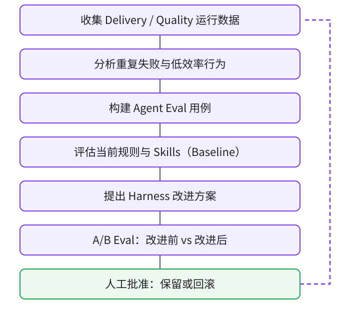

### **Evolution Loop 可以优化什么？**

| 观察到的工程问题           | 进化对象                 |
| ------------------ | -------------------- |
| Agent 经常违反架构边界     | AGENTS.md、静态检查器      |
| Agent 经常过度设计       | Ponytail 规则、克制类 Eval |
| 测试专家只重复研发自测        | 独立验收协议               |
| 架构师重复 Review 同一问题  | 自动化 Lint 和架构规则       |
| Agent 消耗大量 Context | 知识索引、交接机制            |
| Agent 经常虚假完成任务     | Evidence Contract    |
| Superpowers 流程过重   | Skill 触发条件与裁剪        |
| Subagent 派发次数过多    | 调度策略、任务粒度            |
| 三个专家重复阅读源码         | 共享证据、精简交接            |

### **一个具体的进化实验**

假设连续几个切片中，研发工程师都直接在 Generic 模块读取 ARM64 系统寄存器。

传统处理方式是让架构师每次 Review 时指出问题。

Evolution Loop 则会进行以下工作：

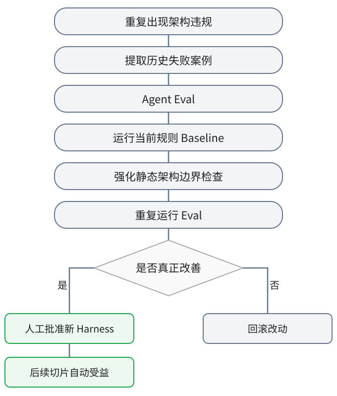

你的仓库已经存在 [`tests/agent-eval/cases.md`](https://github.com/James7zy/hypervisor/blob/develop/tests/agent-eval/cases.md?utm_source=chatgpt.com)，因此完全可以把它作为 Evolution Loop 的基础。

但不要让 Evolution Loop 自己修改评分标准后宣布成功。协议、验收标准和评分器的变更仍然需要你的批准，这也符合你原有的项目授权设计。

## **六、三个 Loop 应该以不同频率运行**

这是整个架构设计的核心。

如果三个 Loop 每完成一个 Task 就全部运行，工程开销将非常大。

### **三环运行节奏示意**

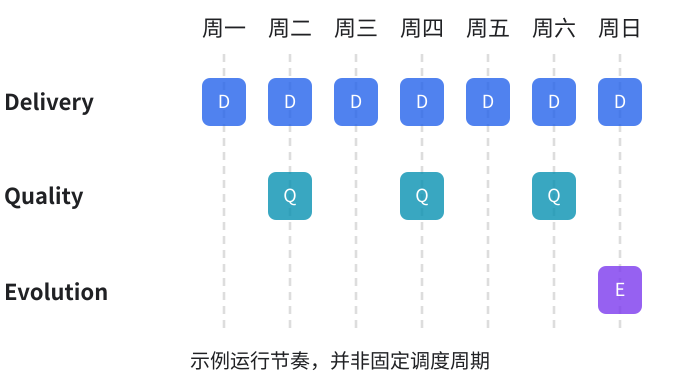

Delivery：每个研发切片

Quality：缺陷事件、里程碑验收

Evolution：每周或累计若干切片

**研发资源分配模拟**

初期建议将大部分研发资源用于产品功能，而不是 AI 系统建设。以下比例为建议值，可调整。

Delivery Loop

**75%**

Quality Loop

**20%**

Evolution Loop

**5%**

Delivery

Quality

Evolution

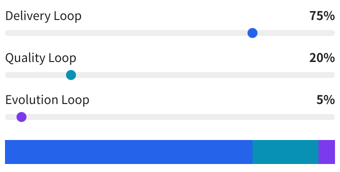

我建议初始资源分配采用 75% / 20% / 5%。不要因为研究 AI Loop，而让 Hypervisor 本身停止演进。

## **七、三个 Loop 如何协作：以 VM Pause 为例**

使用你原始文档中已经提到的 VM 暂停功能作为案例。

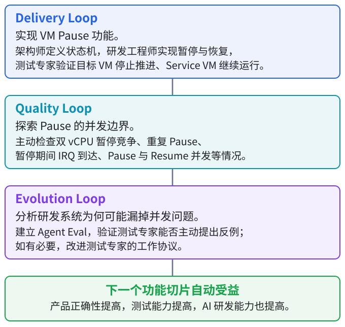

**Delivery Loop**

实现 VM Pause 功能。

架构师定义状态机，研发工程师实现暂停与恢复，测试专家验证目标 VM 停止推进、Service VM 继续运行。

**Quality Loop**

探索 Pause 的并发边界。

主动检查双 vCPU 暂停竞争、重复 Pause、暂停期间 IRQ 到达、Pause 与 Resume 并发等情况。

**Evolution Loop**

分析研发系统为何可能漏掉并发问题。

建立 Agent Eval，验证测试专家能否主动提出反例；如有必要，改进测试专家的工作协议。

**下一个功能切片自动受益**

产品正确性提高，测试能力提高，AI 研发能力也提高。

这是示例性的运行过程，并不是说你的仓库已经出现上述 Pause 缺陷。

最理想的结果是，经过几十个研发切片后，你不仅获得了一个功能越来越完善的 Hypervisor，也获得了一套越来越擅长 Hypervisor 开发的 AI 工程系统。

## **八、三个 Loop 必须有不同的评价标准**

| 评价指标           | Delivery | Quality | Evolution |
| -------------- | -------- | ------- | --------- |
| 切片交付周期         | ✓        |         |           |
| 首次 Gate 通过率    | ✓        |         |           |
| 人工干预次数         | ✓        |         | ✓         |
| 逃逸缺陷数量         |          | ✓       |           |
| 测试假阳性          |          | ✓       |           |
| 回归测试稳定性        |          | ✓       |           |
| Agent Eval 通过率 |          |         | ✓         |
| 架构违规率          | ✓        |         | ✓         |
| Token 消耗       | ✓        |         | ✓         |
| 重复失败率          |          | ✓       | ✓         |

不要使用代码行数、Commit 数量或者 Agent 执行次数作为主要研发效率指标。

对你的项目而言，最重要的三个指标是：

**Delivery**

单位时间交付的已验收能力

**Quality**

缺陷逃逸率与验证可信度

**Evolution**

同类任务所需人工干预的下降幅度

## **九、我建议如何修改你的仓库**

遵循你自己制定的 Ponytail 原则，我不建议现在就引入 Python Orchestrator、复杂的状态机框架或新的 Multi-Agent 框架。

先修改协议，再通过真实切片验证协议的有效性。

```
hypervisor/
├── CLAUDE.md
├── AGENTS.md
├── CONTEXT.md
│
├── docs/
│   ├── loop/
│   │   ├── README.md       # 总体治理、三环模型
│   │   ├── delivery.md     # 功能交付协议
│   │   ├── quality.md      # 工程质量协议
│   │   └── evolution.md    # 研发系统进化协议
│   │
│   ├── adr/
│   ├── reports/
│   ├── devlog/
│   └── superpowers/
│
├── tests/
│   ├── host/
│   ├── svm/
│   └── agent-eval/
│
└── scripts/
```

以上是建议的目标布局。初期甚至不必拆分四个文件，可以先在现有 `docs/loop/README.md` 中增加三个章节，等协议真正复杂到需要拆分时再拆。

### **建议实施顺序**

1

**保留现有三专家切片协议**

将其归属于 Delivery Loop，现有功能开发流程基本不变。

2

**建立 Quality Loop**

先在 Linear 中区分功能任务、质量任务和验证缺口，使用已有测试工具执行。

3

**建立 Evolution Loop**

从已有 Agent Eval 用例中选择 3–5 个有代表性的用例，记录 Baseline。

4

**实际运行若干切片**

观察交付周期、失败次数、人工介入和重复问题。

5

**只自动化被证明存在的瓶颈**

如果手动调度、状态恢复或证据管理确实成为瓶颈，再开发专门的 Loop 执行器。

## **十、进一步的设计：双向进化**

从长期来看，我希望你的 Hypervisor 项目可以形成两条相互促进的演进路径。

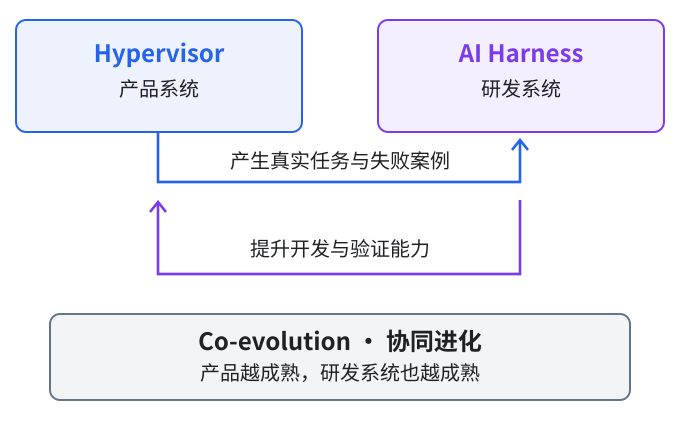

| 演进对象       | 主要优化目标          | 验证机制               |
| ---------- | --------------- | ------------------ |
| Hypervisor | 功能、正确性、性能、隔离性   | Host、QEMU、真机       |
| AI Harness | 自主性、准确性、效率、约束遵守 | Agent Eval         |
| 人类开发者      | 架构理解、技术判断、工程知识  | Review、Devlog、技术决策 |

对于你这个研究型 Type-1 Hypervisor 项目，第三行也非常重要。不能让 AI 交付能力越来越强，而你自己对底层实现的理解越来越弱。

因此，你原有的 Developer Feedback Loop 应当继续保留技术原理、架构取舍和验证证据的交接职责，而不是只向你报告任务完成。

## **最终建议**

我会把你的整个系统定义为：

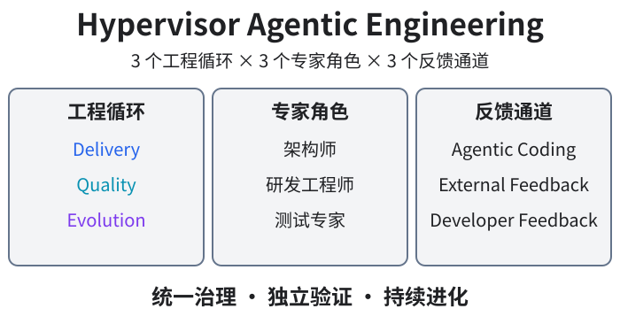

# **Hypervisor Agentic Engineering**

3 个工程循环 × 3 个专家角色 × 3 个反馈通道

**工程循环**

Delivery

Quality

Evolution

**专家角色**

架构师

研发工程师

测试专家

**反馈通道**

Agentic Coding

External Feedback

Developer Feedback

统一治理 · 独立验证 · 持续进化

我最推荐的不是增加 Agent 数量，而是**让三个工程循环分别优化产品交付、产品质量和研发系统能力**。

这次方案基于已经读取的 `develop` 分支原始 Loop 协议进行架构推演，新增的三层划分、资源比例和运行频率均属于我的设计建议，尚未经过你项目的实际运行数据验证，也没有修改仓库。

如果要选择一个最有价值的突破口，我会选择 Evolution Loop。因为你的 Delivery Loop 已经有了相当完整的设计，而 Evolution Loop 可以让这套设计不再停留在静态的 Markdown 协议上，而是逐渐成为一个能够通过客观反馈持续改善自身的研发系统。