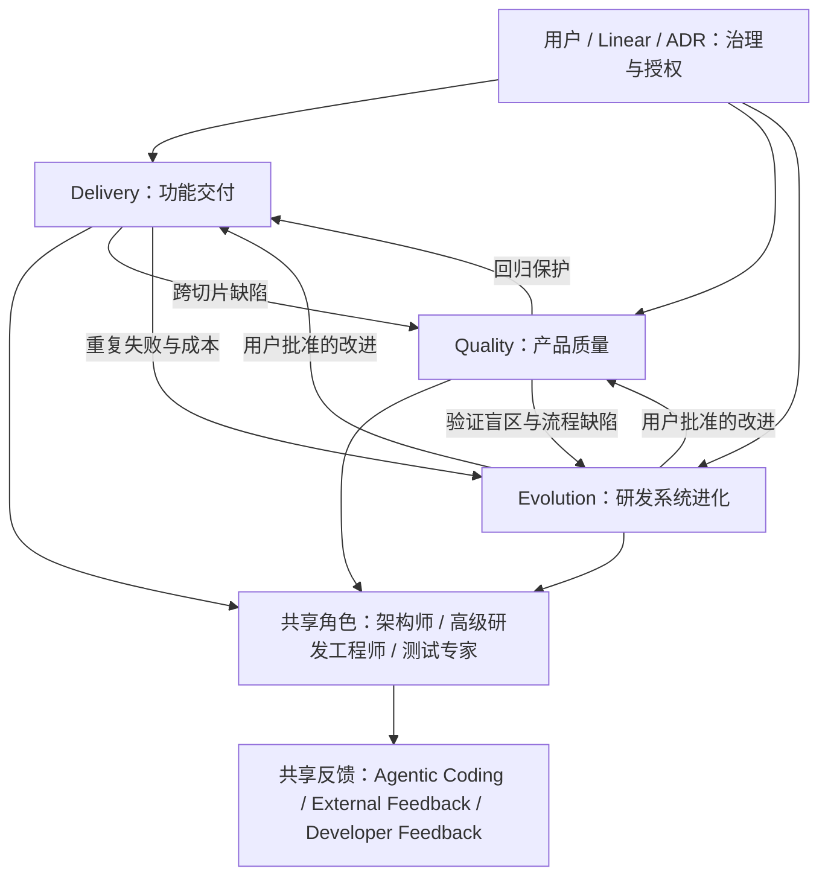
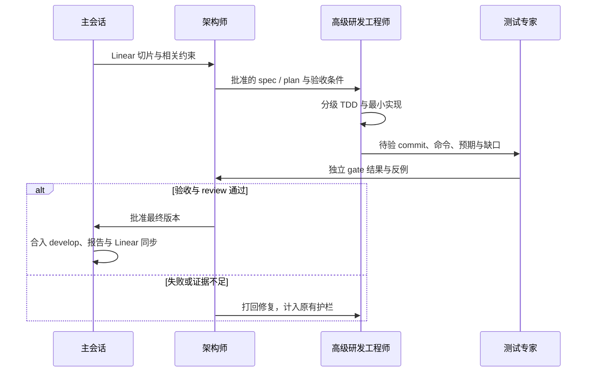
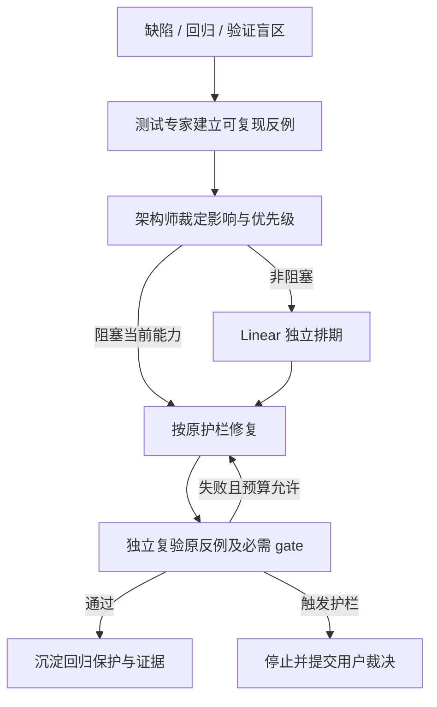
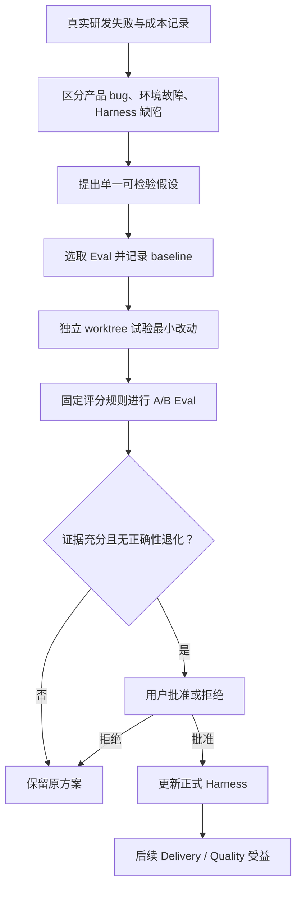
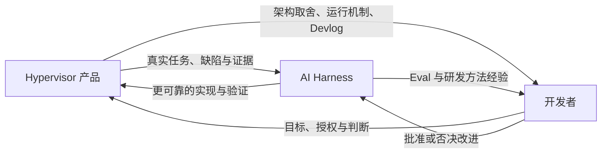

# Hypervisor Loop Engineering：三环融合设计分析

> 2026-11-27 · 设计讨论归档。本文解释设计动机、取舍和实施建议，不是第二份执行协议。
> 正式规则以 [Loop Engineering 设计](README.md) 和 [CLAUDE.md](../../CLAUDE.md) 为准。
> 三环融合已通过用户批准并写入 [协议提交 3f66ce1](https://github.com/James7zy/hypervisor/commit/3f66ce1390a66481d3c7b7876fbc9b115483015d)；实际运行效果仍待验证。

## 1. 核心判断

不把原有三个 Loop 增加到六个执行器，而是区分反馈机制、执行角色与工程生命周期。

原有 Agentic Coding、Developer Feedback、External Feedback 回答 AI 如何开发、获取客观证据及向开发者反馈。新增 Delivery、Quality、Evolution 回答工程系统分别优化什么、何时启动以及何时结束。三专家是共享执行层，不是与三个工程闭环一一对应的常驻进程。

选择这一划分的原因是功能交付、缺陷修复和研发系统改进具有不同的目标、时间尺度和验收指标。若每个任务均运行所有流程，会产生重复审查、重复测试和上下文开销；若只有功能循环，又容易重复出现同类错误，无法形成研发系统自身的改进反馈。

## 2. 原设计如何复用

| 原有机制 | 新架构中的定位 |
|---|---|
| Agentic Coding Loop | 执行、测试、修正；主要用于 Delivery 与 Quality，也可用于 Evolution 的工具实验 |
| External Feedback Loop | Host、QEMU、真机及独立 Eval 提供外部可验证证据 |
| Developer Feedback Loop | 报告、Devlog、Linear 交接；架构取舍、用户授权和下一步决策 |
| 架构师 | 设计、范围、优先级、架构约束与合入审查 |
| 高级研发工程师 | 最小完整实现、复现与修复、候选工具改进 |
| 测试专家 | 独立取证、反例、回归与 Eval 评分 |

原有双阻塞关卡、分级 TDD、2-strike、约五次 subagent 派发、范围锁、Ponytail、feature → develop 线性合入以及 master 的用户所有权均保留。不能通过切换闭环重置重试预算或规避必需验收。

## 3. Delivery Loop：高频功能交付

目标是推进 ACRN 式多平台 Hypervisor 的能力路线图，现有切片生命周期基本可直接复用。

三项重点改进：

| 机制 | 为什么需要 | 落地方式 |
|---|---|---|
| Context Reset | 长会话累积无关上下文和历史假设 | 每片独立上下文，从 CLAUDE.md、CONTEXT.md、Linear、相关 ADR/spec/plan 和必要报告恢复 |
| Evidence Contract | 测试通过并不必然说明预期行为成立 | 开工时定义可观察行为、反例、必需 gate；记录命令、环境、日志、未验证项 |
| Commit Binding | rebase 或修订可能使旧证据失效 | Review 与 gate 对应最终合入版本，发生变化后复审并重跑必需 gate |

Git 与 Linear 保存长期状态，会话只保存临时状态。切片可合入不等于上层能力可关闭；能力证据缺失时保留进行中，本片必需证据缺失则阻塞合入。

## 4. Quality Loop：中频产品质量

Delivery 验证当前功能是否可以交付；Quality 关注跨切片缺陷、历史回归和验证盲区。它不是将每次失败重新包装成独立任务。

| 发现 | 归属 |
|---|---|
| 本片新 PSCI 接口错误 | Delivery 内修复 |
| 新调度器导致历史 vTimer 回归 | 阻塞本片，或由 Quality 独立处理非阻塞缺陷 |
| 并发或隔离盲区 | Quality 建立反例，架构师决定优先级 |
| 测试假阳性 | Quality 强化验证；若原因是 Agent 工作机制，再反馈 Evolution |
| 非阻塞技术债 | Linear 排期，不自动扩大当前范围 |

测试专家从被动验收扩展到有范围的主动反例探索：

| 子系统 | 探索方向 |
|---|---|
| Stage-2 | IPA 边界、权限、隔离、TLBI |
| vGIC | Pending/Active 竞态、重复注入、LR 耗尽 |
| Scheduler | 重复入队、饥饿、vCPU 状态竞态 |
| PSCI | 重复 CPU_ON、非法参数、并发 OFF/ON |
| VM Lifecycle | Pause/Resume/Destroy 交错 |
| vTimer | 切换时的丢失/重复中断与时间状态 |

以上均为候选测试方向，不代表已发现缺陷或已经排期。QEMU 适合功能验证，但不能直接证明真机内存序、硬件时序或性能。待验项按 Linear 跟踪。

## 5. Evolution Loop：低频研发系统进化

前两个闭环优化 Hypervisor，第三个闭环优化开发 Hypervisor 的系统：Agent、Skills、Rules、工具、上下文交接和 Harness。

| 观察到的模式 | 候选改进 |
|---|---|
| 重复违反 arch-neutral 边界 | CLAUDE.md、架构静态检查 |
| 过度设计 | Ponytail 与克制类 Eval |
| 测试专家只重复研发自测 | 独立取证协议与反例评估 |
| 架构师反复指出同类问题 | 可执行静态规则或 Lint |
| Context 消耗过大 | 精简交接与知识索引 |
| 无证据宣称完成 | Evidence Contract |
| Skills 流程过重 | 按风险和任务类型评估触发机制 |
| Subagent 派发过多 | 任务粒度及调度策略 |

现有 [Agent Eval 用例草案](../../tests/agent-eval/cases.md) 是起点，不必从零建设评测系统。例如 Generic 模块重复直接读取 ARM64 寄存器时，可先重放代表性的 shell-uptime、boot-gic-info 等任务，比较既有规则与强化静态检查后的行为。固定基线代码、模型版本、任务和预算，重复运行，并保留未用于调优的对照用例。评判实际代码状态、架构检查和运行证据，不评判 Agent 的自我陈述。

正确性、隔离和验收强度不得退化；测试专家独立评分，用户批准正式协议变更。不能让候选方案通过修改评分器或弱化测试证明自身有效。小样本结果不足以证明普遍提升，必须如实记录不确定性。

## 6. 调度：不同时间尺度，而非三个常驻 Agent

| 闭环 | 节奏 | 初始资源参考 | 优先目标 |
|---|---|---:|---|
| Delivery | 每个批准切片 | 75% | 持续交付已验收能力 |
| Quality | 缺陷事件、里程碑复核 | 20% | 缺陷不逃逸、反例与验证可信度 |
| Evolution | 低频复盘或同类失败重复出现 | 5% | 降低重复失败、人工介入与成本 |

比例仅为非阻塞工作初始参考，不是实测最优值或强制配额。正式协议试行重复失败两次，或每周/累计五片择一复盘；无明确瓶颈跳过。不启用独立后台循环。安全和正确性阻塞优先，架构师依照 Linear 裁定安排。避免复现过去前置任务不断扩张、主线停滞的问题。

## 7. 贯穿示例：VM Pause

以下是设计示例，不是已发现的实际缺陷或运行报告。

| 闭环 | 工作 | 证据 |
|---|---|---|
| Delivery | 实现 VM 暂停、恢复及必要状态转换 | 暂停前目标双核均推进，暂停窗口内双核停止而 Service VM 继续推进，恢复后双核重新推进 |
| Quality | 探索重复 Pause、IRQ 到达、双 vCPU 竞争及 Pause/Resume 交错 | 可复现反例、独立复验与永久回归用例 |
| Evolution | 如发现测试专家反复遗漏并发反例，研究遗漏原因 | 固定评分下比较旧协议与候选测试协议，证明反例覆盖提升且无验收退化 |

反证是整个案例的关键：目标 VM 无输出也可能意味着整机停顿、串口路由错误或日志缺失。测试必须能够区分这些情况，而不是只检查一个成功标记。没有观察到并发缺陷时，不为了运行 Quality 或 Evolution 而虚构问题。

## 8. 度量与评价

| 指标 | Delivery | Quality | Evolution |
|---|---|---|---|
| 已验收能力、切片交付周期 | 主要 | — | — |
| 首次必需 gate 通过率 | 主要 | 辅助 | 辅助 |
| 缺陷逃逸、反例复现率 | 辅助 | 主要 | — |
| 测试假阳性、回归稳定性 | 辅助 | 主要 | 辅助 |
| Agent Eval 通过率、架构违规率 | 辅助 | — | 主要 |
| 人工干预、重复失败、Token/耗时 | 主要 | 辅助 | 主要 |

首轮从现有报告取数，不强制新增统计系统。交付周期按批准开工至有效验收交接计算；首次 gate 通过率按首次独立验收通过的切片占比计算；缺陷逃逸以合入后发现且可归因的缺陷计数并注明观察窗口。成本和人工干预比较时保持任务难度与预算尽可能一致，缺失数据不填零。

不以代码行数、commit 数量或 Agent 调用次数单独衡量生产率。

## 9. 最小落地路线及否决方案

1. 保留三专家切片协议，归入 Delivery。
2. 用同一 Linear backlog 管理功能、质量缺陷与验收缺口，先复用现有 Host/QEMU 测试。
3. 从已有 Agent Eval 选 3–5 个代表用例建立 baseline。
4. 正常推进若干真实切片，记录交付、失败与介入证据。
5. 只有实际出现重复操作瓶颈，才增量实现 runner、调度器或证据自动化。

| 备选方案 | 取舍 |
|---|---|
| 六个独立 Loop / 更多常驻 Agent | 否决：职责与反馈混淆、调度及重复上下文成本过高 |
| 立即引入 LangGraph/CrewAI 或 Python Orchestrator | 暂缓：现有协议足以试行，自动化需求尚未量化 |
| 三环每片强制全量运行 | 否决：时间尺度不匹配，可能阻碍主线 |
| 将全部质量缺口纳入前置工作 | 否决：违反范围锁，重现前置任务自我繁殖 |
| 立即拆分多个协议文件 | 暂缓：先保留 README 单一规则来源，复杂度确实增长后再拆 |

借鉴 Ralph Wiggum 的上下文重置、[Harness Engineering](https://openai.com/index/harness-engineering/) 的工程约束与可观察环境、[AutoResearch](https://github.com/karpathy/autoresearch) 的固定评价与实验保留/回滚思想；不要求直接安装或完整引入这些项目。现有 Superpowers 与 Ponytail 继续使用。性能优化实验可在独立任务中开展，真实硬件性能结论等待合适的真机与测量环境。

## 10. 双向进化与开发者成长

产品通过 Host/QEMU/真机验证，研发系统通过独立 Agent Eval 验证，开发者通过 Review、Devlog、架构决策和代码理解积累知识。研究型 Type-1 Hypervisor 的价值不只是产出代码，更在于理解底层机制；Developer Feedback 不能退化为简单的完成通知。

最终目标是统一治理、独立验证、持续进化：功能交付越来越稳定，产品正确性不断提升，研发系统在同类任务中的错误和人工干预逐步下降。

## 11. 状态与局限

- 本文为三环融合讨论的整理归档，非原聊天逐字稿；示意图转换为 Mermaid，重复内容合并。
- 正式协议已提交，三环运行频率、资源比例和评估方案仍属试行；未取得实际运行数据。
- 未执行编译、QEMU、真机、Agent Eval 或 Mermaid 解析器，不将设计示例当作实测结论。
- 本次归档不修改正式协议、不新增产品任务或后台 Agent，不关联具体 Linear issue；未同步 Linear。
