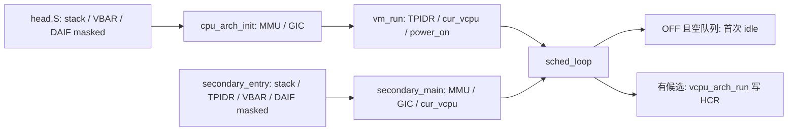

# HV-004 pause confirmation：T1 独立复核

## 裁定与边界

- **行为 RED 与生产基线验证通过**：本次独立强制编译并执行，不是复述前研发 exit；34 条断言中 7 条预期失败，既有 host / QEMU hcall 通过。
- **候选软件协议证明有条件通过**：在 proof 所列单写者、静态 affinity、准入门、队列锁及硬件通知前提下，未找到新的假确认或丢队列反例。当前没有 GREEN 实现，不能验收其实现正确性。
- **T1 不能无条件通过并自动进入 T2**：首次 idle 的物理 IRQ 路由前提仍阻塞。反例由官方规范和实际启动路径成立，不是实测 HCR=0。建议父流程先修订 spec/plan，批准下文最小候选后再授权 T2；本报告不代行授权。
- 只新增本报告；未改生产、测试、spec/plan，未 commit/push/换分支，未做 HCR 实验、变异、全 `make test` 或 Linux gate。H-107/H-125 不关闭。

核实分支 `feature/hv004-pause-confirmation`、HEAD `f810a6d80d30eccc2f7add52312045ea8e0d4107`；批准设计 `b15ffab`，行为 RED `1f07fe1`，生产基线 `3b8b9a8`。已读 CLAUDE.md、设计、对应 2026-11-09 plan、385 行 proof；旧 handoff 仅用于定位。旧 run 超时后的恢复只核对旧记录；**以下运行均由本 reviewer 新执行**。

## 1. 独立执行证据

原始证据：`/tmp/hv004-pause-t1-independent/`。环境：

```sh
export PATH=/tmp/wrapbin:$PATH
export LD_LIBRARY_PATH=/tmp/tc/usr/lib/x86_64-linux-gnu:/tmp/tc/usr/lib
export CROSS_COMPILE=aarch64-linux-gnu-
```

各命令分别重定向 log，紧接命令保存 `$?` 到对应 `.exit`，没有用管道尾命令的状态代替测试状态。host 与 QEMU 分命令运行。

| 实际命令 | exit | 证据及解释 |
|---|---:|---|
| `make -B build/host/pause_confirmation_test` | 0 | `red-build.log/.exit`，强制重新编译成功 |
| `build/host/pause_confirmation_test` | 1 | `red-run.log/.exit`，预期行为 RED |
| `make host-test-pause-confirmation` | 2 | `red-make.log/.exit`，Make 包装上述失败 |
| `make host-test` | 0 | `host-test.log/.exit`，既有聚合套件通过 |
| `make test-qemu-hcall` | 0 | `qemu-hcall.log/.exit`，`ALL PASS`；仅旧异步 ABI 回归 |
| `git diff --exit-code 3b8b9a8 -- hypervisor/` | 0 | `production-baseline.diff` 为空，`.exit=0` |

RED 明细与 `tests/host/pause_confirmation_test.c` 对应：

| 案例 | 本次输出 | 失败断言 |
|---|---|---|
| `running_entry_case(false)` | `guest entries=2`，应为 1 | :67、:112 |
| `running_entry_case(true)` | `guest entries=1`，应为 0 | :67、:112 |
| `idle_pending_case` | `affinity kicks=0,0`，仍允许睡眠 | :124、:125 |
| `query_closure_case` | 两核 loop 后 `query=0x100000001`，缺 bit33 | :140 |

合计 `pause_confirmation FAIL (34 assertions, 7 failed)`。Makefile:352–367 直接编译生产 `sched.c`、`sched_q.c`、`vcpu_state.c`、`vm.c`、`hypercall.c`；硬件替身只提供 load/run/idle 断点和 kick 计数。`vm[]`、查询辅助函数来自生产 vm.c；`--gc-sections` 仅删除未调用初始化段。`linked-symbols.txt` 独立核实实际 binary 包含 `sched_loop/sched_vm_pause/sched_vm_resume/hypercall_dispatch/vm_online_vcpus/vm_is_service/vm`。不是私有确认模型，也不是缺文件、缺符号 RED。

相对 b15ffab 的提交只涉及 Makefile、新测试和 proof；批准 design/plan 无差异。用户 `.pi/`、`scripts/plugctl.sh` 保留；未触碰 RK3588 文件。最终无 staged files。

## 2. 软件证明：反例尝试与成立条件

定位：proof §2–§4；当前生产 `hypervisor/common/sched/sched.c:79–114,122–260`，`include/vm.h:95–110`，`common/hypercall/hypercall.c:78–98`。以下评的是拟议协议，**当前 bool exchange/QUERY/entry 并未实现它**。

### 2.1 packed state / CAS / ack / QUERY

- `s=epoch<<1|paused`、未暂停 `s+3` 进入新代、resume 清低位，最大 epoch 后拒绝新暂停：没有 ABA。最大已暂停状态仍可恢复。一次 strong CAS 输家返回 busy，不能把旧快照的操作报成成功。
- 本核安全点 release-store 完整 s；请求者/IRQ 不代写，resume 不清 ack。尝试交错“p0 新 ack 后远端清旧 ack”被禁止远端清零排除；迟到旧 ack 不等于新 s。
- QUERY 的 state-acquire → 每个 ack-acquire → state-acquire，在相同暂停 s 且全匹配时才完成。匹配 ack 的 release/acquire 将对应 safe point 放在观察之前；state 唯一性和同一原子对象的 coherence 排除拼接前代确认。中途 resume/再 pause 时返回末次请求位、完成=0。随后 resume 可撤销观察，不是租约。
- 仅把最后一次 state load 改 acquire、ack 改 relaxed，不是等价证明；自然对齐、所有运行期访问 atomic、配置去重、对象不重置 epoch 都是必须兑现的实现约束。

### 2.2 排除、队列与 LOAD

最直接的丢队列反例是：本核看到暂停 → 远端 RESUME 看到 RUNNING 因而不入队 → 本核 YIELD 后依据第二次 paused=false 决定不入队。proof 指定 **YIELD 成功后无条件幂等 enqueue，随后才 ack**，正好排除此例；LOAD 后最终门也必须复用同一规则。

另尝试“safe point 读到暂停 → RESUME 放回候选 → pick 把候选丢掉”：不能只凭‘fresh acquire 总能读最新’解释。需要现有 q_lock 的顺序：若 RESUME 的 enqueue 已先完成，后续 dequeue 的锁 acquire 承接其 unlock（pause_state CAS 在此前）；若 enqueue 尚未发生，候选暂时被丢后，恢复扫描/发布者仍负责入队。proof 要求 fresh read 且保留队列锁，组合才闭合。不能改成使用安全点缓存值，也不能去掉队列同步。

`prev/cur_vcpu/launched` 是硬件归属，不是运行许可。现有 sched.c:176–218 在真正 load/resume 后绑定 resident；LOAD CAS 失败或最终门拒绝不得退回旧 prev、不得把 fresh load 的 launched 回滚。最终门应在 LOAD 成功后、tick_arm/run 前；拒绝后回 loop 头再 ack。本轮 RED 的 load hook 暴露了旧 entry 缺门，但**没有验证新 resident 保存逻辑**。

CPU_ON 的 ON_PENDING 发布→enqueue（`arch/arm64/vmexit/vpsci.c:60–82`）和 wake 的 WAKE→enqueue（sched.c:233–241）可能晚于恢复扫描，仍必须经过 pick 与最终 entry 门；BLOCKED 不能由 resume 伪唤醒。

### 2.3 所有 ERET 与共享核

全树检查实际 ERET：

| 路径 | 定位 | 为什么不能先 ack 再续行 |
|---|---|---|
| scheduler 两个 `vcpu_arch_run` | sched.c:147、225；vmexit_asm.S:83、122 | 两个 run 门都必须受暂停约束；门后到 ERET 到达的新请求允许先进入，但尚无本代 ack |
| 同步陷入普通返回 | vmexit_asm.S:197 | 属于未结束的原 guest 执行段；只有 hv_restore 回 loop 才能 ack |
| Lower-EL IRQ 普通返回 | irq_handler_asm.S:96 | 同上；IRQ handler 不发布 ack |
| current-EL IRQ 返回 | boot/vectors.S:110 | 返回 EL2 idle 指令流；idle_window 必须防止错误 hv_restore |

共享核的必要反例：当前运行 Service VM，目标 VM 在本核仅有 OFF vCPU。若 kick handler 只检查 `current_vcpu()->owner` 暂停，会直接 ERET，不能靠无 timer 的目标完成确认。proof §3.1 已要求检查**本核任一相关 VM 的待确认代次**并在非 idle 时 unwind；当前 irq_handler.c:86 尚只有旧 owner 检查，不能声称现有代码已通过。静态 affinity、单线程调度循环、IRQ 不写 ack 下，没有找到绕过上述归约的新 entry 路径。

### 2.4 idle 与测试空白

最后检查到 WFI 全程 I=1，设置 idle_window 后才检查，睡眠 `dsb sy; wfi`，执行或跳过后均在窗口内 `daifclr #2; isb; daifset #2`，清窗口回 safe point：在下节硬件条件满足时，检查前、检查后/WFI前的 kick 都不能提前被 handler 消费；ISB 前已 eligible 的 pending IRQ 必须在再次屏蔽前识别。ISB 后才到达的通知留给下一轮。各相关 inline asm 需 memory clobber，不持锁开 IRQ/WFI。

发送方 `cpu_arch_kick` 的前置 `dsb ish` 排序 RAM 发布与 SGI 写；不能用接收方 DSB 或后置 ISB 替代。`gic_kick_pcpu` 当前 msr/isb 没有 memory clobber，T2 必须同步核对这一具体落点。`vgic_sgi_trap` 的独立直接 kick 缺 DSB 仍属已记录后续缺口，不扩成本片 vGIC 硬化。

proof §6.1 **明确保留**：epoch 耗尽/CAS 输家、QUERY 中途换代/旧 ack、affinity 去重、RESUME 扫描 RUNNING 后 YIELD、LOAD resident、CPU_ON/wake 延迟入队、全部 idle kick 窗口、五类变异和新 QEMU oracle。这些不是本次 34 断言的覆盖项，不能因 RED 符合预期而标 GREEN。

## 3. 官方规范与首次 idle 反例

只使用已有本地官方 PDF/文本，未再次下载。独立核对版本、哈希和相关条款，选段存 `normative-excerpts.txt`；不是通读全部规范。

| 规范 | 版本与 SHA256 |
|---|---|
| DDI 0487G.b | ID072021；`DDI0487G_b-full.pdf`：`9dc15681bbb6df9321c1b5e16c52e16b1a4ac7655b0e6d1b1152fa2ac45606aa` |
| IHI 0069H.b | ID041224；`IHI0069H_b.pdf`：`1fb7c2ab781241532ede15632aec61d4bc31612757fdccff728ad12450f81ea2` |

关键定位（文本行号指 `/tmp/hv004-pause-t1/sources/` 的已有 txt）：

- DDI D1.13.2 Table D1-13，D1-2506，文本 142369 起：无 EL3、有 EL2，TGE=0/IMO=0 时 IRQ 目标 EL1、EL2 执行为 **C**；IMO=1 则目标 EL2、在 EL2 为 **B**。
- DDI D1.16.2，D1-2540，144636 起：物理 WFI wake 要求 A/B/A-B 类，独立于对应 PSTATE mask；**不包含 C**。D1-2541 不保证 WFI 自身 drain memory。
- DDI D13.2.48，D13-3336，193734 起：IMO warm reset 为 architecturally UNKNOWN。不能把未知值推断成“实际等于 0”。
- DDI D1.13.4，D1-2508，142511 起：ISB 等同步事件前 pending 且未 masked 的中断须在后续首条指令前 taken，支持短开 IRQ 窗口。
- IHI §4.7、§4.8.5–6，4-69/78/79：group/individual enable，priority 高于 PMR，group priority 高于 running priority 才 signal；不能仅凭 pending 或 `0xa0 < 0xff` 推断 wake。
- IHI §12.1.6，12-195–196，10703 起：PMR self-synchronizing；SGI 等系统寄存器的 Redistributor 可见性若要由 DSB 保证，须先 ISB/context synchronization。当前候选只要求异步通知，不把发送函数返回冒称远端已收到/确认。

源码全写入检查保存在 `hcr-all.txt`：唯一物理 HCR_EL2 写是 `vmexit_asm.S:83`，紧随 ISB；`guest/vm.c:64` 写 shadow，`vpsci.c:60` 复制 shadow。ICH_HCR_EL2 不是同一寄存器。



路径定位：`boot/head.S:24–65,100–132`、`boot/main.c:23–25`、`cpu/cpu.c:16–44`、`cpu/secondary.c:49–138`、`common/vm/vm.c:121–172`。首次 OFF-secondary idle 不经过物理 HCR 写入，量子仅在 sched.c:224 的 guest entry 前 arm。

**真实的规范允许反例**：PE 初值 TGE=0/IMO=0，secondary 的目标 vCPU OFF、队列空、没有 timer；请求方发布 pause 后发送唯一 kick。即使 GIC 已 signal 物理 IRQ，EL2 执行对应 C，规范不要求该 IRQ 唤醒 WFI；没有其它事件即可无限等待 ack。它反驳的是“当前代码保证无 timer 确认”，不是声称 QEMU 已重现实测挂起。WFI 可以作为 NOP 不会修复跨实现保证。

GIC 源码前提：`irq/gic_v3.c:36–106` 和 `cpu/secondary.c:65–105` 配置 redistributor awake、Group1 NS、kick enabled/priority 0xa0、PMR=0xff、IGRPEN1=1，GICD ARE_NS/EnableGrp1NS；flat TargetList 在 gic_v3.c:132–136。`irq_handler.c:40–45` 在 kick 返回/unwind 前 EOIR+DIR；其它正常 IRQ 分支也 priority-drop，物理 vtimer Active 保留不等于 running priority 保留。仍需实测 RPR/配置和无 timer 前提；不能把代码写值等同硬件已验收。

## 4. 最小 HCR 修订候选裁定（仅建议，待父批准）

**需要**：在现有 `cpu_arch_init`、`secondary_main` 两处入口，分别在 EL2 MMU 初始化/enable **之前**全值写已知非 VHE HCR，并紧接带 compiler memory clobber 的 ISB。此时 head.S 已 mask DAIF；写 HCR 不得顺带开 IRQ。不新增 generic hook、配置框架或每轮 idle 的 HCR 切换。

建议固定组合：

| 用途 | 明确写值 |
|---|---|
| 初始 host 基线 | `RW | FMO | IMO | AMO`，`0x80000038` |
| guest shadow 基线 | host 基线 `| VM | TWI | TWE | TID3 | TSC`，`0x800c6039`，与当前 guest 写值相同 |

常量收敛在**已有** `hypervisor/arch/arm64/include/arch/sysreg.h`：使用同一组 `HCR_EL2_*` bit 定义及 `HCR_EL2_HOST_BASE` / `HCR_EL2_GUEST_BASE` 组合，由 cpu.c、secondary.c、guest/vm.c 共用；不新建通用初始化抽象、不全局改 SYSREG 宏。当前头内没有 HCR 常量，应替换 guest 的散落 shift，而不是新增第二套拼法。汇编仍读 shadow 并保留原 ISB，CPU_ON 仍复制同一 guest shadow。

取值理由和限制：

1. **E2H=0、TGE=0 明确写死**。DDI D13.2.48 D13-3321/3323–3324：E2H 改变 host/MMU 格式；TGE 改变路由、禁用虚拟中断并使返回 EL1 非法。不能对 UNKNOWN HCR 只 OR IMO，不能借 TGE=1 替代正确非 VHE 基线。
2. **VM=0 到 guest 首次 run 才启用**；不提前激活未建立 VTTBR/Stage-2。其它未选位写 0，包括 VI/VF/VSE、NV、HCD 与 trap 扩展位；以当前受支持 QEMU/非 VHE特性为界，不扩为任意未来架构支持。
3. 只为 IRQ wake，`RW|IMO` 已足够；但推荐 `RW|FMO|IMO|AMO` 以保持现有 guest 三类物理路由策略，无需又引入 host/guest FIQ/SError 路由差异。FMO/AMO 不是本片新验收 FIQ/SError 的承诺。DDI D1.13.3 D1-2506 规定虚拟中断在 EL2 始终 masked；再加 VI/VF/VSE=0 和 DAIF 保持屏蔽，不会在初始化中注入虚拟异常或开启尚未就绪的处理器上下文。
4. boot core 在 cpu_arch_init 时 TPIDR/cur_vcpu 尚未由 vm_run 建好，secondary 在 secondary_main 早期 cur_vcpu/GIC 尚未就绪；HCR 路由写必须保持 DAIF masked。仅在 scheduler 的 idle_window 内临时开放 I，A/F 不随本修订开放。head.S 在本候选落点之前已设置 VBAR/stack 并 mask；不借此扩修更早的 boot entry 契约。
5. TWI/TWE/TID3/TSC 仅在 guest 组合保留，HCD=0 保留 HVC。DDI D13-3329 的 TSC 陷入对象是 **EL1 SMC**，不是 EL2 的物理 PSCI SMC；`cpu/psci.c:12` 的 EL2 SMC 不因该 guest bit 改为自陷。仍需 CPU_ON/SMCCC 回归，不能由此推断 EL3 平台已通过。
6. 后续每次 vcpu_arch_run 写 guest shadow 必须保留 IMO/FMO/AMO、E2H/TGE=0，不回退路由；首次 guest 后 idle 可以保留原 guest HCR（VM 已就绪），**不要求每次 idle 清 VM**，避免增加切换协议。QEMU 不实现/RAZ 的 TSC 等位不能作为实测全字强等号失败；按实现的架构语义检查路由位与基线关键位。

本候选只增加两个早期初始化写点和公共常量收敛；原 pause 协议本来要求的 idle/kick/entry 修订不变。RK3588/EL3 的 SCR 路由和任意 warm-entry MMU/TLB 状态不在本次 QEMU 修订保证中。

## 5. 解锁顺序、必须补的证据

**先解除设计阻塞，后做实现验收**：父流程需在 design 的 idle 硬件前提及 plan 的 T2 同步清单写入上述两初始化点、精确 HCR 组合/ISB/DAIF、guest 不回退约束和回归要求；随后显式批准 T2。不能将本报告或旧 hcall PASS 当作 HCR 修改已经批准/验证。

T2/T3 至少应补：

1. **首次 OFF-secondary、无 timer 的实际证据**：在任何 guest entry 前记录该核实际 HCR（IMO=1、E2H/TGE/VM=0、RW 和选定路由符合基线）、DAIF、Group1 enable/PMR/RPR，以及物理 timer 未提供兜底的状态/事件证据。请求新 epoch → 唯一 kick → 对应核实际 IRQ/safe point → 本核同代 ack，关联 pCPU/epoch；超时失败。不能只记录“online”或 host 假 idle 返回。
2. **首次 guest 后路由不回退**：从初始 HCR 到 guest shadow 的物理写入，再到 trap/idle 的实际 HCR 检查；确认 IMO 连续为 1、E2H/TGE=0，VM 仅在已就绪 guest run 后为 1。覆盖 reset/CPU_ON 的 shadow 作者链；没有绕过门的 ERET。
3. **boot 无候选路径**：同样证明首次 idle 前建立基线；保留当前 VBAR/TPIDR/cur_vcpu/idle_window 顺序。不要为制造场景修改 RAM 布局或引入 generic hook。
4. **同源确定性交错**：兑现 proof §6.1 中 epoch/QUERY/CAS、无条件 enqueue、LOAD resident、CPU_ON/wake 和两个 idle kick 窗口；五类坏实现必须可判红。host 空 IRQ hook 不能替代 AArch64 异常识别。
5. 现有 host、hcall、CPU_ON/普通 trap/物理 IRQ 相关 QEMU 回归；按已批准计划完成三个专用场景各三轮和物理进度 HOLD oracle，最终完整 gate/Linux 留到规定验收阶段。本轮不提前消耗全量门禁时间盒。

当前硬件阻塞仍在，现有 QEMU hcall PASS 仅是旧生产回归，不是第 1/2 项的新证据。未测真机、未执行 GREEN/变异/完整 gate/Linux；不得外推执行确认至资源回收。无本线程可用 Linear 工具，未同步或关闭 H-107/H-125，交父流程用本报告及独立日志同步并决定是否修订、批准 T2。
