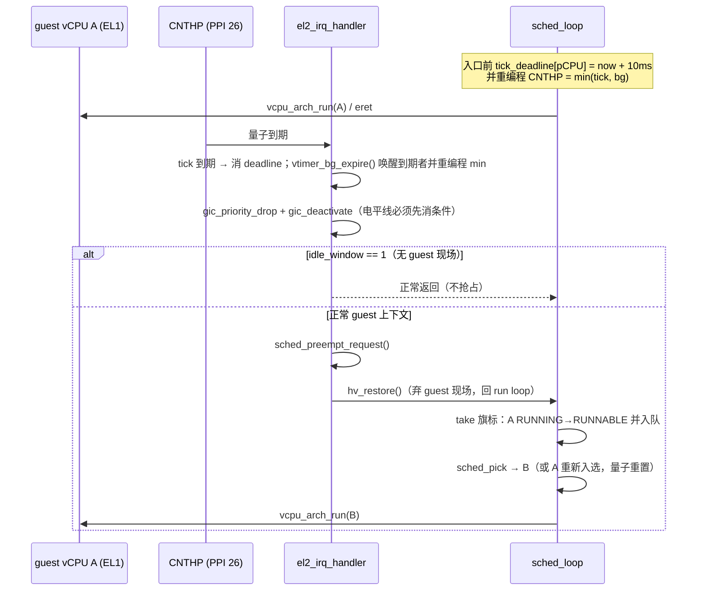

# M11 片 D — 抢占时间片与 Linux 门禁自动化（设计）

> **Status:** Approved（架构师关卡①，2026-11-07）。**日期:** 2026-11-07。
> **分支:** `feature/m11-d-preemption`（从本地 `dev` 拉出，线性合回）。
> 上游依据：[M11 合并版设计](2026-10-30-m11-vcpu-scheduler-design.md) §5 片 D、
> [实施计划](2026-10-30-m11-vcpu-scheduler.md) 片 D、[ADR-0019](../../adr/0019-two-layer-state-division.md)
> （共享 pCPU 协作等待饥饿为已定位未修复缺口）、ADR-0009、ADR-0015。
> 与已接受 ADR 冲突时以 ADR 为准（冲突本身记为本文 bug）。

## 1. Problem Statement

片 A/B1/B2/C 交付的是**协作**调度：只有 WFI trap（guest 主动让出）才换 vCPU。
共享 pCPU 上两个 vCPU 同时处于 RUNNING/RUNNABLE 时，先 Load 上硬件者一直跑到自己
让出为止——**没有任何机制能把它换下**。

已观测后果（ADR-0019）：
- **H-174 启动挂死**：VM0 stop-machine 与 VM1 同步 IPI 的等待环各自所需的对端排在同一个
  pCPU 队列里；宿住者不让出，等待环永不闭合。旧 HV focused boot 14 次中 1 次真实挂死。
- `tests/svm/cases/wfe_wait.c` 是同一缺口的确定性复现（非 gate 诊断）：CPU_ON 的
  secondary 排在同一队列，primary 用 WFE 等它 → 超时。
- 片 C 已否决"无条件 kick 轮转"（可能换下刚收到 IPI 的 current，消费掉唯一通知），
  因此正解是**时间片抢占**，不是"多踢几次"。

第二缺口：Linux 双 VM 门禁（08-10 用户故事 32/33 的头条声明）目前是手工 `/tmp` 脚本，
每次切片关卡②都要人肉重跑；镜像来源裁定 9.1（脚本化 + 固定哈希）未落地。

## 2. 范围

**做**：EL2 物理定时器 tick 驱动的 round-robin 抢占；确定性抢占 gate 场景；`make test-linux`
一条命令跑双 VM Linux 门禁；ADR-0009 显式重访；M11 里程碑收尾（known gaps、架构文档、
AGENTS.md 现状段、Linear 状态在用户恢复同步后补录）。

**不做**（各自触发条件已钉）：
- 目标关联通知协议（片 C 已否决的"定向 kick"变体）——须用户另批。
- 多级/权重调度、SMP 迁移、负载均衡（Linear 后续 issue）。
- `make test-linux` 的下载式镜像获取（见 D8）。

## 3. 关键裁定

| # | 问题 | 裁定 |
|---|---|---|
| D1 | 抢占触发源 | **复用已有 CNTHP（PPI 26）单定时器**，按 `min(下一个 tick, 背景 vtimer 最早期限)` 编程（ADR-0019 既定；v8.0 无 CNTHV）。不新增定时器、不改 GIC 配置。 |
| D2 | 谁来拥有 deadline | tick deadline **只属于 arch timer 模块**（`arch/arm64/timer/vtimer.c` 私有数组，按 pCPU 索引）。通用层只加一个 arch 钩子 `cpu_arch_timer_tick_arm()`（`include/cpu.h`，x86 stub 落实）和两个调度内接口 `sched_preempt_request()/sched_preempt_take()`（`include/sched.h`）。**不改 `struct percpu`/`PERCPU_SIZE`/asm 偏移**。 |
| D3 | 切换发生点 | 中断上下文**只置旗标 + 解栈**（`hv_restore()`，与 kick-SGI 停机路径同构）；状态转换（RUNNING→RUNNABLE）与入队发生在 `sched_loop` 里，沿用 `VCPU_EV_YIELD` + `sched_yield_cur()`（B1 既有路径）。理由：ADR-0019 状态机原子化要求所有转换走 `vcpu_state_step` 的同一条路，且"不在中断上下文切换"。 |
| D4 | 量子 | `SCHED_QUANTUM_MS 10`（`include/sched.h`），运行时用 `CNTFRQ_EL0/100` 换算成计数，不写死频率。10 ms 是 QEMU TCG 与真机都安全的量级（100 Hz tick）。 |
| D5 | 空闲窗口 | `percpu[].idle_window == 1` 时**不抢占**（该上下文没有 guest 现场，`hv_restore` 会载入陈旧 HV 上下文）：只消 tick、按背景 vtimer 重新编程后正常 `eret` 回 idle 复查。 |
| D6 | guest 掩中断 | **已实验确认（2026-11-07，QEMU 9.2.4 / cortex-a72）**：guest 在 EL1 全程 `PSTATE.I=1` 自旋时，EL2 的 tick 仍被投递（探针：sched 入口临时装 5 ms CNTHP + handler 打印，输出 `[hv] TICK probe hit` 后 guest 继续）。理由：中断路由到 EL2 时异常在 EL2 取，掩蔽位只作用于当前 EL 取的异常。因此抢占**不受 guest 掩中断影响**，H-174 自旋环无豁免。证据入 `docs/debug/`；`preempt` 场景仍显式 `msr daifclr, #2`（与既有 SVM 用例一致，测的是正常 guest 形态）。 |
| D7 | 门禁用例形态 | 新增 `tests/svm/cases/preempt.c`（`svm_ctxsw` profile，单 VM 两 vCPU 共享 pCPU0）+ `make test-qemu-preempt` 进聚合；`wfe_wait.c` 由诊断升级成本场景的 `wfe` 变体（两者同缺口、同判据，取实现更小的一个；选型在 T4 记录）。 |
| D8 | 镜像来源（裁定 9.1 的落地） | `make test-linux` **前置校验** `LINUX_IMAGE`/`LINUX_INITRD` 存在且 sha256 匹配 `tests/linux-gate.sha256`，不匹配即红（这是"固定哈希"的可执行形态）；镜像仍是构建产物（内核 + busybox 步骤已固化在 [devlog 2026-11-06](../../devlog/2026-11-06-linux-gate-rebuild.md)），**不写下载器**——没有外部制品源，写一个只会多一个无人用的脚本。缺镜像时报错文本直指该 devlog。 |

## 4. 结构与时序

模块落点（箭头 = 调用，全部是已有方向的延伸，无新层）：

```mermaid
graph TD
    SL[sched_loop<br/>common/sched/sched.c] -->|每次 guest 入口前| HOOK[cpu_arch_timer_tick_arm<br/>include/cpu.h]
    HOOK --> VT[arch/arm64/timer/vtimer.c<br/>tick_deadline[] + el2_timer_rearm]
    VT -->|min bg/tick| CNTHP[(CNTHP_EL2)]
    CNTHP -->|PPI 26| IRQ[el2_irq_handler<br/>arch/arm64/irq/irq_handler.c]
    IRQ -->|tick 到期且非 idle 窗口| REQ[sched_preempt_request]
    IRQ -->|hv_restore 解栈| SL
    SL -->|旗标已置| YIELD[sched_yield_cur + VCPU_EV_YIELD]
    X86[arch/x86/stub/hooks.c] -.->|链接检查| HOOK
```

抢占时序（`needs_resched` 等价物 = sched 模块的 per-pCPU 旗标）：



`el2_timer_rearm()` 是**唯一**写 CNTHP 的地方：现有 `vtimer_bg_arm()` 在 `vcpu_arch_load`/
`resume` 末尾被调用，若只算背景最早期限就会把 tick 抹掉——这是本片最容易漏的改动点，
T1 以"所有 CNTHP 写点收敛到一个函数"为验收。

## 5. 接口

```c
/* include/cpu.h —— 通用层唯一新增的 arch 钩子（ADR-0015：x86 stub 必须实现） */
void cpu_arch_timer_tick_arm(void);   /* 为本 pCPU 装下一段量子并重编程物理定时器 */

/* include/sched.h —— 通用层内部接口（中断侧请求 / 循环侧消费） */
void sched_preempt_request(void);
bool sched_preempt_take(void);
```

ARM64 私有（不进通用头）：

```c
/* arch/arm64/timer/vtimer.h */
void el2_timer_rearm(void);      /* = min(背景 vtimer 最早期限, tick)，唯一 CNTHP 写点 */
bool vtimer_tick_expire(void);   /* 到期则消费 deadline 并返回 true */
```

## 6. 验收（DoD）

1. **host**（秒级）：`sched_test` 新增确定性用例——`vcpu_arch_run(A)` 内请求抢占后返回，
   循环必须把 A 标 RUNNABLE + 入队并切到 B；`A` 之后仍被选中（不饿死）。RED commit 先行。
2. **QEMU 聚合**（`make test`）：新增 `preempt` 场景（共享 pCPU，两 guest 都不 WFI，
   primary 自旋等 secondary 的标记）——**无 tick 时超时，有 tick 时 PASS**；受控红留证
   （先不加 tick 跑一次，记 `docs/debug/`）。10 场景 → 11。
3. **Linux 门禁（一条命令）**：`make test-linux` 从干净树跑到双 shell，exit 0；
   连跑 5 次全绿（记录次数，不宣称 H-174 不会再现——ADR-0019 明确禁止）。
4. **ADR-0009 修订**在档（四层 gate + Linux 自动化层）；`docs/adr/0019` 的饥饿缺口条目
   改为"片 D 修复 + 验证边界"；ADR 需要新号时续 0021。
5. **收尾**：`AGENTS.md` Current state 段、`docs/reference/arm/current-architecture.md`
   （调度/定时器/钩子清单）、M11 计划勾选与 commit 哈希、`docs/debug/` 受控红记录、
   devlog + 日报。Linear 同步按片 C 报告的用户暂停指示**不执行**，只在报告里留待办。

## 7. 已知限制（本片不解决，进 ADR-0019 缺口表）

- **量子固定、无优先级**：只保证前向进度，不保证时延；首个对延迟有要求的 milestone（H2）
  再评估。
- **掩中断行为只在 QEMU 验证**（D6 实验）：ARM ARM 语义与 QEMU 一致，但 RK3588 真机未跑；
  真机 bring-up 时把该实验重跑一遍。
- **tick 与背景 vtimer 共用一个比较器**：两者的最早期限精度受同一 CNTHP 限制（现状已如此）。
- **`make test-linux` 依赖本机镜像**：新机器上必须先按 devlog 构建内核与 initramfs。
