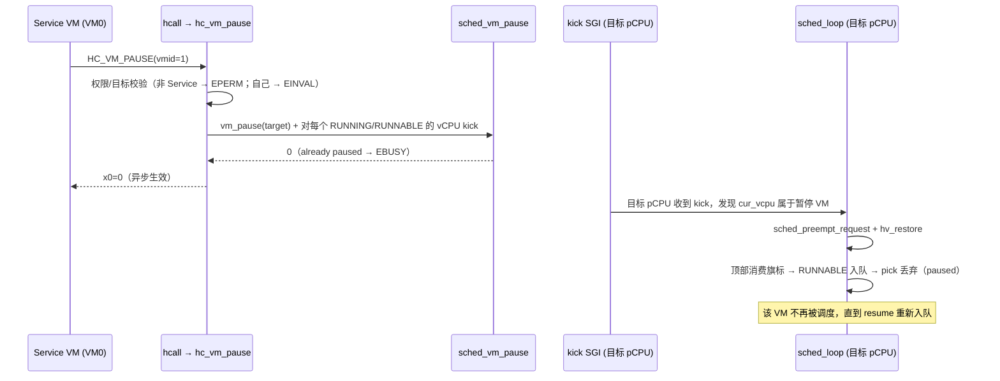

# HV-004（第一刀）— VM 暂停/恢复与调度器跳过（设计）

> **Status:** Approved（架构师关卡①，2026-11-08）。**分支:** `feature/hv004-vm-pause`（从 `dev` `ac844e4`）。
> **Linear:** H-107（HV-004）。**上游:** HV-005 已关闭（ADR-0022 hypercall ABI）。

## 1. Problem Statement

HV-005 给了 ABI，但没有一个调用能改变 VM 的运行状态。HV-004 的完整目标是
`CREATED/READY/RUNNING/PAUSED/DESTROYED` 全生命周期 + 事件，而那需要 VM 创建（分配
Stage-2 表、vGIC 初始化）与销毁（teardown）——这些属于内存/资源管理（H2），现在做等于
凭空造一套分配器。

所以本片只做**今天能完整成立的那一段**：`RUNNING ↔ PAUSED`，以及让暂停真正生效的调度器
语义。CREATED/DESTROYED/READY 与事件通道留到 VM 创建/销毁切片（触发条件 = Stage-2 动态
页分配落地）。

## 2. 范围

**做**：`vm->paused` + `vm_pause()/vm_resume()`；调度器在 pick 时跳过暂停 VM；被暂停
VM 正在别的 pCPU 上跑的 vCPU 必须被踢醒并换下；`HC_VM_PAUSE`/`HC_VM_RESUME`（仅
Service VM）；`HC_VM_QUERY` 追加 `paused` 位；`vm_list` 显示暂停态；host 单测 +
扩展现有 `hcall` 门禁场景。

**不做**（触发条件）：CREATED/READY/DESTROYED 与事件通道（VM 创建/销毁切片，依赖 H2 的
页分配）；暂停的同步确认（等一个 vCPU 真的停下再返回）——没有确认协议，本片是**异步生效**。

## 3. 关键裁定

| # | 问题 | 裁定 |
|---|---|---|
| F1 | 状态表示 | `struct vm` 加 `bool paused`，**不引入 `enum vm_state`**：现在只有两态，加枚举就是为了将来三态而写的死代码；创建/销毁切片再引入枚举（届时 `paused` 成为其中一态）。 |
| F2 | 暂停如何生效 | `paused` 是**调度判据**，不是"停下 guest"：`sched_pick` 弹出已暂停 VM 的 vCPU 时**丢弃**（与既有 swept 分支同形，vCPU 保持 RUNNABLE 但不在队列里）；正在 pCPU 上跑的 vCPU 由 kick SGI 强制换下。**异步生效**：hypercall 返回时目标可能还差了最多一个量子/kick 延迟。 |
| F3 | 恢复 | 清 `paused` 后把该 VM 所有 RUNNABLE 的 vCPU 重新入队 + kick；BLOCKED 的**不唤醒**（它在等自己的事件，暂停不该伪造唤醒）。 |
| F4 | 权限 | 两个调用都是 **Service VM 专属**（表项 `roles = HC_ROLE_SERVICE`，HV-005 留下的表项权限分支自此有真实覆盖）；`x1 = vmid`；暂停/恢复自己 → `HC_EINVAL`；重复 pause / 未暂停时 resume → `HC_EBUSY`（新增 `-5`）。 |
| F5 | 查询 | `HC_VM_QUERY` 返回字追加 `bit 32 = paused`（只加高位，已有位不动）。 |
| F6 | shell | `vm_list` 的 STATE 列在暂停时显示 `paused`（不与 `on` 混淆），列宽不变（6 字符）。 |

## 4. 结构

模块落点：

| 文件 | 改动 |
|---|---|
| `include/vm.h`、`common/vm/vm.c` | `bool paused`；`vm_pause()/vm_resume()`（纯逻辑，返回 0/`-EALREADY`）；`vm_is_paused()` |
| `include/sched.h`、`common/sched/sched.c` | `sched_vm_pause()/sched_vm_resume()`（纯逻辑 + kick）；`sched_pick` 跳过 paused |
| `arch/arm64/irq/irq_handler.c` | kick 分支：cur_vcpu 属于暂停 VM 时 `sched_preempt_request()` + `hv_restore()`（镜像 tick 路径，含 idle 窗口门） |
| `common/hypercall/hypercall.c`、`include/hypercall.h` | `HC_VM_PAUSE`(`0x87000101`)/`HC_VM_RESUME`(`0x87000102`)、`HC_EBUSY -5`、query 的 paused 位 |
| `dm/hv_shell.c` | STATE 列显 `paused` |

## 5. 验收（DoD）

1. **host**：`vm_pause/resume` 语义（重复暂停 `-EALREADY`、恢复未暂停同样）；`sched_pick`
   跳过暂停 VM 的 vCPU 且恢复后能被选中（`sched_test`）；分发权限（非 Service → `HC_EPERM`
   现在真的走到表项 roles 分支）；query 的 `bit 32`。
2. **QEMU**（扩展 `hcall` 场景，不新增场景）：VM0 暂停 VM1 → `HC_VM_QUERY(1)` 读回
   `paused=1` → 等 2 s → 恢复 → `paused=0`；VM1 用自己的时间基检测"被冻结过"（`CNTPCT`
   跨睡眠出现 > 1 s 的空洞）并打印；VM1 尝试暂停 VM0 → `HC_EPERM`。
3. **回归**：既有 12 场景零改动仍绿（`hcall` 的 expect 只追加行）；`make test-linux` 绿
   （暂停语义不能影响正常调度）；`-Werror` 零告警；`check-arch-boundary`、`check_offsets`。
4. **文档**：ADR-0023（暂停语义与异步边界）、devlog、报告、Linear（H-107）。

## 6. 已知限制

- **异步生效**：hypercall 返回不等于目标已停；没有确认协议（触发 = 首个需要"静默后复用
  资源"的消费者）。
- **没有 `CREATED`/`DESTROYED`/事件**：等 VM 创建/销毁切片。
- 暂停不保存任何"暂停时刻"的额外状态：vCPU 的上下文留在它自己的影子与 `vcpu_arch_put`
  路径里，与普通换出相同。
- 只有 Service VM 能暂停/恢复；跨 VM 通知（事件通道）没有。
