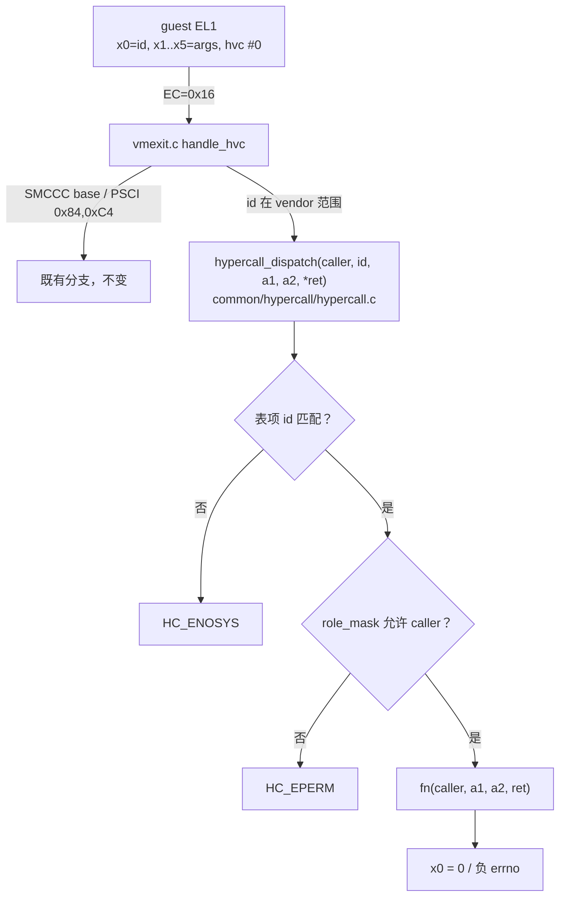

# HV-005 — Hypercall ABI 与陷入分发（设计）

> **Status:** Approved（架构师关卡①，2026-11-08）。**日期:** 2026-11-08。
> **分支:** `feature/hv005-hypercall-abi`（从 `dev` `57bf8df` 拉出，线性合回）。
> **Linear:** [H-113](https://linear.app/jamestam/issue/H-113)（本片）、H-107（HV-004，下一片）。
> **上游:** HV-003 已关闭（M11 四片），H1 剩余主线里本片是 HV-004 / HSM / DM 的前置。

## 1. Problem Statement

今天 guest 与 hypervisor 之间只有三样东西：
`smc/hvc 0x84/0xC4`（PSCI，`vpsci.c`）、两个 SMCCC base 查询、以及**一个测试用的 ad-hoc 分支**
`HC_GUEST_DONE`（`vmexit.c` 里的 `switch case`，只为 SVM 用例"通知 EL2 我跑完了"）。

后果：
- 没有"功能号 → 处理函数"的分发，没有"调用者是谁"，没有"谁能调什么"。任何新调用都得往
  `handle_hvc()` 里塞 `if`，权限靠人肉纪律。
- HV-004（VM 生命周期）的每个迁移入口本身就是一次 hypercall；没有本片，它只能挂在 PSCI 或
  shell 这类临时入口上，接线时接口要改一次。
- 后续 HSM（M13）/用户态 DM（M14）要的 ABI 形状（id 编码、参数、返回码、错误语义）没有定论。

## 2. 范围

**做**：ABI 常量与错误码；generic 侧分发表 + 调用者识别 + 权限；两个真实调用
`HC_VERSION`、`HC_VM_QUERY`；把 `HC_GUEST_DONE` 纳入 id 空间（行为不变）；host 单测；
一个新 SVM 门禁场景。

**不做**（各自触发条件）：
- **VM 生命周期迁移**（HV-004：CREATE/START/PAUSE/RESUME/DESTROY + 事件）——下一片；
  本片只提供**只读**查询，不引入 `enum vm_state`。
- 事件通道、`io_req` 环、HSM 调用（M13）——没有消费者。
- 参数结构体（大块 copy_from_gpa 型 ABI）——没有消费者；本片只传标量。
- 版本协商（minor 版本降级）——没有对端；只报版本号。

## 3. 关键裁定

| # | 问题 | 裁定 |
|---|---|---|
| E1 | id 空间 | 沿用 SMCCC **vendor 服务范围** `0x87000000+`（DEN 0028 B），编码 `base + (module<<8) + index`：`HC_VERSION=0x87000000`、`HC_GUEST_DONE=0x87000001`（**保持原值**，SVM 用例不受影响）、`HC_VM_QUERY=0x87000100`（module 1 = VM）。不并入 PSCI 的 `0x84/0xC4` 分支：两个 ABI 语义不同（PSCI 是固件代理，hypercall 是 hypervisor 服务）。 |
| E2 | 调用者身份 | 一律 `current_vcpu()->owner`，**永不从参数取**。这条是安全边界，违反它的代码视为 bug。 |
| E3 | 权限模型 | `vm_is_service(v)` = `v->id == 0`（VM0 即 Service VM，ADR-0014 的静态拓扑）。**不新增 config 字段**：等出现第二个 service 类 VM 时再把 role 提到 `vm_config`（触发条件写进 ADR-0022）。特权调用用表项里的 `role_mask` 表达，不是散落的 `if`。 |
| E4 | 返回约定 | `x0 = 0` 成功、`x0 = 负 errno` 失败。本片定义：`HC_EINVAL -1`、`HC_EPERM -2`、`HC_ENOSYS -3`、`HC_ENODEV -4`。未知 id → `HC_ENOSYS`；**SMCCC base 探测维持现状**（`SMCCC_NOT_SUPPORTED`），不改已有行为。 |
| E5 | 代码落点 | 分发表在 **generic**：`common/hypercall/hypercall.c` + `include/hypercall.h`，arch 只把 `arch_regs` 摊成 `u64` 调进来（`hypercall_dispatch()`）。这样 host 可测、x86 侧将来用 VMCALL 只换入口不换表。 |
| E6 | 兼容性 | 已发布的 id **只增不改**；未用参数**忽略不校验**（前向兼容）；结构体参数留给将来需要时新增调用，不改造已有调用。 |

## 4. 结构



调用表（本片全部内容）：

| id | 名称 | 权限 | 参数 | 返回 |
|---|---|---|---|---|
| `0x87000000` | `HC_VERSION` | 任意 VM | 无 | `x0=0`，`x1 = major<<16 \| minor`（本片 `0.1`） |
| `0x87000001` | `HC_GUEST_DONE` | 任意 VM | `x1` 诊断值 | noreturn（`hv_restore`，停在 vmexit.c，不进表——它不返回） |
| `0x87000100` | `HC_VM_QUERY` | 查自己：任意；查他人：仅 Service | `x1 = vmid` | `x0=0`，`x1 = vm_state_word`（见下） |

`HC_VM_QUERY` 的返回字：`bits[15:0] = vmid`，`bit16 = 是否 Service VM`，
`bits[31:17] = 在位 vCPU 数（`state != VCPU_OFF` 的计数）`。
**不引入 VM 级状态机**：判据仍是派生态（"至少一个 vCPU 没 OFF" = 在跑），与
`hv_shell` 的 `vm_list` 同源——所以把该派生逻辑从 shell 里抽成
`vm_any_vcpu_on()`/`vm_online_vcpus()` 放到 `common/vm/vm.c`，两边共用一份。

## 5. 接口

```c
/* include/hypercall.h —— generic，无 arch 头 */
#define HC_OK        0
#define HC_EINVAL   -1
#define HC_EPERM    -2
#define HC_ENOSYS   -3
#define HC_ENODEV   -4

#define HVC_VENDOR_BASE 0x87000000U
#define HC_ID(module, index) (HVC_VENDOR_BASE + ((u32)(module) << 8) + (u32)(index))
#define HC_MOD_GENERIC 0
#define HC_MOD_VM      1

#define HC_VERSION      HC_ID(HC_MOD_GENERIC, 0)
#define HC_GUEST_DONE   HC_ID(HC_MOD_GENERIC, 1)   /* 原 0x87000001，值不变 */
#define HC_VM_QUERY     HC_ID(HC_MOD_VM, 0)

/* caller 由 arch 从 current_vcpu()->owner 传入；返回 0 或负 errno，
 * 需要回传给 guest 的值写 *ret（arch 负责写 x1）。 */
s64 hypercall_dispatch(struct vm *caller, u32 func_id, u64 a1, u64 a2, u64 *ret);

/* common/vm/vm.c：派生态，hv_shell 与 HC_VM_QUERY 共用 */
bool vm_any_vcpu_on(const struct vm *v);
u32  vm_online_vcpus(const struct vm *v);
bool vm_is_service(const struct vm *v);   /* id == 0，见 E3 */
```

## 6. 验收（DoD）

1. **host（RED→GREEN，commit 顺序可见）**：`tests/host/hypercall_test.c` + `make host-test`
   覆盖：未知 id → `HC_ENOSYS`；`HC_VERSION` 任意 VM 可用；`HC_VM_QUERY` 自查询成功、他人
   查询在非 Service 调用者下 `HC_EPERM`、在 Service 下成功、越界 vmid → `HC_ENODEV`；
   返回字的三段编码。
2. **QEMU 聚合**（10 → 12 场景）：新 `hcall` 场景（`svm_dual` profile，**同一份二进制跑两个
   VM**，guest 用 `HC_VM_QUERY` 查自己的 vmid 决定走 Service 分支还是拒绝分支），断言：
   VM0 `VERSION`/自查询/查 VM1 成功；VM1 `VERSION` 成功、查 VM0 得 `HC_EPERM`、未知 id 得
   `HC_ENOSYS`。
3. **兼容**：既有 11 场景零改动（`HC_GUEST_DONE` 的 id 与行为不变）；`make test-x86-stub`
   通过（generic 新模块无 arch 依赖）；`-Werror` 零告警。
4. **文档**：ADR-0022（ABI 形状与权限）、devlog、当日报告、Linear 同步。

## 7. 已知限制

- **ABI 还没有外部消费者**（DM/HSM 未落地）：id 与错误码按"只增不改"承诺，但 minor 兼容
  不承诺。
- `HC_VM_QUERY` 只报派生态；真正的 VM 级状态（CREATED/PAUSED/DESTROYED）随 HV-004 落地
  后再扩返回字（新增字段，不改已有位）。
- 没有 `copy_from_gpa` 型参数 ABI（结构体入参），第一个需要的调用（VM 创建）出现时再加。
- 权限只有"Service VM / 其他"两档；出现第二个 service 类 VM 时提到 `vm_config`。
