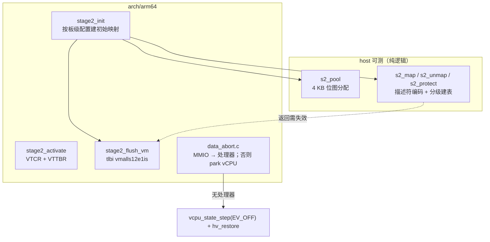

# HV-011/012（第一刀）— Stage-2 表分配器、动态映射与 fault 闭环（设计）

> **Status:** Approved（架构师关卡①，2026-11-08）。**分支** `feature/hv011-s2-tables`（从 `dev` `03232ad`）。
> **Linear:** H-125（HV-011）、H-123（HV-012）、H-127（HV-013 的属性部分）。
> **上游事实（2026-11-08 核实）**：`mmu/stage2.c`（119 行）现在是**两张静态表**
> （`l1_table[NR_VMS][512]` + `l2_dev[NR_VMS][512]`），设备 2 MB 块 + RAM 1 GB 块硬编码，
> GICD/GICR 与 PL011 用"置无效"打洞；**没有分配器、没有映射 API、没有 TLB 维护、
> 没有权限位**。更糟的是：数据异常未处理时走 `vmexit.c` 的 `default:` → `cpu_arch_halt()`
> ——**一个 guest 的 Stage-2 fault 会停掉整个 pCPU**（共享 pCPU 上另一个 VM 也一起死）。

## 1. Problem Statement

三件事被同一段代码挡住：

1. **静态表是硬编码的**：加一个设备、改一段内存属性、做只读页，都得改 `stage2.c` 的常量；
   DM 将来要按 VM 动态建内存，没有入口。
2. **权限与属性无法表达**：`S2_S2AP_RW` 写死，`XN` 只用在设备上；HV-012 要的写保护、
   HV-013 要的 MAIR 属性选择没有代码承载。
3. **fault 没有闭环**：未映射 IPA / 权限错误一律落到 `cpu_arch_halt()`，把 pCPU 一起钉死
   ——这是"一个坏 guest 拖垮同核好 guest"，正是 H1 阶段必须消掉的失败模式。

## 2. 范围

**做**：Stage-2 表页池 + 分配/释放（host 可测）；动态 `map/unmap/protect` API
（属性/权限编码可表达）；用该 API 重建现有映射并**证明与旧静态值等价**（启动自检）；
TLB 维护（VM 级失效）；fault 闭环（park 故障 vCPU，**不停 pCPU**）；新 SVM 门禁场景。

**不做**（触发条件）：
- guest RAM 的动态分配（仍是板级静态区间；触发 = DM 需要按 VM 分内存，H2 后续切片）。
- 把 MMIO 请求转给用户态 DM（`io_req`，M13）。
- TLB range 失效（`ipas2e1is`）—— `vmalls12e1` 够用；触发 = 实测切换/映射开销成为瓶颈。
- 2 MB 以上巨页的继续使用之外的分级优化、页合并、NUMA。

## 3. 关键裁定

| # | 问题 | 裁定 |
|---|---|---|
| G1 | 分配粒度 | 4 KB 表页，静态池 `S2_POOL_PAGES`（默认 64，够 2 VM ×（L1+若干 L2/L3））。位图管理，**host 可测**（纯逻辑，无 MMIO）。池用尽 → `-ENOMEM`，调用者（`stage2_init`）打印并让该 VM 建表失败（不 halt pCPU）。 |
| G2 | API 形状 | `s2_map(s2, ipa, pa, len, attr)`、`s2_unmap(s2, ipa, len)`、`s2_protect(s2, ipa, len, attr)`（attribut 含 RW/RO、XN、Device/Normal）。**纯逻辑对内**：只改内存里的描述符，返回是否需要 TLB 失效；**arch 侧**再执行 `dsb`+`tlbi`。这样描述符编码可 host 测试。 |
| G3 | 属性编码 | **修订（2026-11-08，实测+测试专家独立核实）**：Stage-2 块/页描述符自带 `MemAttr[3:0]`（ARM DDI0487 D8.2.6），**stage-2 行走不读 `MAIR_EL2`**——原稿写"显式写 MAIR_EL2 两个槽位"是错的。实现改为：`S2_ATTR_NORMAL_WB`/`S2_ATTR_DEVICE_nGnRE` 只是**属性选择器**，直接编码进描述符；`MAIR_EL2` 保持 `el2_mmu.c` 既有布局（slot0=Device、slot1=Normal），因为它是 **EL2 自己 stage-1** 的 attr 索引，改槽序会静默重定 EL2 身份映射的类型。XN 作为独立 flag（Device 恒 XN）。⚠️ QEMU 不建模内存属性，这个错误在所有 gate 上**都看不出来**，只能靠描述符单测 + 真机。 |
| G4 | 权限 | `S2_PROT_RO` = S2AP 只读（0b11 的读位），`S2_PROT_RW` = 读写。**写保护靠 S2AP**，不是靠去掉 AF/WRITE 位；权限 fault 的 DFSC 走 G5。 |
| G5 | fault 闭环 | `data_abort.c` 先查 MMIO 处理器（现有行为不变）；**没有处理器时**：打印 `[hv] s2 fault: vCPU<x> ipa=… fsc=… ec=…`，把**该 vCPU 置 OFF**（复用 `VCPU_EV_OFF`，与 CPU_OFF 同一条状态机路径）并 `hv_restore()`。pCPU 继续调度其他 vCPU。**禁止 `cpu_arch_halt()`**。 |
| G6 | 等价的启动自检 | 新 API 重建后，`stage2_init` 末尾比对"旧静态期望值"（RAM 1 GB 块、设备 2 MB 块、GIC/UART 无效），不一致 → 打印 + 建表失败。这把"重构没改变语义"变成可执行的断言，而不是评审口头的。 |
| G7 | TLB | 任何 map/unmap/protect 之后 `tlbi vmalls12e1is` + `dsb ish`（VM 级、保守）。记录为已知成本，条件见 §6。 |

## 4. 结构

## 5. 验收（DoD）

1. **host**：池分配/释放/耗尽；`s2_map` 建两级表、块与页混用、`s2_unmap` 回收表页；
   `s2_protect` 改 S2AP/XN 不影响输出地址；属性编码（Normal WB vs Device nGnRE、XN）；
   TLB 需求返回值。**RED commit 先行**。
2. **QEMU**：
   - 既有 12 场景零改动仍绿（等价性由 G6 启动自检 + 这些场景共同证明）。
   - 新场景 `s2fault`：VM0 的 vCPU0 访问一个未映射 IPA → 打印 `[hv] s2 fault` 日志、该 vCPU
     PARK、**另一个 VM 的 vCPU 继续跑**（证明 pCPU 没被 halt）；expect 两个 VM 的标记。
3. **回归**：`make test`（13 场景）、`make test-linux`、`-Werror` 零告警、`check_offsets`、
   `check-arch-boundary`。
4. **文档**：ADR-0025（Stage-2 表池/权限/fault park 语义）、devlog、报告、Linear。

## 6. 已知限制

- **保守全刷 TLB**：每次映射变更 `vmalls12e1`；触发升级 = 实测映射/切换开销成为瓶颈
  （RK3588 直通阶段）。
- **RAM 仍静态**：`ram_pa` 板级固定、1 GB 块直映；没有按页分配 guest 内存。
- **无巨页拆分策略**：`s2_map` 遇到"块中间要改一页"时的拆分规则本片只做**保守拒绝**
  （`-EINVAL` + 打印），触发 = 出现需要部分改写的消费者（如 MMIO 直通）。
- **fault 只是 park**：没有把 fault 报给 DM（`io_req` 未落地），没有按需调页（没有 swap 需求）。
- **`s2_map` 不回收半途失败**：多块区间中途 `S2_ENOMEM` 时，已装的叶子保持映射、已分配的表页
  留在池里，**没有回滚**。当前唯一调用者是 `stage2_init()`（失败即整 VM 不下发），所以无现网
  影响；动态消费者必须自己 unmap 已装部分，否则永久漏页。触发 = 第一个动态映射消费者（M13）。
- **`*flush` 还没有运行期消费点**：`stage2_init` 收了 `flush` 却靠末尾无条件刷一次兜底；
  `stage2_flush_vm()` 目前无调用者。触发 = 第一个动态映射（届时必须"看 flush 再刷"）。
- **QEMU 不建模内存属性**：属性/共享性/XN 的错误在所有 QEMU gate 上都不可见，只有描述符
  host 单测与 RK3588 真机能发现。任何属性语义的改动必须在真机阶段复验。
- 权限/只读的硬件行为只有 host 层的描述符断言 + 代码评审；SVM 场景只验证"未映射 fault
  不拖死 pCPU"（触发真实写保护验证 = 出现第一个 RO 页消费者）。
