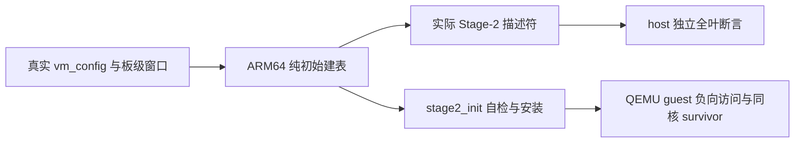

# XL-003 第一切片：初始 Stage-2 RAM 授权边界

> 状态：Approved（独立设计复核 PASS，父架构师批准实施；不代表运行验收）。
> 基线 `40db2d4`，分支 `feature/xl003-ram-bounds`。
> Linear：[H-124](https://linear.app/jamestam/issue/H-124)。仅交付 HV 侧 RAM 边界，不代表跨 HV/HSM/DM 契约完成。

## 事实与根因

生产 `stage2_init()` 将 `ram_pa` 向下截到 1 GiB，再忽略 `mem_base/mem_size`，固定映射
IPA `[0x40000000,0x80000000)`。以下是源码推导，不是新一轮运行结果：

| profile | 配置授权 | 现有实际映射 |
|---|---|---|
| Linux VM0 | IPA 0x40000000 → PA 0x80000000，256 MiB | 1 GiB |
| Linux VM1 | IPA 0x40000000 → PA 0xc0000000，256 MiB | 1 GiB |
| SVM VM0 | IPA 0x40200000 → PA 0x40200000，2 MiB | IPA/PA 0x40000000 起 1 GiB |
| SVM VM1 | IPA 0x40200000 → PA 0xc0200000，2 MiB | IPA 0x40000000 → PA 0xc0000000，1 GiB |

正常 Linux 的两段 PA 不重叠、不直接覆盖 EL2，但每 VM 多授权 768 MiB。SVM VM0 的
身份映射覆盖 EL2 镜像 PA 0x40080000，构成测试 profile 的真实隔离缺口；不能外推为
Linux VM 也直接覆盖 EL2。旧 EQUIV 自检只证明保留旧布局，不能证明布局安全。

## 范围锁与时间盒

固定范围：初始 RAM 建表、对应描述符自检、QEMU 板级 HV/SVM 边界断言、host 与负向
QEMU 验证。时间盒为两个工作日（提取/RED 半日，GREEN 半日，独立回归及评审一日）。
不延长前置工作；到期登记未完成项，按 Linear 原顺序处理下一项，未通过验收不得伪称完成。

不做：设备白名单、DMA/SMMU、动态映射与 TLB 协议、巨页拆分、页帧分配、HSM/DM、
共享页/carveout 框架、RAM 重排或 loader 地址更改。新发现问题只登记，不扩入本切片。

## 决策

1. `vm_config.{mem_base,ram_pa,mem_size}` 是当前 RAM 授权来源。映射恰为
   `[mem_base,mem_base+mem_size)` → `[ram_pa,ram_pa+mem_size)`，禁止掩码取整扩大范围。
   复用现有 `s2_map()` 的 1 GiB/2 MiB/4 KiB 选择，不新增映射框架。
2. 将生产初始建表的最小纯逻辑部分提取到 `arch/arm64/mmu/`；host 测试编译同一源文件
   和真实 `vm_configs.c`（分别 Linux/SVM 双 VM 配置），不得复制一个正确的测试 builder。
   先保留旧行为提取，再提交会揭示旧行为的 RED；新 ARM 逻辑不放入 `common/`。
3. 设备窗口及 GIC/UART 洞本轮保持不变。RAM 自检替代旧 L1 字面等价要求：遍历有效叶，
   检查完整覆盖、OA 偏移、Normal/RW 属性与边界外无 RAM 叶；不得仅检查区间首地址。
   池耗尽/无效配置仍返回失败，经 `vm_arch_init()` 保持该 VM OFF。
4. 对齐、零长度、IPA/PA 端点及加法溢出必须在建表成功前拒绝；PA 范围遵守当前
   VTCR 的 40-bit 输出地址配置，不能只依赖底层描述符能容纳 48-bit。
   设备区间与 RAM IPA 冲突同样不得成功。启动期失败不引入回滚与重试承诺。
5. QEMU 链接期约束：包含 BSS 和 boot stack 的 HV 末端不得越过 SVM backing 起点
   0x40200000。当前已有产物 `build/test-s2fault/hypervisor.elf` 的 `__stack_top=0x400e6dc0`
   只作旧构建参考，新代码须重新链接验证。保持 loader/guest DTB/SVM 链接地址不变。
6. 当前真实配置由 host 全叶检查确认：两个 VM 的 RAM OA 不重叠、都不覆盖 HV 保留区。
   这是静态 profile 的验证，不声称已提供任意动态配置的通用授权策略。

## 验收

- host：实际 Linux 两配置只各映射 256 MiB，SVM 两配置只各映射 2 MiB；OA 不取整；
  枚举全部叶，验证无额外 RAM alias、两个 VM 的 RAM OA 不重叠、不覆盖 HV 保留区。
  保留设备映射检查，覆盖非法配置、池耗尽、RAM 边界前后页；RED/GREEN 分开提交。
- QEMU 新目标建议 `test-qemu-s2bounds`：复用 `svm_xvm2` 同 pCPU survivor 拓扑，每个
  致命探针独立启动：VM0 读 IPA 0x40080000、0x40400000、0xc0200000。
  必须出现对应 IPA 的 translation fault（前两项应为 L2 fault），访问后的穿透标记
  必须不存在，同 pCPU 的 VM1 必须完成。只证明第三探针回归，不称它为旧版本漏洞。
- 禁止标记由测试 harness 显式校验，不能仅靠正向日志出现。新增检查逻辑须有小自检。
- 受控回退到旧固定 1 GiB RAM 映射，host 与前两个负向探针必须失败；所有变异恢复。
  若新自检在启动前拦截变异，只证明自检承重。QEMU 访问检查须另在一致的旧建表/旧自检
  下让 guest 真正访问，观察穿透标记并判失败，不能将启动失败冒充隔离探针承重。
- `make host-test`、`make clean && make test`、`make test-linux`、x86 stub 与静态检查。
  既有场景 expect 不随意放宽；新目标包含多个独立 QEMU 启动，报告分别统计目标与启动次数。
- 独立测试专家重跑，父架构师评审后线性合入 `dev`、push `dev:develop`、同步 Linear 并读回。

## 历史决策与限制

新 ADR 应局部替代 ADR-0004 的固定 RAM 大块映射及 ADR-0025 的 RAM 旧值等价要求；
设备布局不变，历史记录保留并链接新裁定，不重写旧实现事实。

即使本切片通过，低地址设备宽映射仍未白名单化；DMA、真实 cacheability 与运行期
TLBI 仍未验收。Linux 正常启动不独自证明恶意 Linux 的越界访问，Linux 配置的范围证据
来自生产 builder 的 host 全叶检查。H-124 保持 In Progress。
