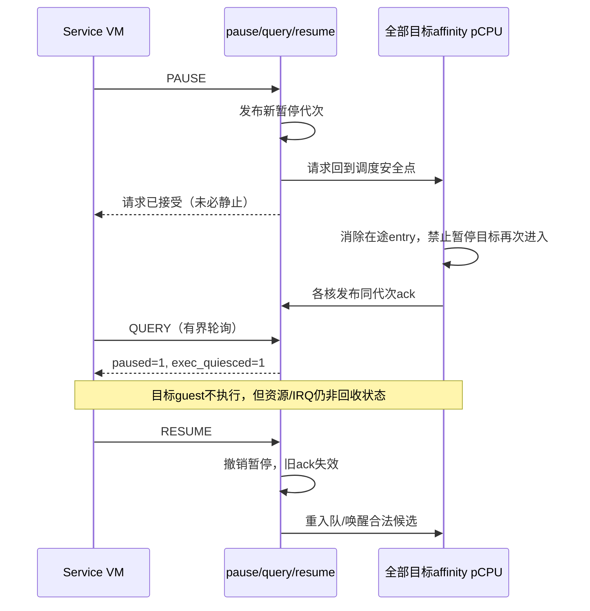

# HV-004：暂停请求的执行静止确认

> 状态：T1 同源 RED 已独立验证，软件证明有条件通过；父架构师批准下述最小 HCR 修订及 T2 实施。
> 这是设计准入，不是 GREEN/硬件验收；首次 idle 路由、无 timer kick→ack 与 guest 后路由证据仍待实现验证。
> 基线 `3b8b9a8`，分支 `feature/hv004-pause-confirmation`。
> Linear：[H-107](https://linear.app/jamestam/issue/H-107)。本片属于已有 pause/resume 能力闭环，
> 不关闭完整 VM 生命周期需求，不宣称 H-125 的资源回收已完成。

## 事实、用途与边界

当前 `HC_VM_PAUSE` 设置 `paused` 并 kick 采样为 RUNNING 的 vCPU 后返回。它不确认停机。
`sched_loop()` 的 RUNNING 快路径不检查 paused，pick 后的唯一检查还存在远端 pause 与
load/entry 的交错窗口。扫描“没有 RUNNING”不能排除尚未完成的 guest-entry 路径。

目标：保留异步请求，再通过现有 QUERY 观察本轮**执行静止确认**。定义为：所有相关
pCPU 已经过本轮暂停的调度安全点，没有尚未完成的目标 guest-entry 路径；在下次 resume
前目标不再执行 guest 指令。真实消费者是 SVM Service VM 的 pause→有界轮询→hold→resume。

这不是资源静止或一致寄存器快照：live vGIC/vtimer、console/IRQ 发布者、Stage-2/VTTBR
可能仍驻留/更新；执行静止不能授权释放 RAM、页表或复用 VMID。QUERY 只是可线性化观察，
不是租约，并发 resume 可以撤销它。将来 destroy 必须持有统一生命周期排他协议。

## 范围锁与时间盒

两工作日：第一日冻结交错矩阵、host 行为 RED、协议/ABI GREEN；第二日 QEMU 进度证据、
变异、回归与独立验收。固定范围为请求代次、每 affinity pCPU 确认、guest-entry 门、
QUERY 新位及测试。到期记录未完成，按 Linear 顺序处理下一项，不继续增加前置硬化。

不做：create/destroy/reset、五态 VM 枚举、事件环/HSM/DM、内存 allocator、设备 teardown、
排空 IRQ 发布者、live LR 清除、完整寄存器快照、运行期 TLBI/VMID 复用、迁核、通用会合框架。
不改 loader、RAM/设备地址布局，不向 guest 额外映射其他 VM 的 RAM 来便利测试。

## 接口契约

- 保留 HC_VM_PAUSE/QUERY/RESUME ID、权限与错误语义；PAUSE 成功仍仅表示请求已接受。
- QUERY 的 bit32 保留“暂停请求状态”；新增 bit33 `EXEC_QUIESCED` 表示本代次执行静止。
  bit33=1 必须蕴含 bit32=1。低位 VM ID/service/online vCPU 含义和位置不变。
- bit32/33 必须来自同一稳定代次观察；低位 online 计数仍是原派生计数，不承诺与暂停位
  构成整个 VM 的原子快照。新增位定义放 ABI 头，不在调用方各写 magic number。
- HC_VERSION 从 0.1 增为 0.2，使消费者可检查是否支持确认位；保留旧 ID/字段/操作语义，
  不承诺所有旧二进制接受新版本。原严格比较 0.1 的 SVM 必须同步，新消费者拒绝无确认位版本。
- 只有 Service VM 可控制他者；普通 VM 仅可查自身；self/非法目标/重复操作保持原拒绝。
- RESUME 无需等待确认即可撤销暂停，完成位立即在新稳定观察中清除；快速
  pause→resume→pause 不得继承旧 ack。无新增同步 QUIESCE hypercall或等待远端的忙等。
- `HC_EBUSY` 除重复状态外，也覆盖并发 CAS 竞争及暂停代次耗尽；这些拒绝不改变状态。
  并发调用不得依据失效快照返回成功。QUERY不无限重试，变化时保守返回未确认。

## 协议不变量（实现必须附交错证明）

1. 每次成功暂停有独立代次；pause/resume 的发布有明确线性化点。代次不得静默回绕导致
   旧 ack 被复用；若表示存在耗尽边界，必须明确拒绝而不是复用。
2. 确认集合由目标的所有**不同 affinity pCPU** 构成，不只采样 RUNNING 者；即便目标
   vCPU OFF/BLOCKED/ON_PENDING 或队列为空，也要该核经过安全点。未回应核保持未完成。
3. 仅 affinity pCPU 自己在调度安全点发布对应代次 ack；请求者不能扫描 state 伪造确认。
   安全点之后不得继续本轮已选中的目标 guest-entry，除非已观察到后续 resume。
4. 覆盖 RUNNING 快路径、pick 检查后到 LOAD 前、fresh load、resume/self-repick、idle。
   pause 在 entry 检查后到实际进入之间到达时，允许请求尚未完成，但该核必须在退出后
   才确认。不能先确认再完成旧的 entry。
5. 所有 guest-entry 路径共享同一暂停准入契约。确认后只要暂停未撤销，CPU_ON、wake
   或队列重入都不能恢复目标执行。需要 IRQ unwind 时保留 idle-window 防护。
6. QUERY 只有在同一稳定暂停代次的全部 ack 满足时返回 bit33；并发 resume/再暂停或
   迟到 ack 不能拼出假完成。明确 acquire/release、锁顺序与本地 IRQ 状态约束。
7. 不持锁进入 guest、idle 或等待远端 ack；不在 hypercall 同步等待同核目标。既有队列锁
   与 IRQ 约束不可削弱。避免新增 arch hook，必要时才同步 x86 stub。
8. resume 保留 RUNNABLE/ON_PENDING 重入队，BLOCKED 仍等待真实事件，不伪造唤醒。
   pause/resume 交错不得丢掉应运行候选；排除重复入队仍使用原有队列语义。

### 锁定的 packed-state 协议

- 每 VM 一个自然对齐 atomic u64 `pause_state`，低位为暂停位，高63位为代次，初始0。
  成功 PAUSE 对未暂停值 CAS 到下一代暂停值；RESUME CAS 清低位、保留代次。
  成功 CAS（acq_rel）是线性化点；失败使用 acquire 观察并返回 busy，不无限争抢。
  代次耗尽拒绝并保留状态，不回绕；运行中对象不能重置代次。
- 每 VM、每 affinity pCPU 一个 ack，初始化0；仅本核调度循环 release-store 完整暂停值。
  RESUME 不远端清零 ack；过期 ack 自然不匹配下一代，单写者不在 IRQ 中确认。
- QUERY acquire读state、acquire读全部所需ack、再次acquire读state。两次state相同且
  paused、全部ack匹配才置bit33；若变化，返回最后state的bit32及bit33=0。
  0表示本次未确认，允许保守返回；不能将ack改relaxed后仅靠末尾acquire声称读取有序。
- ack只发布执行确认，不是设备排空或资源释放屏障。全部路径按上述顺序实现，host必须
  执行同一协议；研发T1提交具体entry/安全点/QUERY交错证明，独立复核后才进入GREEN。

### RUNNING 排除与队列协议

暂停门拒绝 RUNNING resident 时，通过 `VCPU_EV_YIELD` 转为 RUNNABLE，转态成功后
**无条件**使用原幂等队列入队；不得依据另一次 paused 采样决定是否入队。处理之后才能
发布本核ack。这样即便远端RESUME刚扫描到RUNNING而未入队，目标也不会永久丢失。
LOAD后若另设最终entry门，同样处理；`prev/cur_vcpu/launched`必须继续对应已加载硬件，
不能因拒绝entry退回旧resident。pick后重新读取pause_state，不能用安全点缓存值丢弃
RESUME刚放回的候选。CPU_ON/wake发布后才入队的既有路径也必须受同一entry门约束。

### Idle 无丢通知协议（本片必要条件）

- 待确认代次纳入睡眠判据，不能只看队列空；即便只有OFF secondary且无timer，也要响应。
  共享核正在运行另一VM时，kick处理须检查本核任一相关VM的待确认代次并请求unwind，
  不能只看当前owner的paused。idle_window内仍返回EL2指令流，ack只能在scheduler发布。
- 调度循环设置idle_window后，最后一次检查“队列空且无待确认代次”到WFI之间保持
  本核IRQ屏蔽，避免唯一kick先被handler消费。IRQ只是PSTATE屏蔽，不关闭GIC对应SGI
  或用PMR屏蔽唤醒信号；pending IRQ须能结束WFI。
- 精确序列：PSTATE.I=1时设置idle_window，最后检查判据；允许睡眠才执行
  `dsb sy; wfi`。无论WFI执行还是跳过，都在idle_window=1期间执行
  `msr daifclr, #2; isb; msr daifset, #2`，再清idle_window并回安全点。
  所有相关inline asm带compiler memory clobber，不能让判据/状态跨越IRQ或睡眠操作。
  ack始终在调度循环，不放进handler；无锁跨WFI/开IRQ。
- `cpu_arch_kick()`明确采用请求发布 → `dsb ish`（memory clobber）→ 现有
  `gic_kick_pcpu()`的SGI写入/ISB。睡前DSB、开IRQ后ISB、发SGI前DSB不能互相替代。
  检查公共hook全部调用者与直接GIC kick路径，保留后者已有屏障；不新增通用barrier接口。
- 该证明要求kick是已启用且路由正确的物理Group-1 IRQ，GIC group/PMR/running priority
  不挡住唤醒信号；当前配置kick priority=0xa0、PMR=0xff，handler需priority-drop/deactivate。
  只用PSTATE.I延迟处理，不关闭SGI或在PMR层屏蔽通知，不笼统声称所有masked IRQ均能唤醒。
- Linux arm64 `cpu_do_idle()`支持DSB/WFI及PMR条件，`kvm/arm.c`的enable→ISB→disable
  引用ARM DDI0487G.b D1.13.4。T1与独立复核已核对官方DDI0487G.b/IHI0069H.b相关条款，
  版本、哈希、定位见[T1报告](../../reports/2026-11-09-hv004-pause-t1-review.md)；不是通读全部规范。
  公共hook注释须区分ARM masked-WFI和x86 HLT；x86仅链接stub，不外推为可运行idle实现。
  host覆盖检查前、检查后/WFI前两个kick窗口；QEMU验证无timer空核确认。

### T1 后批准的最小 HCR 初始化修订

独立复核确认：只有guest run才写HCR时，首次OFF-secondary idle不能保证EL2 IRQ路由。
DDI D1.13.2 Table D1-13中IMO=0/TGE=0为C类，不属于D1.16.2物理WFI唤醒条件；
IMO复位值UNKNOWN，不得将缺保证描述为实测0。父批准如下必要修订，时间盒不顺延：

- 现有ARM `cpu_arch_init()`、`secondary_main()`入口，在EL2 MMU初始化/enable之前，
  全值写`HCR_EL2_HOST_BASE = RW|FMO|IMO|AMO = 0x80000038`，紧接带memory clobber的ISB。
  DAIF保持屏蔽；不提前开IRQ，不新增generic hook或每轮idle的HCR切换。
- 在现有`arch/sysreg.h`收敛HCR bit/组合定义；guest reset使用
  `HCR_EL2_GUEST_BASE = HOST_BASE|VM|TWI|TWE|TID3|TSC = 0x800c6039`，保持旧guest写值。
  CPU_ON复制shadow、run写物理HCR/ISB的链不变，所有guest entry保留IMO/FMO/AMO。
- 两基线均E2H/TGE=0；初始VM/VI/VF/VSE=0，VM仅在Stage-2就绪后guest run启用。
  head.S已有stack/VBAR/DAIF顺序不扩大改造；TPIDR/cur_vcpu/GIC未就绪时不能开放IRQ。
  不对UNKNOWN寄存器仅OR IMO；不修改全局SYSREG宏、不承诺FIQ/SError新能力。
- 实际验证首次无guest/no-timer secondary的HCR、DAIF、Group1/PMR/RPR及kick→同代ack；
  guest首次run后核对IMO及E2H/TGE不回退、VM时机正确。使用关键位而非全字强等号，
  因TSC等位可RAZ。boot无候选路径也须覆盖；旧hcall PASS不能替代这些证据。
- T2交付软件GREEN及初始化修订，T3把实际硬件观察接入已冻结场景；缺证据不得验收。
  非VHE QEMU为本片边界；EL3/SCR、任意warm-entry MMU/TLB、RK3588验收不外推。

## 验收

### Host：确定性交错，生产同源

- 先行为 RED：原异步 pause 不能支持完成语义；不以编译缺符号作为协议验证。
- 请求后目标在 run/load 窗口，完成为0；两 affinity 核只确认一个仍为0，全部同代次确认才为1。
- 覆盖 queued/BLOCKED/ON_PENDING/OFF-resident/idle、RUNNING 快路径、pick后到LOAD前暂停。
- resume→再次 pause 后迟到旧 ack 无效；QUERY/resume 并发不能出现 bit32=0/bit33=1 或
  将前代确认算作本代。并发控制的确定性交错须测试生产路径，不只是私有模型。
- resume不丢RUNNABLE/ON_PENDING、不伪唤醒BLOCKED，CPU_ON/wake不能越过暂停entry门。
  必测RESUME扫描RUNNING后本核才YIELD排除（必须入队），以及resume扫描后CPU_ON/wake
  才完成入队；覆盖idle两个kick窗口与无timer的OFF secondary。
- 权限/self/越界/重复请求拒绝及旧 QUERY 低位保持；同步版本检查与已有 hcall 用例。
- 受控错误至少覆盖：完成=paused、完成=无RUNNING、遗漏一个核、复用旧ack、绕过快路径
  暂停门；每项必须有可判红用例。不能用最终全绿代替交错与承重证据。

### QEMU：独立物理进度 oracle

冻结为三个独立场景，不做条件笛卡尔积：

1. `svm_dual`：从未运行的OFF secondary、无timer空队列确认 → resume/CPU_ON →
   目标双vCPU计数闭环。
2. `svm_xvm2`：共享核双计数闭环，timer/block/wake分阶段覆盖。
3. 共享核并发控制：两个Service vCPU、CPU_ON/pause交错与权限/非法目标/重复操作拒绝；
   不与静止HOLD oracle混跑。确定性竞态与五类变异主要由host承担。

每场景重复三次，共九次专用启动，完整gate另算。两个已有拓扑不变，目标计数页固定在
各自授权RAM中、专用linker校验；明确64-bit对齐计数与必要发布屏障。

Service guest自主执行有界阶段，在自身RAM发布`{阶段序号, phase, 进度}`；runner只读，
不写mailbox、不添加跨VM共享映射。HOLD仅在本轮QUERY完成后发布，同轮所有Service
控制线程承诺不在HOLD内resume；并发压力放独立场景。phase发布使用明确的稳定序号
协议，runner将目标计数采样夹在同一个已确认HOLD序号内，阶段变化/错过窗口均保守失败。

QMP/monitor不发送stop/cont；检查QEMU运行状态，读取目标真实backing PA及Service进度。
暂停前目标两计数增长；同一HOLD有界观察窗内两者不变，**每个观察间隔Service计数都增长**；
resume后确认位清除、目标两计数再次增长。不从日志静默推断停机，不将全机停止算成功。
明确观察窗/超时并保存QMP原回复。物理读取仅是当前QEMU证据，不外推真机缓存一致快照。

QMP按请求ID匹配回复、区分异步事件，错误/截断/断连/超时失败；新增检查留下小自检，
不扩成通用日志硬化工程。有限QEMU运行不声称穷尽并发，时间盒内未完成项明确保留。

最终 `make host-test`、专用 pause 目标（重复三轮）、`make clean && make test`、
`make test-linux`、x86 stub/静态检查；原场景不放宽 expect。独立专家重跑、原始证据归档，
父架构评审通过后才合入/push并同步 Linear。H-107、H-125 保持各自未完成范围。

## 借鉴与后续边界

只读参考 ACRN `vm_reset.c`、`zombie_vcpu()/sleep_thread_sync()`、`vm_event.c`：借鉴请求、
执行确认、资源释放与事件通知分层，不照搬状态名冒充已停机。未来真正 destroy/recreate
须再建立生命周期排他、撤销发布并排空、正确目标 VMID 失效与遍历结束、资源归还清零、
装载失败回滚和设备重建；这些不能仅凭本片 QUERY bit33 执行。
