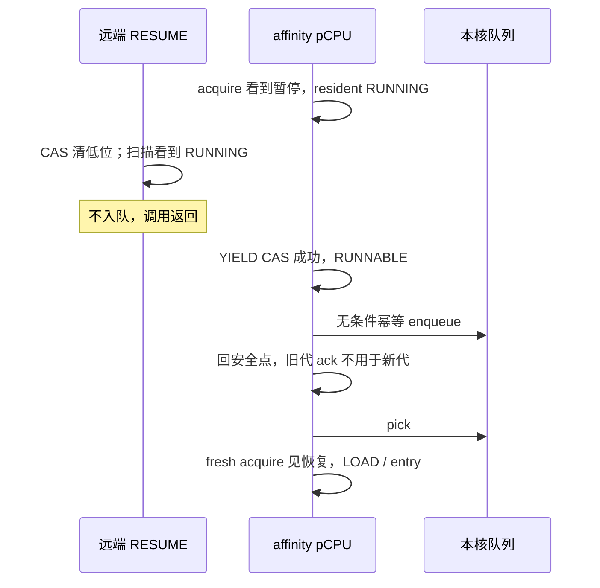
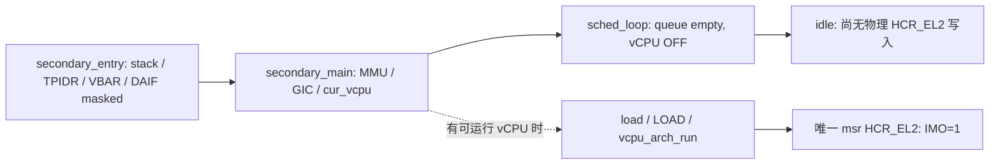

# HV-004 pause confirmation：T1 落点、交错证明与行为 RED

> **T1 待独立复核，不是实现验收，也不是 T2 GREEN 授权。**
> 批准方向：[design](2026-11-09-hv004-pause-confirmation-design.md)、
> [plan](../plans/2026-11-09-hv004-pause-confirmation.md)。生产基线 `3b8b9a8`，
> 开始时 HEAD `b15ffab`；两者的 `hypervisor/` 内容相同。
> 两工作日范围锁不变；本文中“拟”及证明均是 T2 的具体实施约束，不表示代码已具备该能力。
> **发现未解除的硬件前提阻塞：首次 guest-entry 前没有建立 EL2 物理 IRQ 路由保证，见 §5.2。**
> 父架构师只允许记录最小 T2 修改候选，仍需重新批准，未授权生产修改。
> **超时后 checkpoint：**原执行 run 达到 1800000 ms 上限；恢复仅核对已保存文档与
> exit/log 并提交本文，未重新研究、下载或构建。T1 尚未独立通过，IMO 路由阻塞未解除。

## 1. 盘点与本次实际改动

遵循 ADR-0015 架构边界、ADR-0019 resident/资格分离、ADR-0022 ABI 与
ADR-0023 异步请求语义。下表路径均以仓库根为起点；批准 plan 中省略了 `hypervisor/`
前缀，实际文件不是顶层 `common/`。

| 边界 | 现有调用链、必须同步的落点 |
|---|---|
| 请求与恢复 | `common/hypercall/hypercall.c:hc_vm_pause/hc_vm_resume` → `common/sched/sched.c:sched_vm_pause/resume` → `include/vm.h:vm_pause/resume`（当前实际是 inline bool exchange，不在 vm.c） |
| 状态对象 | `include/vm.h:struct vm.paused`；`common/vm/vm.c:vm_init` 初始化；`vm_is_paused` 的生产读者为 scheduler、hypercall、`dm/hv_shell.c`、ARM IRQ handler |
| 调度入口 | `common/vm/vm.c:vm_run`、`arch/arm64/cpu/secondary.c:secondary_main` → 唯一 `sched_loop`；它有两个 `vcpu_arch_run` 调用点 |
| 架构 entry | `arch/arm64/vmexit/vmexit_asm.S:vcpu_arch_run` 最后 ERET；同文件 `el1_sync_handler` 的普通陷入返回、`irq/irq_handler_asm.S:el1_irq_handler_asm` 的 IRQ 返回也 ERET；不能漏算这两种续行 |
| 通知与 unwind | `include/cpu.h`、`arch/arm64/cpu/cpu.c` 的 idle/IRQ/kick hook；`irq/irq_handler.c:el2_irq_handler` kick/tick 分支；保留 `idle_window` 防止 current-EL IRQ 从旧 hv_ctx 解栈 |
| CPU_ON/stop | `arch/arm64/vmexit/vpsci.c:psci_cpu_on_guest` 发布 ON_PENDING 后 enqueue/kick；CPU_OFF 与 SYSTEM_OFF 通过 `hv_restore` 回调度器；CPU_SUSPEND 已走 block/unwind，旧注释中的原地 WFI 不是实际代码 |
| wake | `sched_wake` 只对 BLOCKED 做 WAKE CAS → enqueue → kick；调用者为 `vgic.c:vgic_inject_spi`、`vgic_sgi.c:vgic_sgi_trap/vgic_sgi_drain_vcpu`、IRQ vtimer 分支、`timer/vtimer.c:vtimer_bg_expire` |
| ABI/消费者 | `include/hypercall.h` 定义 bit32/33；`hypercall.c` 版本 0.2 与 QUERY；`tests/host/hypercall_test.c`、`tests/svm/cases/hcall.c` 的 0.1 严格期望须 T2 同步；shell 继续只显示请求，无需新 UI |
| host/stub | 现有 `tests/host/sched_test.c` 用真 scheduler、inline VM 转态；`hypercall_test.c` 的 sched_pause/resume 是替身，不能据此证明调度闭环。新增测试直接链接真 sched/vm/hypercall。`arch/x86/stub/hooks.c` 只链接检查；不新增 arch hook，不把其 HLT 当成正确 idle |

表中相对 `common/`、`include/`、`arch/`、`dm/` 路径均在 `hypervisor/` 内。
没有额外公开调用者：`vm_pause/resume` 的生产调用仅 scheduler，`sched_vm_pause/resume`
的生产调用仅 hypercall。`vm_is_paused` 保留唯一 bool 读入口。

**本次只修改 Makefile、新增 host 测试与本文。没有生产提取，没有协议/idle/IRQ 修复。**
测试用 `-ffunction-sections -fdata-sections -Wl,--gc-sections` 链接生产 `vm.c`，仅丢弃未调用
的 boot/平台初始化段，因此不需要复制 `vm_online_vcpus`、`vm_is_service` 或 `vm[]`。
测试中硬件 hooks 是确定性调度断点，不实现 ack 或 QUERY，不构造私有协议模型。
不改用户设置、plugctl、RK3588、批准 spec/plan，不加 QMP 消费者。

## 2. packed state、接口与线性化点（拟）

### 2.1 对象与访问

在 `struct vm` 以 `u64 pause_state` 替换 bool，追加 `u64 pause_ack[NR_CPUS]`。
普通结构成员自然 8 字节对齐，不使用 packed；T2 用 `_Static_assert` 钉住字段 offset
模 8 为 0、对象 alignment 至少 8（ARM 与 x86 host/stub 均构建），所有运行期访问使用
`__atomic_*`，不混入普通读写。`vm_init` 在发布对象之前初始化两者为 0；运行中不清代次。
内存为既有 coherent、Inner Shareable Normal RAM；这是 `dsb ish` 的作用域前提。

`pause_state = epoch << 1 | paused`，epoch 范围 `0..2^63-1`。
ack 保存完整 state，不只保存 epoch 或 bool；仅该 pCPU 的调度循环写 `pause_ack[pcpu]`。
其它核、请求者、IRQ handler 均不可代写；RESUME 不清任何 ack。
确认集合是 `vm_config.vcpu_pcpu[]` 的**不同核**，不由 online/state/queue 推导。
重复 affinity 去重；配置由 `vm_init` 检查范围。未启动/失败核不被偷偷从集合移除，保持未完成。

| 操作 | 精确落点、原子序与结果 |
|---|---|
| PAUSE | `vm_pause` acquire 读 s；已暂停或 `s >> 1 == 2^63-1` 拒绝；对未暂停 s 做一次 strong CAS 到 `s+3`（下一 epoch、低位置 1），成功 acq_rel、失败 acquire；成功 CAS 是请求线性化点 |
| RESUME | `vm_resume` acquire 读 s；未暂停拒绝；一次 strong CAS 到 `s & ~1ULL`，成功 acq_rel、失败 acquire；成功 CAS 是撤销线性化点 |
| 拒绝 | 沿现有非零内部返回映射 `HC_EBUSY`；重复状态、并发 CAS 输家、代次耗尽不写状态，不无限重试。耗尽的已暂停状态仍可 RESUME，随后不能再 PAUSE |
| 请求通知 | CAS 成功后 `sched_vm_pause` 对所有不同 affinity 核调用 `cpu_arch_kick`，包含本核、OFF/BLOCKED/ON_PENDING、空队列；不等 ack |
| 恢复入队 | CAS 成功后原扫描 RUNNABLE/ON_PENDING → 幂等 enqueue → kick，BLOCKED 不伪唤醒；不凭之前的状态快照返回成功 |
| ack | 每次 loop 头的安全点，在清除本核在途 entry/排除当前暂停 RUNNING resident 后，对本核相关 VM release-store 其所采样的完整暂停 s |
| QUERY | 拟在 `vm.h` 保持与转态同源的 `vm_pause_query(v, &paused, &exec_quiesced)`：acquire state s1 → acquire 所有所需 ack → acquire state s2；不循环重试。s1=s2、低位 1、全部 ack=s1 才完成；否则 bit33=0、bit32=s2低位 |

QUERY stable 路径在最后一次 state acquire 处线性化；若请求并发变化，最后 state 读
决定请求位，完成位保守为 0。低位 online 仍由 `vm_online_vcpus` 独立派生，不承诺全字快照。
成功完成一定含请求位。每个暂停 s 都唯一，resume/再 pause 不能 ABA 回到同一 s；
两个 state 读之间出现撤销/新请求时，不会把不同代 ack 拼成新代完成。
acquire ack 保留在两次 state acquire 之间，不能把 ack 改 relaxed 后只靠末尾 acquire。
QUERY 是观察，不是租约；随后 RESUME 可立即撤销，资源仍不能释放。

### 2.2 锁与 IRQ

- 正常 scheduler、hypercall、guest trap C 均 `PSTATE.I=1`；只有 idle 的明确窗口开 IRQ。
  不在持 `q_lock`、vGIC/设备锁时开 IRQ、WFI、进入 guest 或等待远端。
- `sched_enqueue/pick` 沿用每核 ticket lock、幂等队列；转态与 pause/ack 的原子操作不新增锁。
  safe point 写 ack 前完成 YIELD/队列操作并释放队列锁。
- `sched_idle_may_sleep` 拟在屏蔽 IRQ 的最后检查读取 queue 与待确认代次；可复用
  `sched_queue_empty` 的有锁检查，释放锁后才能睡。不得继续依赖旧的“开 IRQ 的 advisory
  probe”契约；对应头文件/注释须同步，不允许 handler 与本核持锁者互锁。
- 只作有界 `NR_VMS × VCPUS_PER_VM` 扫描；无等待 ack 的循环。原有队列锁、CPU_ON authoring、
  架构原子 LL/SC 内部重试不等于新建远端会合等待，T1 不宣称硬实时执行上界。

## 3. 安全点、准入与 resident

### 3.1 最小函数落点

`sched_loop` 保持单循环，不造新调度器。拟加 scheduler 内部 `sched_pause_safe_point(pcpu, prev)`：
位于现有 preempt_take/YIELD 之后、RUNNING 快路径之前。对本核相关 VM acquire 取 s；
若暂停且 `prev` 属于该 VM、仍 RUNNING，先 `VCPU_EV_YIELD`，成功后**无条件**
`sched_enqueue(prev)`，再 release ack=s。CAS 被 OFF sweep 打败时不把 OFF 复活。
本核没有其它 pending pick/load（安全点只在 loop 头）；另一 VM 的 resident 不妨碍确认本 VM。
若旧 s 被并发撤销，迟到旧 ack 可以写，但不能用于任何新代完成。

拟用内部 `sched_pause_exclude(v)` 收敛 YIELD 成功 → 无条件 enqueue 的动作；它不决定代次、
不发布 ack。RUNNING fast entry 之前、两种 switch-in/self-repick 合流后的最终 entry 之前，
分别**新 acquire** `vm_is_paused`，暂停则 exclude 并 continue，回 loop 头再 ack。
必须同时保留 pick 后的 fresh acquire 检查；不能用 safe point 缓存 s 过滤后来出队的候选。
最终门放在 LOAD 成功之后、tick_arm/run 之前，覆盖 fresh load、resume、自重选、re-ON。

`prev=v` 仍在真正切换硬件后立即设置，不能等 LOAD/暂停门成功再设置；`cur_vcpu=v`
仍在 load/resume 前重绑；fresh load 后 `launched=true` 不回滚。这些值描述硬件归属而非准入。
暂停拒绝不伪装成旧 resident，也不多清一次 vGIC/EL1。之后若换到他者，原 `put(prev)`
仍保存这次实际加载的 v。旧 OFF/BLOCKED resident 的保存分工不改。

拟公开 `sched_pause_pending(pcpu)` 供 idle 最终判据与 IRQ 使用：相关 VM acquire state
为暂停、且本核 ack 不等于完整 state 时返回 true。它只检测，不确认。
`irq_handler.c` 在 kick 已 priority-drop/deactivate 后，若非 idle_window 且本核任一 VM
待确认，则请求 unwind 到 loop（可复用 preempt_request + hv_restore）。
**不能只检查 `current_vcpu()->owner` 暂停**：共享核可能运行 Service VM，而目标仅有 OFF
secondary；它也必须经过 safe point。idle_window 内 handler 正常返回，不 ack、不 hv_restore。

### 3.2 全部 guest entry/return 的归约

| 路径 | 暂停前/后到达时的处理 | 何时才能 ack |
|---|---|---|
| RUNNING 快路径 | safe point 先排除已看到的暂停；紧邻 `vcpu_arch_run(prev)` 再查新暂停 | 已排除且入队后；绝不能 ack 后直接沿旧 RUNNING 分支进入 |
| pick → state/PICK → load | pick 后 fresh acquire；之后到达的请求由 LOAD 后最终门截住 | 该候选 continue 回 loop 头后 |
| v!=prev、launched=true | resume 后 resident 已更新；LOAD 成功后共用最终门 | 拒绝后的下轮 safe point；硬件归属不回退 |
| fresh load | load 后 launched=true、prev/cur_vcpu 指向新硬件；最终门拒绝不回滚这些值 | 同上 |
| prev==v 自重选、re-ON | 既有 launched 分叉保留：前者 LOAD，后者必须 fresh load；合流最终门 | 同上 |
| 最终检查 → 汇编 ERET 的窗口 | 请求可以在检查后到达；当轮允许进入 guest，完成仍为 0；kick/tick/显式 unwind 后才处理 | 下一调度安全点，不在中断里先确认 |
| el1_sync_handler 普通 trap ERET | 仍属于已经准入、尚未回 scheduler 的执行段。HVC/sysreg/MMIO 快速返回本身不发布 ack | 后续 hv_restore 回调度器才确认 |
| el1_irq_handler_asm ERET | 未 unwind 的 IRQ 同上；kick 待确认必须在非 idle 分支 unwind，不能 ack 后 ERET | loop 头 |
| current-EL idle IRQ 返回 | 返回 idle 的 EL2 指令流，不是 guest；idle_window 防止误用旧 hv_ctx | 重新屏蔽、清 idle_window 后的 loop 头 |

在目标暂停 s 被本核确认以后，要执行目标只能重新经过两个 run 门之一；门不能在不观察
RESUME 的情况下放行。普通 trap/IRQ ERET 不构成旁路：确认时本核已不在那个 guest 执行段，
且 IRQ 不能发布 ack。静态 affinity、单核 resident、无迁移是此归约的必要前提。

### 3.3 请求/恢复交错矩阵

| 交错 | 结果与不丢候选理由 |
|---|---|
| RESUME 扫描看到 RUNNING、不入队 → 本核按先前暂停观察做 YIELD | YIELD 成功后无条件 enqueue，不再读 paused 决定入队；即使 RESUME 已清位，也能再次 pick/LOAD。条件性 enqueue 会永久丢 vCPU |
| 本核先 YIELD/入队 → RESUME 扫描 RUNNABLE 再入队 | 既有 sched_q 幂等，只有一份候选 |
| LOAD 后刚成 RUNNING → RESUME 扫描 RUNNING → 最终门按先前暂停观察排除 | 与首行同一 enqueue 规则；保留新 resident/cur_vcpu/launched，不能回退旧硬件身份 |
| safe point 看暂停 → RESUME 入队 → pick | pick 后重新 acquire。若用缓存 paused 丢候选，恢复扫描已结束就无发布者再入队；fresh read 禁止该丢失 |
| pick fresh read 仍暂停 → 随后 RESUME | 出队已发生；RESUME 看到 RUNNABLE/ON_PENDING 再入队。若 RESUME 已先完成，fresh acquire 须按其实际原子顺序观察，不用前一 safe point 值 |
| CPU_ON 在 RESUME 扫描 OFF 后发布 ON_PENDING/入队 | CPU_ON 本身负责 enqueue/kick；pick 和最终 entry 门仍查当前暂停，不借 ON_PENDING 绕过 |
| wake 在 RESUME 扫描 BLOCKED 后做 WAKE/入队 | wake 自己负责发布；RESUME 不伪造事件，entry 门继续约束 |
| PAUSE 时 OFF/BLOCKED/ON_PENDING/空核 | 仍请求全部 affinity safe point；无 RUNNING 不等于已完成；无 timer 也靠 kick/idle 协议推进 |
| p0 ack=s、p1 未到 | QUERY 未完成，不能只扫 RUNNING 或漏一核 |
| resume → pause(s') → 迟到 ack=s | s' 不等 s；QUERY 不接受。RESUME 不远端清零，避免清零覆盖新确认 |
| QUERY 取 s → RESUME/新 PAUSE → ack 混代 → 再取 s' | 双读不稳定，完成=0；请求位取末次 state |
| 最终门放行后才 PAUSE | 本核尚无本轮 ack，QUERY 必须未完成；不能把 PAUSE 返回等价于 entry 已终止 |

## 4. Idle：通知不能在睡前被消费

拟序列（不是本次修改）：在 `PSTATE.I=1` 的 loop 中设置 `idle_window=1`，最后检查
queue 空且 `!sched_pause_pending(pcpu)`；允许睡才执行 `cpu_arch_idle` 的 `dsb sy; wfi`。
执行或跳过 WFI 后，仍保持 idle_window=1，执行
`msr daifclr,#2; isb; msr daifset,#2`，最后清 idle_window 并回 safe point。
现有 enable hook 仅有 daifclr，T2 拟在该 hook 加 ISB（唯一生产调用者是 idle）；disable
保留 daifset。所有相关 asm 带 `memory` clobber。没有锁跨睡眠或开 IRQ。

| kick 到达窗口 | 不丢失依据 |
|---|---|
| 最后检查前 | 请求发布先于 SGI；检查发现待确认/队列非空则跳睡。即使读未及时看到，SGI 尚未在屏蔽窗口被 handler 消费，仍能结束 WFI |
| 检查后、WFI 前 | PSTATE.I 保持 1，handler 不能抢先清掉唯一 SGI；满足 GIC 信号前提的 pending IRQ 使 WFI 不悬停/结束 |
| WFI 中 | 相同物理 IRQ 信号唤醒；返回后开 IRQ + ISB 处理/清除 kick，避免一直 pending 的忙循环 |
| 开 IRQ 到重新屏蔽之间 | idle_window 始终为 1；handler 只处理 IRQ，不 stale hv_restore，不 ack；ISB 保证 eligible pending IRQ 在重新屏蔽前被识别 |
| 重新屏蔽之后、清 idle_window/回 safe point 前 | 新通知不能在本核被消费，下一 safe point 或最后检查观察到请求；否则 SGI 留 pending 结束下一次 WFI。清窗口与检查间没有再次开 IRQ |

SGI 合并不要求每个请求一个 IRQ：最新完整 state 与队列才是事实；已经处理的旧通知不等于
新请求已确认。最终检查期间保持屏蔽、发布先于通知、返回 safe point 三者共同闭合。
无 timer 空核不依赖量子兜底。host 不模拟 Arm 异常识别或 WFI 电气语义，硬件结论需以下规范。

### 4.1 通知顺序与全部 kick 调用者

`cpu_arch_kick` 拟明确为请求发布 → `dsb ish`（memory clobber）→ 现有
`gic_kick_pcpu` 的 `ICC_SGI1R_EL1` 写与 ISB；后两项 asm 的编译器边界也须核对。
发通知前 DSB 是共享内存对目标可见的完成约束，不可由接收方睡前 DSB 或开 IRQ 后 ISB 代替。
这是异步 kick，不声称返回时目标已收到/处理 SGI。

| 路径 | 现有顺序与 T2 限定 |
|---|---|
| sched pause/resume/wake → cpu_arch_kick | 当前没有 DSB，T2 在公共 ARM hook 补，覆盖三者；不新增通用 barrier API |
| PSCI CPU_ON、SYSTEM_OFF → cpu_arch_kick | 调用前已有 `dsb ish`，保留；CPU_ON 还有 register authoring 发布与 ON_PENDING CAS，不能删 |
| vgic_inject_spi → 直接 gic_kick_pcpu | 调用前已有 `dsb ish`，保留；不绕过它作“去重” |
| vgic_sgi_trap → 直接 gic_kick_pcpu | **实际只有 sgi_lock 的 release unlock，没有 DSB**。这是既有独立虚拟 SGI 发布路径，不能声称所有直接路径已满足 barrier。T1 记录，不扩大成 vGIC 修复；暂停新通知必须经过修正后的 cpu_arch_kick |

## 5. 硬件前提与可定位依据

以下先区分信号产生与 PE 接受异常：PSTATE.I 仅推迟异常处理，不等于 GIC PMR/group mask。
当前 `gic_init` 与 `secondary_main` 均设置 kick 为 Group1 NS、priority `0xa0`、ISENABLER，
唤醒 redistributor，物理 CPU interface `ICC_IGRPEN1_EL1=1`、`ICC_PMR_EL1=0xff`，
SRE 开启。Distributor 开 ARE_NS/EnableGrp1NS；QEMU flat Aff3:1=0、Aff0=pCPU<16，
SGI1R TargetList 按此拓扑路由。guest 运行期间 `vcpu_arch_run` 写入的 `HCR_EL2.IMO=1`
将物理 IRQ 路由至 EL2；**首次 guest-entry 前并未建立这项保证**，不能把该值外推到从未
运行 guest 的 OFF secondary（§5.2）。§4 的 masked-WFI 证明以此路由已建立为前提。

running priority 也必须允许 kick：不能仅凭 `0xa0 < 0xff` 就说一定有 IRQ 信号。
`el2_irq_handler` 在 kick、EL2 timer、maintenance/UART 的 unwind/返回前作 priority drop；
kick 还立即 deactivate。虚拟 timer 的物理 PPI 可保留 Active（HW LR linkage），但已 EOIR
降低 running priority，不等于阻挡其它同优先级 IRQ。idle 不从一个未 priority-drop 的 IRQ
handler 内进入。若将来持有物理 active priority 跨 idle、更改 PMR/group/routing、迁核或关闭
redistributor，这份证明失效，必须重审，不能外推到 RK3588 或 x86 masked-HLT。

### 5.1 已取得并实际核对的规范

本轮取得官方完整 PDF，不再只转述 Linux 注释。仅核对下列相关条款，**未通读整本规范**。
官网前端只返回应用壳，改由官方 documentation-service 的 document API 解析 resources 链接：

1. **Arm DDI 0487G.b，ID072021**，
   [版本元数据](https://documentation-service.arm.com/documentation/ddi0487/gb)，
   [官方 PDF](https://documentation-service.arm.com/static/611fa684674a052ae36c7c91)。
   - **D1.16.2 / D1-2540，Wait For Interrupt → WFI wake-up events**：
     PE 收到表中标记 A、B、A/B 的物理 IRQ/FIQ/SError 是 WFI wake-up event，
     “regardless of the value of the corresponding PSTATE.{A, I, F} mask bit”。
     并明确 wake-up 不被这些 mask 位屏蔽；异常若仍 masked 则不被 taken。
     因此这里只依赖 **IRQ signal 已到达 PE** 的 masked-WFI，不声称 GIC 内任何 pending
     都能唤醒。允许 WFI 作 NOP/其它原因醒来，调度器必须循环复查判据。
   - **D1.13.2 / D1-2504–2506，Asynchronous exception masking**：异常进入把
     PSTATE.{A,I,F} 置 1；同 EL 的 IRQ 用 I 屏蔽；Table D1-13（无 EL3、有 EL2）
     `TGE=0, IMO=1` 时目标 EL2，运行在 EL2 对应 B、在 EL1 对应 A。
     B 是受相应 PSTATE mask 控制，正是 D1.16.2 列出的 WFI wake 类型。
     本工程非 VHE，guest 的 I 不阻止物理 IRQ 进入 EL2；EL2 idle 的 I 只延后 handler。
     若平台带 EL3，应按 Table D1-11 的 SCR 路由核对，不能套用无 EL3 的表。
   - **D1.13.4 / D1-2508，Prioritization and recognition of interrupts**：ISB 等
     context synchronization event 前已经 pending 且未 masked 的中断，必须在事件后第一条
     指令前被 taken。故 `daifclr; isb; daifset` 的 ISB 不能删；只有 enable/disable 不保证
     短窗口内已处理。新 IRQ 若在 ISB 后才到，落到下一 safe point/idle 检查的 pending 情形。
   - **B2.3.10 / B2-150–151，Data Synchronization Barrier (DSB)**：DSB 完成前，
     其前指定 domain/type 的显式内存效果必须 complete；其后指令不能改变系统状态或执行
     有副作用的功能。因此 `dsb ish` 在 SGI 系统寄存器写之前完成共享请求发布。
     `arch/arm64/mmu/el2_mmu.c` 的 `S1_SH_ISH`、WBWA RAM 映射支持此作用域前提。
     D1-2541 另外明确 WFI **不保证** drain pending memory，不能以 WFI 替代睡前 DSB。
2. **Arm IHI 0069H.b，ID041224**，
   [版本元数据](https://documentation-service.arm.com/documentation/ihi0069/hb?lang=en&rev=1)，
   [官方 PDF](https://documentation-service.arm.com/static/67eaa4d098aa3c3b6eea7351)。
   核对其中 GICv3 普通 IRQ 规则，不采用其更新架构的 NMI 特性。
   - **§4.4 / 4-60，Software Generated Interrupts**：Group1 SGI 由 ICC_SGI1R_EL1
     或 ICC_ASGI1R_EL1 生成，路由取写入值的 affinity/TargetList，允许包括源 PE；
     Non-secure ICC_SGI1R_EL1 生成 Non-secure Group1。
   - **§4.7–4.7.2 / 4-69–70**：GICD group enable、CPU interface group enable、
     GICR individual enable 共同约束投递。disabled IRQ/group 不能假定产生 PE IRQ signal。
   - **§4.8.3 / 4-74、§4.8.5 / 4-78、§4.8.6 / 4-79**：普通 pending IRQ 被 signal
     要同时高于 PMR mask、group priority 高于 running priority；数值越小优先级越高。
     running priority 取未 priority-drop 的 active IRQ，不能用虚拟 AP 状态冒充物理 running priority。
   - **§12.1.6 / 12-195–196，Observability of the effects of accesses to the GIC registers**：
     PMR 写自同步；列出 SGI 写等被 Redistributor 观察的 DSB 保证，并说明系统寄存器写须先
     ISB/context synchronization 再 DSB 才能声称这种可见性。批准的 kick 是异步协议：
     前置 DSB 保证的是 **RAM 发布早于 SGI 写**，后置 ISB 不被冒称为目标已经确认。
     若需要同步等待发送/Redistributor 完成，须另作协议；本片不要求这种接口。
3. 交叉参考，不替代上面原文：Linux **v6.12.103** 本地树 `f8e6766a9`，
   [`arch/arm64/kvm/arm.c`](https://git.kernel.org/pub/scm/linux/kernel/git/stable/linux.git/tree/arch/arm64/kvm/arm.c?h=v6.12.103)
   1253–1264 的 enable → ISB → disable 明引 DDI0487G.b D1.13.4；
   [`arch/arm64/kernel/idle.c`](https://git.kernel.org/pub/scm/linux/kernel/git/stable/linux.git/tree/arch/arm64/kernel/idle.c?h=v6.12.103)
   的 `cpu_do_idle` 使用 `dsb(sy); wfi()`，注释强调不能在 PMR 屏蔽唤醒；
   [`arch/arm64/include/asm/cpuidle.h`](https://git.kernel.org/pub/scm/linux/kernel/git/stable/linux.git/tree/arch/arm64/include/asm/cpuidle.h?h=v6.12.103)
   保存/放开/恢复 PMR，说明只屏蔽 PSTATE 与 PMR mask 有本质区别。
   另核对 [ICC_PMR_EL1 寄存器文本镜像](https://df.lth.se/~getz/ARM/SysReg/AArch64-icc_pmr_el1.html)
   （2024-03-26 版，页尾 commit `67c0ae5282a7629ba0ea0ba7267b43cd4f7939f6`），
   仅比 mask 更高优先级中断 forwarded；官方 PDF 已取得，不以镜像代替版本标识。

下载证据：DDI 完整文件 50,332,686 bytes，SHA256
`9dc15681bbb6df9321c1b5e16c52e16b1a4ac7655b0e6d1b1152fa2ac45606aa`；
IHI 完整文件 9,941,288 bytes，SHA256
`1fb7c2ab781241532ede15632aec61d4bc31612757fdccff728ad12450f81ea2`。
DDI 首次限时下载 exit 28 留部分 PDF，续传因服务器不支持 Range exit 33；两者均不算成功。
最终有界完整下载 exit 0，独立重新转换两个 PDF 的 pdftotext exit 均为 0，条款检索 exit 均为 0。
失败尝试与成功原文件分开保留。IHI 初次 HTTP 200 的工具输出有下载字节数，但该次 curl
shell exit 未独立落盘，不补造 exit；完整文件哈希及后续转换成功独立可验证。

仍未由规范本身保证的前提：实际平台初始化/IRQ priority-drop 无遗漏、GIC 实现及路由符合配置、
目标 pCPU 能取得执行机会。这些需 T2/T3 的源码复核与真实无 timer 场景；规范证明不是平台验收。

### 5.2 阻塞：首次 idle 前未建立 HCR 物理 IRQ 路由保证

规范核对揭示了不能被 QEMU 经验代替的前提缺口：DDI0487G.b **Table D1-13 / D1-2506**
中，`TGE=0, IMO=0` 的物理 IRQ 目标是 EL1，PE 在 EL2 时标为 **C**（不管 PSTATE.I
都不 taken），不属于 D1.16.2 列出的 A/B/A-B 类物理 WFI wake-up。
**D13.2.48 / D13-3336，HCR_EL2.IMO** 同时明确 warm reset 值为 architecturally UNKNOWN。
因此准确结论是“代码没有建立 IMO=1（或其它有效 EL2 路由）的保证”，**不是实测 IMO=0**。
本轮没有读取启动现场 HCR_EL2；不能把允许的反例初值描述成实测结果。

实际全部写入与启动路径：

- 全树 `HCR_EL2/hcr_el2` 检索：唯一物理 `msr hcr_el2` 在
  `arch/arm64/vmexit/vmexit_asm.S:83`，且只由 `vcpu_arch_run` 执行；
  `guest/vm.c:vcpu_arch_reset` 仅写 `v->arch.hcr_el2` 内存，
  `vpsci.c:psci_cpu_on_guest` 仅把 boot vCPU 的该影子复制给 secondary。
  `ICH_HCR_EL2` 是另一个虚拟接口寄存器，不补这个缺口。
- boot：`boot/head.S:_start` 安装 stack/VBAR、屏蔽 DAIF → `hypervisor_main` →
  `cpu_arch_init`（EL2 MMU/GIC/timer）→ `vm_init` → `vm_run` 设置本核 cur_vcpu/TPIDR，
  power_on 各 secondary → `sched_loop`。若没有可进入的 boot vCPU，也可能先 idle。
- secondary：`secondary_entry` 安装 stack/TPIDR/VBAR、屏蔽 DAIF → `secondary_main`
  做 EL2 MMU、GICR/CPU interface/timer 配置，设 cur_vcpu/online → `sched_loop`。
  其 affinity vCPU 从未 CPU_ON 时为 OFF，队列空，直接进入 idle，**不经过 vcpu_arch_run**。
  CPU_ON 之前的量子也未 arm，因此该场景不能借 timer 或已有 guest-entry 的 HCR 值证明。
- GIC 已使能不等于 PE 路由已建立；在这个条件下，仅按批准方向加入 masked-WFI 和 DSB/ISB
  仍不能完成“OFF secondary 无 timer 确认”证明。host 的空 IRQ hooks 也不能覆盖这个缺口。

**父架构师本轮裁定：**允许把这一项列为阻塞及 T2 必须重新批准的最小修改候选；它是已锁定
OFF secondary 场景的必要前提，不另开泛化 boot 硬化阶段。以下未实现、未获 GREEN 授权：

1. 拟在现有 ARM `cpu_arch_init` 与 `secondary_main` 两个初始化落点、进入任何 sched/idle
   之前，为每个 PE 显式建立非 VHE 的已知 HCR 基线和 EL2 物理 IRQ 路由；可放在各自
   EL2 MMU 初始化前，因 EL2 MMU 格式同样以 E2H=0 为前提。不新增公共 arch hook。
   需评审完整受控写值，**不能只对 UNKNOWN HCR 做 OR IMO 就宣称完成**。
2. 候选写值从现有 `guest/vm.c:vcpu_arch_reset` 的非 VHE HCR 控制位集合核对，host idle
   阶段不提前设置 VM=1/激活未就绪 Stage-2；IMO 与 E2H/TGE、RW、FMO/AMO 以及已有 trap 位
   的取值须明确审查。首次 `vcpu_arch_run` 写入 guest HCR 时必须保持物理 IRQ 路由连续，
   不取消现有 guest trap/虚拟化配置；如收敛常量，限现有 ARM 头与这两个初始化调用方及 reset，
   不泛化成配置框架。此处列的是候选约束，不是已选定并验证的寄存器值。
3. HCR 初始化不能顺便开 IRQ：stack、VBAR、TPIDR、GIC、cur_vcpu 未就绪之前保持 DAIF
   屏蔽；最后仍只有 scheduler 设置 idle_window 后按规定临时开 IRQ，防止无效寄存器帧
   被保存/从旧 hv_ctx unwind。若路由写有待同步的系统寄存器效果，须按原规范加适当 ISB。
4. 需要同步复核 `cpu.c`、`secondary.c`、ARM guest HCR authoring 与 run 汇编、head.S 的
   mask/VBAR 前置顺序，及现有 CPU_ON/普通 trap/物理 IRQ 回归；不让通用 scheduler 直接写 HCR。
   host 不能执行该初始化：T2/T3 应在从未运行 guest 的 secondary 无 timer 场景记录实际 HCR
   和 kick 进 safe point/ack 的证据，并覆盖 boot 无可运行候选、首次进入 guest 后 HCR 不回退。
   现有 QEMU hcall PASS 不覆盖这些要求。
5. 潜在副作用包括提前启用虚拟 IRQ/FIQ/SError 语义、误用 E2H 格式、过早开启 Stage-2、
   trap 位与 guest 基线漂移、初始化中断进入未就绪上下文；本轮不通过“加一个 bit”消除这些风险。

**阻塞仍未解除：**§2–§4 是在完整初始化前提下的候选协议证明，不能据本次 T1 宣称硬件闭环
已成立。独立复核与父架构师须先决定是否把上述最小修订纳入 T2，再许可实现。

## 6. 同源行为 RED 与证据边界

行为 RED commit：`1f07fe1`（Makefile + `tests/host/pause_confirmation_test.c`）。
独立目标 `make host-test-pause-confirmation`，不把已知 RED 混入已有 host-test 聚合。
现有 `hypervisor/` 相对 `3b8b9a8` 零 diff，旧生产代码可编译；没有缺符号/缺文件 RED。
硬件替身仅记录 load/run、提供可返回的 idle 边界、统计 kick，无假的确认实现。

| 测试函数 | 控制的真实生产交错 | 原始结果 |
|---|---|---|
| `running_entry_case(false)` | 生产 LOAD/run 第一次进入；run hook 发真实 HC_VM_PAUSE、以 RUNNING unwind 回生产 loop，不设置 preempt；第二次 run 不应发生 | entries=2（应为1），暂停状态仍 run，2 条断言红 |
| `running_entry_case(true)` | load hook 在生产 pick 暂停检查之后发真实 PAUSE，返回生产 LOAD/entry | entries=1（应为0），2 条断言红 |
| `idle_pending_case` | 全 OFF、空队列；真实 hypercall→sched pause；在下一 safe point 前直接调用生产最终 sleep predicate | may_sleep 仍 true，两个 affinity kick 均为0，2 条断言红 |
| `query_closure_case` | 请求后 QUERY 未完成；依次进入两核的生产 loop 到 idle 边界；期间不 resume、无 guest entry | QUERY=`0x100000001`，bit32=1、低位兼容、bit33=0，闭环1条断言红 |

运行汇总：**34 assertions、7 failed**，binary exit **1**；Make 包装 exit **2**。
`make build/host/pause_confirmation_test` 编译 exit **0**。
同一工作树 `make host-test` exit **0**，`make test-qemu-hcall` exit **0**。
QEMU 只证明旧异步 hcall 场景未回归，不能证明新确认语义、idle race 或无 timer 空核确认。

原始命令、exit/log、调用点盘点、规范下载保存在 `/tmp/hv004-pause-t1/`：
`red-build.*`、`red-run.*`、`red-make.*`、`host-baseline.*`、`host-regression.*`、
`qemu-hcall.*`、`production-baseline.diff`（空）、`callers.txt`、`sources/`。
这些是本机工作证据，长期可复现入口是已提交测试/Makefile，不把本机路径当跨机器依赖。

### 6.1 本轮没有声称覆盖的交错

- 代次 API 尚不存在：旧 ack 延迟、QUERY 双读之间 resume/再 pause、epoch 耗尽、CAS 输家、
  不同 affinity 去重的行为测试须 T2 同源接口形成后补，不能为制造 RED 提前实现协议。
- YIELD 后无条件入队、RESUME 扫描 RUNNING 后排除、LOAD 后新 resident 保持、CPU_ON/wake
  在恢复扫描后完成入队等，目前是上述证明，不是本次新测试已执行的交错。
- idle 的检查前、检查后/WFI前受控 kick、重新屏蔽窗口与真实 pending IRQ 服务，本次测试只
  覆盖“有新请求但 sleep predicate 仍放行”与漏 kick。不得把 host 空 hook 当作硬件窗口覆盖。
- 五类 GREEN 变异、三个专用 QEMU 场景各三次、物理进度 oracle、完整 `make test`、Linux
  gate、x86 stub 重跑均未在 T1 执行；本次没有生产提取，不冒充提取的等价回归。
- 完整 CPU_ON 并发 authoring、资源静止/teardown、既有 vgic_sgi 直接通知屏障缺口不借本片修复。
- Linear 无可用工具授权，本执行线程未同步 H-107/H-125；交由父流程记录本次 commit/证据，
  不关闭 issue，不写最终 ADR/验收报告，不合并/push。

T1 交回后停止；必须由独立复核检查本证明、实际 RED 与规范前提，父架构师明确批准后才可 T2。
