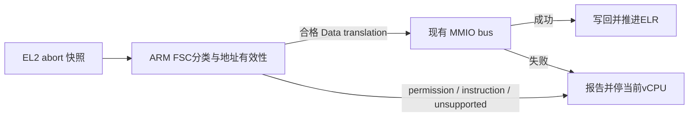

# HV-012：abort 安全分类与初始化 RO/XN 验证

> 状态：Approved（独立设计复核 PASS，父架构师批准实施；不代表运行验收）。
> 基线 `f31a22b`，分支 `feature/hv012-abort-permissions`。
> Linear：[H-123](https://linear.app/jamestam/issue/H-123)。本片不关闭 HV-012 全项或 H-127。

## 现状与范围锁

`handle_exit()` 对所有 lower-EL Data Abort 先调用 `mmio_handle_data_abort()`；后者仅检查
ISV，无条件拼 HPFAR/FAR 后查 MMIO。permission/access-flag fault 因此也能进入模拟路径。
当前 RAM 没有注册 MMIO handler，不能宣称已经复现实际 RAM 写保护绕过。

Instruction Abort 目前走 unexpected-exit 并停当前 vCPU，没有 IFSC/地址有效性诊断。
生产 RAM 均 RW、可执行；`s2_protect()` 仅有 host 消费者。RO/XN 编码未发现基本错误，
但缺少真实 guest 权限测试。QEMU 可执行 S2AP/XN 检查，不能以 MAIR 交换实验免除验证。

**固定范围**：ARM abort 分类与 MMIO 准入、保守地址诊断、启动前测试专用 RO/XN 页配置、
host 行为 RED/GREEN、两次负向 QEMU 启动及承重反证。时间盒两工作日：规范/RED 半日、
实现半日、独立 QEMU/变异/评审一日。到期记录未完成项，不延长前置、不追加新发现。

**不做**：AT 地址重建、按需补页、COW/dirty logging、运行期 protect/TLBI、VMID 复用、
块拆分、设备白名单、DMA/SMMU、HSM/DM、通用权限配置接口、guest 指令解码器。

## 架构依据与适用 profile

适用当前 AArch64 QEMU cortex-a72、4 KiB granule、39-bit IPA、L1 起始的非 LPA2 profile。
依据 ARM 系统寄存器说明 HPFAR_EL2、FAR_EL2、ESR_EL2（本次可读的 Arm 文档镜像版本
`26/03/2024 09:49; 67c0ae5282a7629ba0ea0ba7267b43cd4f7939f6`）：

- [HPFAR_EL2](https://df.lth.se/~getz/ARM/SysReg/AArch64-hpfar_el2.html)：Stage-2 translation/access
  fault 更新 HPFAR；permission fault 仅 S1PTW 情形列在更新条件中，其余情形不能信任 HPFAR。
- [FAR_EL2](https://df.lth.se/~getz/ARM/SysReg/AArch64-far_el2.html) 与
  [ESR_EL2](https://df.lth.se/~getz/ARM/SysReg/AArch64-esr_el2.html)：FnV 对指定 synchronous
  external abort 表达 FAR 无效，不是所有异常的通用有效位；S1PTW 表示 Stage-1 页表遍历访问。
- 非扩展 FIPA 为 IPA[47:12]，位于 HPFAR[39:4]；须先按该格式解码，再检查当前 IPA 范围。
  不允许将越界高位截掉后变成合法 MMIO 地址。S1PTW 不能拼原始 FAR 页内偏移模拟 guest 指令。

Arm 官网页面本次只取得站点内容，未取得完整可检索条文；以上明确引用镜像，不冒称已直接
阅读最新版 ARM ARM。实现时复核对应字段，遇到不一致停下报告。Linux KVM `hyp/fault.h`
及 Xvisor `cpu_vcpu_excep.c` 是交叉参考，不替代寄存器规则；本片不照搬其 AT/demand mapping。

## 决策

### 1. ARM 层分类，generic MMIO bus 不解释 ESR

将寄存器读取与可 host 测试的生产决策分离，保留最少的 ARM 私有实现，不引入通用 fault 框架。
单次捕获 ESR/FAR/HPFAR/ELR 供处理与诊断使用，避免各路径重读而混淆。

| 类别 | 当前支持的 FSC | 行为 |
|---|---|---|
| translation | 0x05–0x07（L1–L3） | 仅合格的 Data Abort 可尝试 MMIO |
| access-flag | 0x09–0x0b | 报告并停当前 vCPU，不模拟 |
| permission | 0x0d–0x0f | 报告并停当前 vCPU，不模拟 |
| 其他/扩展/未知 | 其余 | 保守拒绝，不把高位分组当完整支持 |

MMIO 准入必须同时满足：EC=lower-EL Data Abort、支持的 translation FSC、ISV=1、
S1PTW=0、CM=0、地址有效且在当前 IPA 范围内。明确拒绝 cache-maintenance/address-translation
来源（CM=1），不能只依赖 ISV 排除非普通访存。只有 handler 成功才写回 GPR
并推进 ELR；permission、Instruction Abort 以及拒绝路径不得改 GPR/ELR 或调用 MMIO。
保留现有普通 MMIO 访问宽度、方向与零寄存器约定，不新增指令解码能力。

### 2. 诊断区分“值存在”与“地址可靠”

对于受支持且非 S1PTW 的 translation/access-flag，可以按定义构造 IPA。对普通 permission
（含 XN）不信任 HPFAR，显示 `ipa_valid=0`/未知 IPA，报告有效 FAR、ELR、原始 ESR、
EC/FSC、fault 类别、VM ID、VM-local vCPU ID 与 pCPU ID。不实施 AT 重建。

S1PTW 与未支持类别保守不声称有效完整 IPA；未知 FAR 有效性也明确标记，不能把原始值
当确定地址。FnV 按其定义类别解释；不因未知类别 FnV=0 就认定 FAR 有效。
SVM 探针明确保持 Stage-1 MMU 关闭，测试可据此关联 FAR 与预定 IPA；该前提不推广到 Linux。
原 translation fault 日志的已有期望可保留并追加字段，或同步精确更新，但不删除验证要求。

Data 与 Instruction Abort 最终都复用现有 `park_current_vcpu()`，仅停故障 vCPU。

### 3. 编译隔离的启动前权限 fixture

专用 `svm_s2perm` 编译 profile 复用 `svm_xvm2` 拓扑与独立 build 目录；不改公共
`vm_config`、hypercall 或生产权限默认值。fixture 实现在测试目录，生产仅留编译条件化接点。

仅 VM0，首次安装 VTTBR 前：普通 builder 与授权自检通过后，用已有 unmap/map 将已授权
2 MiB RAM 重建为 4 KiB 叶（每次 map 4 KiB，避免重新合成大块），范围与 OA 不变，再跑
原生产授权自检。随后用真实 `s2_protect()` 将一页改 Normal RO、仍可执行，另一页改
Normal RW+XN；其余属性不变。fixture 独立遍历核验所有叶，仅两页权限不同，设备与 VM1
不变；失败拒绝启动，不放宽生产 `stage2_build_check()` 的规则。

guest linker 固定保留探针页并 ASSERT 不与代码、数据、栈重叠。RO 页放已知数据；XN 页
预加载真正指令与穿透标记路径，不临时生成代码，避免引入 cache-maintenance 变量。

## 验收

### Host 行为 RED/GREEN

- 编译同一生产 abort 决策，spy MMIO handler 注册于构造/陈旧 HPFAR 对应地址；permission
  fault 必须 dispatch=0、GPR/ELR 不变。旧 ISV-only 路径应行为 RED，而不是编译失败。
- access-flag、S1PTW、ISV=0、越界/无效地址、Instruction Abort 也不得模拟；合法 translation
  正向控制仅 dispatch 一次，宽度/方向正确，成功才推进 ELR，失败不得改寄存器。
- 补 4 KiB protect 的 RO/XN 设置与清除、OA/叶类型保留、邻页不变、变更与 no-op flush；
  不以描述符断言代替真实 guest 验证。

### QEMU：一个门禁目标、两次独立致命启动

- RO：先读已知数据成功，再执行明确 store；EC=0x24、DFSC=0x0f、WnR=1，FAR 为目标，
  ELR 为固定 store 指令地址，禁止 store 后的穿透标记。
- XN：先读目标页指令数据成功，再跳入；EC=0x20、IFSC=0x0f，FAR/ELR 匹配目标入口；
  禁止目标页入口标记以及返回后的穿透标记。
- 两次均要求 VM0/vCPU0/pCPU0 fault 在前、同 pCPU VM1 的新进度标记在后。专用 survivor
  可持续产生递增进度，不依赖原 `svm-vm1.bin` 恰好最后完成，不引入跨 VM 共享页或生产握手。
  复用正/负标记检查，加最小顺序检查及合成日志自检：缺失、错 FSC、穿透、仅有故障前
  survivor 标记、错误故障归属、错误 FAR/ELR 均失败。身份与地址须匹配同一条 fault 记录，
  不得跨记录拼凑。此处验收故障后的执行进展，不要求 survivor VM 终止。
- 三类受控红：移除分类门禁使 host spy 红；RO→RW/XN→可执行分别实际穿透且 checker 红；
  park→halt pCPU 使故障后 survivor 检查红。权限变异须同步放行 fixture 自检让 guest
  真正执行，不能拿启动前自检拒绝充当穿透检测承重。变异精确恢复后 clean 重建。
- `make host-test`、`make clean && make test`、`make test-linux`、x86 stub/静态检查；
  新权限目标重复三轮。独立专家重跑，保留原始日志/退出码并归档。

## 交付声明上限

通过仅证明当前 profile 启动前权限生效、abort 分类拒绝错误 MMIO 模拟及同核 fault 隔离。
不是运行期写保护/TLB、按需补页、完整 HPFAR/ARM 扩展支持或 H-123 全项完成；H-127 的
cacheability/设备顺序及真机行为仍另行验收。
